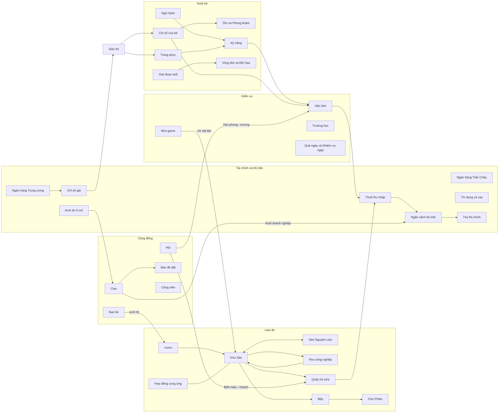
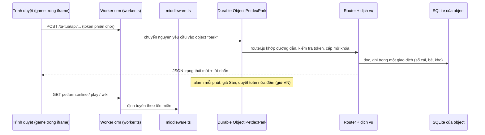
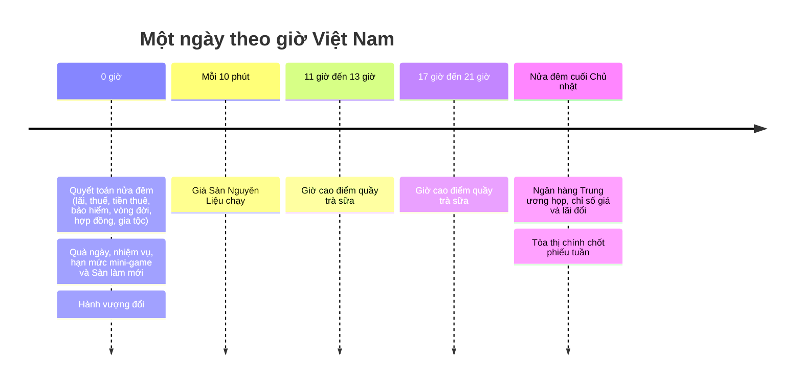

# Bản đồ hệ thống

> [!summary]
> Một trang nhìn toàn cảnh: các hệ thống của Pet Town nối với nhau thế nào, xu chảy qua đâu, và một yêu cầu của người chơi đi từ trình duyệt tới cơ sở dữ liệu ra sao. Mỗi ô trong sơ đồ là một ghi chú; bấm vào tên trong danh sách bên dưới để đi sâu.

## Vòng chơi chính

| Nhóm | Ghi chú gốc |
|---|---|
| Nuôi bé | [[Chỉ số của bé]], [[Chăm sóc ở nhà]], [[Ốm và Phòng khám]], [[Ngũ hành]], [[Loài và độ hiếm]], [[Trứng ngũ hành]], [[Tính cách]], [[Giai đoạn tuổi]], [[Vòng đời và Đồi Sao]], [[Trang phục]], [[Cấp độ và XP]], [[Dáng theo cấp]] |
| Kiếm xu | [[Việc làm]], [[Kỹ năng]], [[Trường học]], [[Mini-game]], [[Quà ngày]], [[Nhiệm vụ ngày]], [[Mã quà]] |
| Làm ăn | [[Sàn Nguyên Liệu]], [[Kho Sàn]], [[Vườn]], [[Bếp]], [[Khu công nghiệp]], [[Quầy trà sữa]], [[Chợ Phiên]], [[Hợp đồng cung ứng]] |
| Tài chính và thị trấn | [[Dòng xu trong game]], [[Ngân hàng Trân Châu]], [[Ngân hàng Trung ương]], [[Chỉ số giá]], [[Kinh tế vĩ mô]], [[Thuế thu nhập]], [[Thuế doanh nghiệp]], [[Ngân sách thị trấn]], [[Tòa thị chính]], [[Tín dụng và vay]], [[Sổ cái]] |
| Cộng đồng | [[Bạn bè]], [[Công viên]], [[Hội]], [[Clan]], [[Bản đồ đất]] |

## Một yêu cầu đi qua những đâu

Chi tiết: [[Kiến trúc máy chủ]], [[Durable Object PetdexPark]], [[Router]], [[Nhịp mỗi phút]], [[Quyết toán nửa đêm]], [[Middleware định tuyến]], [[Tên miền Petfarm]], [[Kiến trúc giao diện game]].

## Một ngày của phố

## Ba tên miền

| Tên miền | Phục vụ | Ghi chú |
|---|---|---|
| `petfarm.online` (và `www.` chuyển về) | [[Trang giới thiệu petfarm.online]] | trang giới thiệu game |
| `play.petfarm.online` | [[Trang chơi server1]], [[Link mời]], [[Link đặt mật khẩu]] | game sau khi đăng nhập |
| `wiki.petfarm.online` | [[Wiki người chơi]] | hướng dẫn chơi |

Xem [[Tên miền Petfarm]] và [[Quy trình deploy]].

## Liên quan
- [[Trang chủ]]
- [[Thuật ngữ]]
