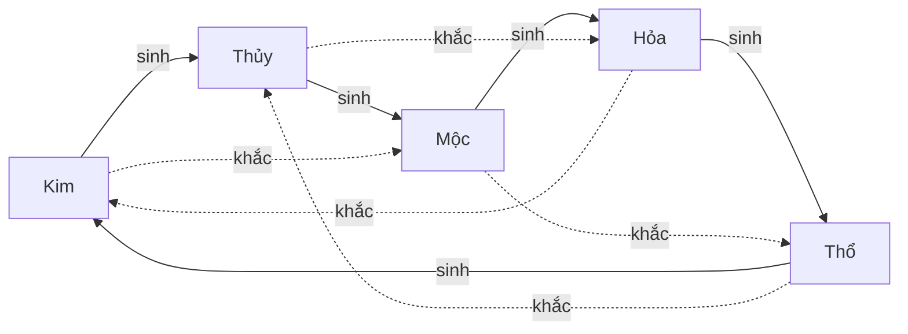

# Hợp mệnh và kỵ mệnh

> [!summary]
> Mỗi món đồ ăn, đồ chăm sóc, trang phục và món nấu đều có hành. Quan hệ giữa hành của món và hành của bé (tương sinh, cùng hành, sinh xuất, mình khắc, tương khắc) quyết định: trang phục làm kỹ năng lên nhanh hay chậm, đồ ăn có thêm XP không, và quà "hợp mệnh" trong [[Mã quà]] chọn món nào.

## Cách hoạt động
Vòng tương sinh (`feeds`): Kim → Thủy → Mộc → Hỏa → Thổ → Kim. Vòng tương khắc (`beats`): Kim khắc Mộc, Mộc khắc Thổ, Thủy khắc Hỏa, Hỏa khắc Kim, Thổ khắc Thủy (`public/ta-tua/game/js/shared/pets.js:12-40`).



`relation(itemEl, petEl)` (`public/ta-tua/game/js/shared/pets.js:49-56`) và `RELATIONS` (58-65):

| Quan hệ | Điều kiện | Nhãn UI | Nhãn ngắn | Hệ số đồ đeo |
|---|---|---|---|---|
| `feeds` | hành món sinh ra hành bé | Tương sinh | Hợp mệnh | +10% |
| `same` | cùng hành | Cùng hành | Hợp mệnh | +5% |
| `drains` | hành bé sinh ra hành món | Sinh xuất | Bình thường | 0 |
| `beaten` | hành bé khắc hành món | Mình khắc | Bình thường | 0 |
| `beats` | hành món khắc hành bé | Tương khắc | Kỵ mệnh | −5% |

## Con số
| Bé hành | Tương sinh (+10%) | Cùng hành (+5%) | Sinh xuất (0) | Mình khắc (0) | Kỵ mệnh (−5%) |
|---|---|---|---|---|---|
| Kim | Thổ | Kim | Thủy | Mộc | Hỏa |
| Mộc | Thủy | Mộc | Hỏa | Thổ | Kim |
| Thủy | Kim | Thủy | Mộc | Hỏa | Thổ |
| Hỏa | Mộc | Hỏa | Thổ | Kim | Thủy |
| Thổ | Hỏa | Thổ | Kim | Thủy | Mộc |

## Công thức
```
wearBonus = min(0,30, Σ hệ số của các món đang đeo)                       (pets.js:310-315)
hệ số kỹ năng = growth[skill] × max(0,5, 1 + wearBonus) × (1 + %Chỉ số/100)  (elements.js:11-14)
XP đồ ăn/chăm sóc/món nấu = xp × (1 + 0,2 nếu tương sinh hoặc cùng hành)    (pets.js:332)
```

## Nơi dùng
| Hệ thống | Quan hệ dùng | Nguồn |
|---|---|---|
| Tốc độ lên [[Kỹ năng]] | tổng hệ số các món đeo, trần +30% | `petdex/server/elements.js:11-14` |
| XP khi cho ăn, dùng đồ chăm sóc | `foodBonus` (+20%) | `petdex/server/game.js:264` |
| XP khi ăn món tự nấu | `foodBonus` | `petdex/server/farm.js:241` |
| Quà hợp mệnh trong [[Mã quà]] | `same` hoặc `feeds` với [[Thú chính]] | `petdex/server/gifts.js:53` |
| Nhãn "Hợp mệnh/Kỵ mệnh" ở tủ đồ | `RELATIONS[...]` | `public/ta-tua/game/js/app.js:667` |

## Trường hợp đặc biệt
- Trần +30% chỉ chặn phía dương. Phía âm, 5 món kỵ mệnh là −25%, chưa chạm sàn 50% của `skillFactor` (sàn chỉ là chốt an toàn).
- Trước commit `152cd2e`, hợp mệnh không có trần (5 món tương sinh = +50%). Xem [[Bộ đồ ngũ hành]] và `docs/pet-town-gear-balance.md`.
- Đồ chơi không có hành; trứng có hành nhưng không "ăn" được.
- [[Bộ đồ ngũ hành]] (thưởng lương) tính theo số món **cùng một hành** với nhau, không cần hợp với hành của bé.

## Liên quan
- [[Ngũ hành]] · [[Trang phục]] · [[Bộ đồ ngũ hành]] · [[Đồ ăn và đồ chăm sóc]] · [[Kỹ năng]] · [[Mã quà]]
