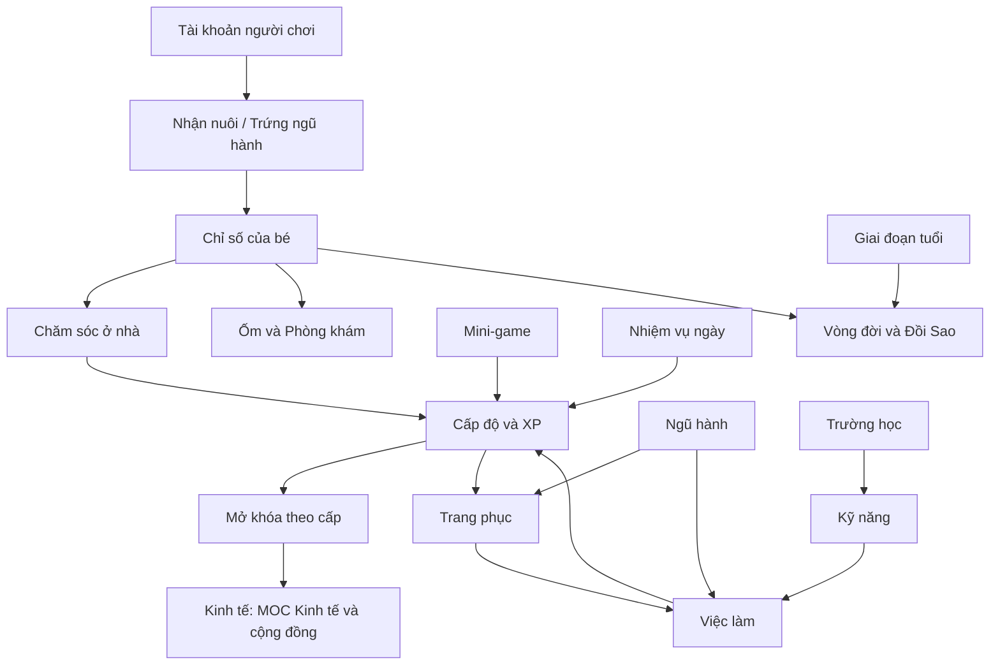

# MOC Luật chơi

> [!summary]
> Mục lục khu **10 Luật chơi**: mọi luật người chơi chạm tới khi nuôi bé (chỉ số, ốm, tuổi, vòng đời), lên cấp (XP, mở khóa, dáng), ngũ hành và loài, trang phục, Siêu thị, kỹ năng và việc làm, mini-game, phần thưởng hằng ngày, tài khoản và các hoạt động xã hội. Mọi con số đối chiếu với code ở commit `e03a0db` và ghi nguồn `path:line`. Phần kinh tế (Sàn, ngân hàng, quầy, vườn, bếp, xưởng, Hội, gia tộc, thuế) nằm ở [[MOC Kinh tế và cộng đồng]].



## Chăm sóc bé
- [[Chỉ số của bé]]: 5 chỉ số, tốc độ hao/hồi mỗi giờ, ngưỡng, công thức `tick`.
- [[Tâm trạng của bé]]: nhãn Đói meo, Lấm lem, Buồn ngủ, Buồn thiu, Vui phơi phới.
- [[Chăm sóc ở nhà]]: Cho ăn, Chơi đùa, Tắm, Chăm sóc; điều kiện, XP, xu.
- [[Đồ ăn và đồ chăm sóc]]: hiệu quả, XP/xu, hợp mệnh, đồ chơi.
- [[Ốm và Phòng khám]]: xác suất ốm, phí khám chữa, bé ốm bị chặn gì.
- [[Cảm lạnh]] · [[Đau bụng]]: hai bệnh và phí chữa.
- [[Bảo hiểm sức khỏe]]: gói Cơ bản và Toàn diện.

## Tiến trình
- [[Cấp độ và XP]]: đường cong XP, thưởng lên cấp, nguồn XP.
- [[Mở khóa theo cấp]]: bảng `UNLOCKS`, cấp gia tộc, cấp món Siêu thị.
- [[Dáng theo cấp]]: 6 dáng mỗi 10 cấp.
- [[Kỹ năng]]: 5 kỹ năng, công thức tăng giảm dần.
- [[Trường học]]: 5 lớp, giá, giới hạn 3 buổi/môn/ngày.

## Ngũ hành và loài
- [[Ngũ hành]]: hệ số kỹ năng, chỉ số, lợi thế làm ăn của 5 hành.
- [[Hành vượng]]: vòng vận khí 5 ngày, +10% XP và lương.
- [[Hợp mệnh và kỵ mệnh]]: tương sinh, tương khắc và nơi áp dụng.
- [[Loài và độ hiếm]]: 50 loài, 4 độ hiếm, cách tính số liệu loài.
- [[Danh mục loài]]: bảng đủ 51 loài với kỹ năng khởi đầu, hệ số ăn/sức, tuổi thọ.
- [[Linh vật Boba]]: linh vật rái cá trà sữa.
- [[Trứng ngũ hành]]: giá, tỉ lệ nở, ấp và nở, trứng tưởng niệm.

## Tính cách, tuổi, vòng đời
- [[Tính cách]]: 6 nét và cách bốc 1–2 nét.
- [[Tính cách Tham ăn]] · [[Tính cách Chăm chỉ]] · [[Tính cách Ham chơi]] · [[Tính cách Ngủ nướng]] · [[Tính cách Có duyên]] · [[Tính cách Mọt sách]].
- [[Giai đoạn tuổi]]: 6 giai đoạn, hệ số luật và dáng vẽ.
- [[Vòng đời và Đồi Sao]]: tuổi thọ, kỷ vật, ô tưởng niệm, Đồi Sao.

## Trang phục và Siêu thị
- [[Trang phục]]: 5 khe, giới hạn 3/4/5 món, đeo/tháo.
- [[Danh mục trang phục]]: 55 món với khe, hành, giá, cấp.
- [[Cấp trang phục]]: Xanh lam → Đỏ, tỉ lệ quay, May mắn.
- [[Dòng chỉ số trang phục]]: 4 loại dòng, cộng dồn có giảm dần 25/0,5/60.
- [[Bộ đồ ngũ hành]]: bộ 3/4/5 món +3/5/8% lương.
- [[Hộp kín Siêu thị]]: mua hộp, mở hộp, `gradeLuck`.
- [[Siêu thị]]: luật mua và danh mục đồ ăn, chăm sóc, đồ chơi, trứng.

## Việc làm
- [[Việc làm]]: ca, lương, thăng bậc, ca trực quầy và đứng máy.
- [[Nghề Pha chế]] · [[Nghề Giao hàng]] · [[Nghề Bốc vác]] · [[Nghề Gia sư]] · [[Nghề Ca sĩ đường phố]].

## Mini-game
- [[Mini-game]]: giới hạn ngày, rớt vật liệu và trang phục, kiểm tra kết quả.
- [[Câu cá]] · [[Hứng trân châu]] · [[Ghép hình nhớ]].

## Phần thưởng hằng ngày
- [[Quà ngày]]: chuỗi 60 → 120 xu.
- [[Trợ cấp tân thủ]]: 30 xu/ngày trong 7 ngày đầu.
- [[Nhiệm vụ ngày]]: 14 nhiệm vụ, 3 mỗi ngày, rương +50.
- [[Mã quà]]: phần luôn nhận, lượt chọn, quà hợp mệnh.

## Người chơi và phố
- [[Tài khoản người chơi]]: tạo tài khoản, đăng nhập, mật khẩu, nhận nuôi.
- [[Thú chính]]: bé đại diện và những nơi dùng tới.
- [[Bạn bè]]: kết bạn, thăm nhà, thả tim, tặng quà.
- [[Công viên]]: đi lại, chat, vuốt ve, cư dân vắng chủ.
- [[Bản đồ Phố Trân Châu]]: 18 tòa nhà và cấp mở.
- [[Báo Trân Châu]]: các nguồn tin.
- [[Bảng vàng]]: xếp hạng cấp, tài sản ròng, Đồi Sao.

## Tất cả ghi chú trong khu
```dataview
TABLE loai, trang-thai FROM "10 Luật chơi" WHERE file.name != this.file.name SORT file.name
```

## Liên quan
- [[Trang chủ]] · [[Bản đồ hệ thống]] · [[Thuật ngữ]] · [[MOC Kinh tế và cộng đồng]] · [[MOC Máy chủ]] · [[MOC Giao diện]] · [[MOC Thiết kế]]
