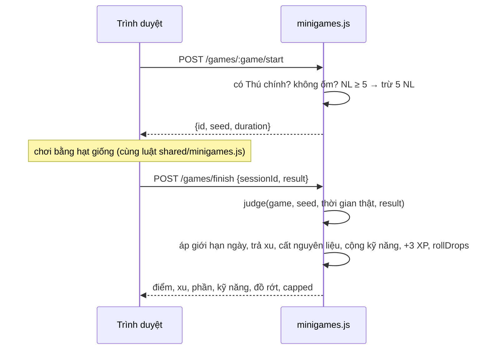

# Mini-game

> [!summary]
> 🎮 Khu vui chơi & Hồ câu có 3 trò: [[Câu cá]], [[Hứng trân châu]], [[Ghép hình nhớ]]. Mỗi ván tốn 5 năng lượng của [[Thú chính]], cho xu, nguyên liệu (cá, trân châu vào kho Sàn), điểm kỹ năng, 3 XP, và có cơ hội rớt thêm vật liệu thô hoặc một món trang phục. Xu và nguyên liệu có **giới hạn mỗi ngày**; vượt mức vẫn chơi được (vẫn có XP, kỹ năng, đồ rớt) nhưng không nhận thêm xu/nguyên liệu.

## Con số
| Trò | Mã | Thời gian | Năng lượng | Kỹ năng | Nguồn |
|---|---|---|---|---|---|
| 🎣 [[Câu cá]] | `fishing` | 40 giây | 5 | Nhanh nhẹn | `public/ta-tua/game/js/shared/minigames.js:5` |
| 🧋 [[Hứng trân châu]] | `pearls` | 30 giây | 5 | Nhanh nhẹn | `public/ta-tua/game/js/shared/minigames.js:6` |
| 🧩 [[Ghép hình nhớ]] | `memory` | 60 giây | 5 | Thông minh | `public/ta-tua/game/js/shared/minigames.js:7` |

| Giới hạn mỗi ngày (mỗi người chơi) | Giá trị | Nguồn |
|---|---|---|
| Xu | 100 | `public/ta-tua/game/js/shared/minigames.js:11` |
| Cá (phần) | 10 (= 1 lô) | như trên |
| Trân châu (phần) | 20 (= 2 lô) | như trên |

| Thưởng thêm mỗi ván (mặc định, quản trị viên chỉnh được) | Giá trị | Nguồn |
|---|---|---|
| XP | 3 (× vận khí × tuổi) | `petdex/server/minigames.js:109` |
| Rớt vật liệu thô | 50% × (1 + May mắn%), 1–3 lô (10–30 phần) một trong 6 hàng thô: Lá trà tươi, Sữa tươi, Củ sắn, Mía, Dâu tây, Cá tươi | `public/ta-tua/game/js/shared/gear.js:62-64`, `petdex/server/minigames.js:16,69-76` |
| Rớt trang phục | 3% × (1 + May mắn%), món ngẫu nhiên trong 55, cấp quay đủ 4 cấp có May mắn | `public/ta-tua/game/js/shared/gear.js:66`, `petdex/server/minigames.js:77-80` |

## Cách hoạt động

- Máy chủ cấp phiên có hạt giống ngẫu nhiên; mọi thứ trong ván (thứ tự cá, lịch rơi trân châu, bộ bài) sinh từ hạt giống nên hai bên thấy cùng một ván (`rng`, `public/ta-tua/game/js/shared/minigames.js:13-22`).
- `judge` kiểm tra kết quả với **thời gian thật do máy chủ đo** (tối đa thời lượng + 10 giây) và trả thưởng thô (`public/ta-tua/game/js/shared/minigames.js:94-152`, `petdex/server/minigames.js:89-92`).
- Mỗi phiên chỉ kết thúc được một lần ("Ván này đã kết thúc rồi."); phiên cũ hơn 2 ngày bị xóa (`petdex/server/minigames.js:56,88`).
- Xu ghi sổ loại `minigame`; nguyên liệu vào kho [[Kho Sàn]] (cá → `fish`, trân châu → `pearl`).
- Màn: "🎮 Khu vui chơi & Hồ câu · Mỗi ván tốn 5 năng lượng của bé chính. Xu và nguyên liệu nhận được có giới hạn mỗi ngày." (`public/ta-tua/game/js/views/games.js:7`).

## Công thức
```
xu nhận   = min(xu thô, 100 − xu đã nhận hôm nay)
phần nhận = min(phần thô, giới hạn − phần đã nhận hôm nay)    (rồi bị cắt thêm nếu kho đầy)
P(rớt vật liệu) = min(1, 0,50 × (1 + May mắn/100));  P(rớt đồ) = 0,03 × (1 + May mắn/100)
```
(`petdex/server/minigames.js:64-82,96-100`.)

## Trường hợp đặc biệt
- Bé ốm không chơi được ("… đưa bé đi khám rồi hẵng chơi."); thiếu NL: "<tên> cần 5 năng lượng để chơi."; chưa có bé: "Hãy nhận nuôi một bé trước đã." (`petdex/server/minigames.js:46-50`).
- **Không kiểm tra bé đang bận**: thú chính đang đi làm hay đi học vẫn chơi mini-game được nếu đủ năng lượng (`startGame` không gọi `isBusy`).
- Kho đầy thì phần nguyên liệu và vật liệu rớt bị cắt, nhưng phần đã "tính" vẫn bị trừ vào giới hạn ngày (`q.addDay` ghi `portions` trước khi cất kho, `petdex/server/minigames.js:96-106`).
- Vật liệu rớt **không** bị giới hạn ngày.
- Mỗi ván cộng nhiệm vụ "Chơi 2 ván mini-game" ([[Nhiệm vụ ngày]]).

> [!warning] Lệch tài liệu
> `petdex/README.md:58` không nhắc việc rớt vật liệu 50% và trang phục 3%, và còn trỏ đường dẫn cũ `public/js/shared/minigames.js` (nay là `public/ta-tua/game/js/shared/minigames.js`).

## Liên quan
- [[Câu cá]] · [[Hứng trân châu]] · [[Ghép hình nhớ]] · [[Thú chính]] · [[Dòng chỉ số trang phục]] · [[Cấp trang phục]] · [[Kho Sàn]] · [[Giao diện mini-game]] · [[Module minigames]]
