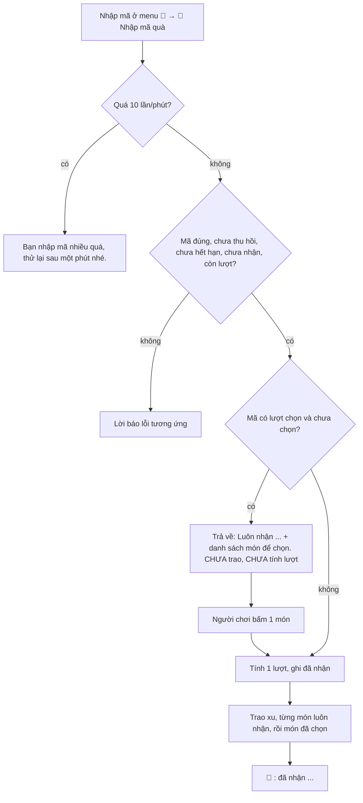

# Mã quà

> [!summary]
> Quản trị viên tạo mã quà (dạng `XXXX-XXXX` hoặc tự đặt), người chơi nhập trong menu tài khoản để nhận. Một mã gồm **phần luôn nhận** (xu và tối đa 12 món) và có thể có **lượt tự chọn 1 trong 2–6 món**. Mỗi món quà có thể cố định, ngẫu nhiên trong một nhóm, hoặc **hợp mệnh bé chính** của người nhận, nên cùng một mã cho mỗi người một món hợp hành. Mỗi người nhận một mã một lần.

## Cách hoạt động

- API: `POST /gifts/redeem {code, choice?}` (`petdex/server/routes.js:280-284`); xử lý `redeemGiftCode` (`petdex/server/gifts.js:229-278`).
- Giao diện: menu tên người chơi → "🎁 Nhập mã quà", ô "Ví dụ: ABCD-EFGH", nút "Nhận quà"; mã có lượt chọn hiện "Luôn nhận: … Chọn thêm 1 món:" và các nút lựa chọn (`public/ta-tua/game/js/app.js:1077-1083,1114-1140`).

## Con số
| Luật | Giá trị | Nguồn |
|---|---|---|
| Định dạng mã | 4–32 ký tự A–Z, 0–9, `-`, `_`; tự đổi chữ hoa | `petdex/server/gifts.js:29,231-232` |
| Mã ngẫu nhiên | `XXXX-XXXX` từ bảng chữ bỏ I, O, 0, 1 | `petdex/server/gifts.js:28,45-48` |
| Mỗi người | 1 lần / mã | `petdex/server/gifts.js:238` |
| Chống dò | 10 lần nhập / phút / người (bộ nhớ máy chủ) | `petdex/server/gifts.js:216-223` |
| Xu luôn nhận | 0–1.000.000 | `petdex/server/gifts.js:30,105` |
| Món luôn nhận | tối đa 12 | `petdex/server/gifts.js:31,108` |
| Lượt chọn | 0 hoặc 2–6 món | `petdex/server/gifts.js:109` |
| Trang phục mỗi mã | tối đa 10 (cả luôn nhận và lựa chọn) | `petdex/server/gifts.js:32,110` |
| Số lượng một món vật phẩm | 1–99 | `petdex/server/gifts.js:69` |
| Lượt dùng tổng | không giới hạn hoặc 1–100.000 | `petdex/server/gifts.js:183` |
| Hạn dùng | tùy chọn, phải ở tương lai lúc tạo | `petdex/server/gifts.js:184` |

### Các dạng món quà
| Loại (`kind`) | Cách chọn (`pick`) | Ý nghĩa | Nguồn |
|---|---|---|---|
| `coins` | | xu, **chỉ dùng trong lượt chọn** (xu luôn nhận nhập ở ô Xu) | `petdex/server/gifts.js:63-66` |
| `item` | `fixed` | món cụ thể (không được là trang phục) | `petdex/server/gifts.js:70-75` |
| `item` | `random` | ngẫu nhiên trong nhóm | `petdex/server/gifts.js:76-79` |
| `item` | `match` | ngẫu nhiên trong các món của nhóm **hợp mệnh** Thú chính (cùng hành hoặc tương sinh); nhóm Đồ chơi không dùng được vì không có hành | `petdex/server/gifts.js:76-79,53` |
| `gear` | `fixed` / `random` / `match` | một bản trang phục; cấp chọn sẵn (Xanh lam…Đỏ) hoặc "cấp ngẫu nhiên" | `petdex/server/gifts.js:81-89` |

Nhóm vật phẩm (`GIFT_CATEGORIES`): Đồ ăn, Đồ chăm sóc, Đồ chơi, Trứng ngũ hành, Vật phẩm (mọi loại trừ trang phục) (`petdex/server/gifts.js:35-41`).

## Trao quà
- Hành dùng để "hợp mệnh" là hành của [[Thú chính]] **lúc nhận** (`elementOf`, `petdex/server/gifts.js:143-147`).
- Chưa có Thú chính, hoặc nhóm không có món nào hợp: quay ngẫu nhiên trong cả nhóm (`petdex/server/gifts.js:158-161,167-170`).
- Trang phục từ mã quà về tay **đã mở** (không phải hộp kín); "cấp ngẫu nhiên" quay theo tỉ lệ cấu hình 60/28/10/2, không có May mắn (`petdex/server/gifts.js:172`).
- Xu ghi sổ loại `gift_code` ("Mã quà <mã>").
- Lời báo kết quả liệt kê món thật sự nhận, kể cả món đã quay: "🎁 <tên mã>: đã nhận 500 🪙, 3 × 🍣 Khay sushi, Cánh bướm (cấp Vàng)." (`petdex/server/gifts.js:268-275`).

## Lời báo lỗi
"Mã quà không đúng." · "Mã quà này đã bị thu hồi." · "Mã quà này đã hết hạn." · "Bạn đã nhận quà của mã này rồi." · "Mã quà này đã hết lượt." · "Món quà chọn không hợp lệ." (`petdex/server/gifts.js:232-258`).

## Trường hợp đặc biệt
- Bước hỏi chọn món không tính lượt: hai người cùng mở bảng chọn khi mã còn 1 lượt, người bấm chọn trước nhận; người sau gặp "Mã quà này đã hết lượt." (`q.use` có điều kiện `uses < max_uses`, `petdex/server/gifts.js:19,258`).
- Mã tạo trước khi có lượt chọn (định dạng cũ `{items, gear}`) vẫn được đọc (`fromLegacy`, `petdex/server/gifts.js:94-101`).
- Có thể dùng mã để tặng nhiều trứng cùng loại, điều Siêu thị không cho ([[Trứng ngũ hành]]).

## Liên quan
- [[Quản trị trang phục và mã quà]] · [[Thú chính]] · [[Hợp mệnh và kỵ mệnh]] · [[Cấp trang phục]] · [[Thanh điều hướng và menu tài khoản]] · [[Module gifts]]
