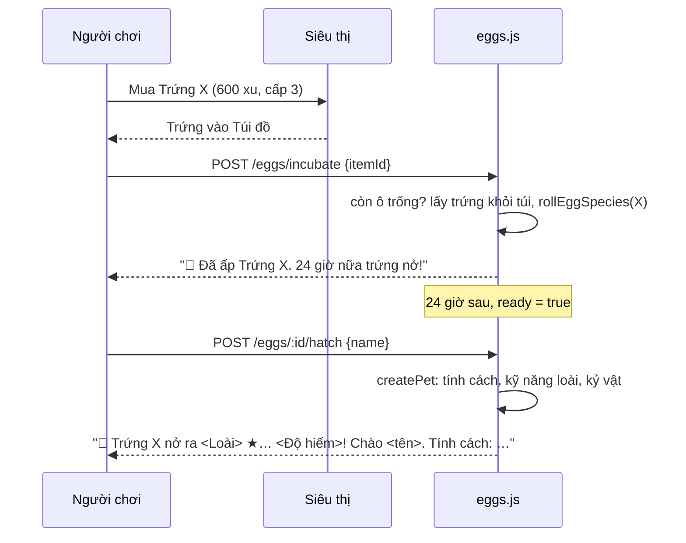

# Trứng ngũ hành

> [!summary]
> Trứng là cách duy nhất để có loài Hiếm, Quý, Huyền thoại. Mỗi hành có một quả trứng bán ở [[Siêu thị]] (600 xu, cần bé cấp 3); ấp 24 giờ thật thì nở một bé của đúng hành đó, độ hiếm bốc theo tỉ lệ 75/20/4/1. Loài được bốc **ngay lúc bắt đầu ấp**, nên không thể ấp lại để đổi kết quả.

## Con số
| Mục | Giá trị | Nguồn |
|---|---|---|
| Món | `egg_kim`, `egg_moc`, `egg_thuy`, `egg_hoa`, `egg_tho` (🥚 Trứng Kim…) | `petdex/server/game.js:117-122` |
| Giá | 600 xu × [[Chỉ số giá]] | `public/ta-tua/game/js/shared/pets.js:336` |
| Cấp mua | bé cao nhất ≥ 3 | `public/ta-tua/game/js/shared/pets.js:336`, `petdex/server/routes.js:307-308` |
| Thời gian ấp | 24 giờ | `public/ta-tua/game/js/shared/pets.js:336`, `petdex/server/eggs.js:55` |
| Tỉ lệ độ hiếm | Thường 75% · Hiếm 20% · Quý 4% · Huyền thoại 1% | `public/ta-tua/game/js/shared/pets.js:335` |
| Trong mỗi độ hiếm | bốc đều: 5 loài Thường (20% mỗi loài), 3 Hiếm, 1 Quý, 1 Huyền thoại | `public/ta-tua/game/js/shared/pets.js:349-350` |
| Ô nuôi | trứng đang ấp giữ 1 trong 4 ô | `petdex/server/lifecycle.js:50-54` |

Xác suất ra **một loài cụ thể**: Thường 15%, Hiếm ≈ 6,7%, Quý 4%, Huyền thoại 1% mỗi quả.

## Cách hoạt động

- Ấp: `incubate` (`petdex/server/eggs.js:47-58`); hết ô báo "Đã đủ 4 ô nuôi (tính cả trứng đang ấp và ô tưởng niệm). Chờ có chỗ trống rồi ấp tiếp nhé." (51-53).
- Nở: `hatch` (`petdex/server/eggs.js:64-80`): chưa đủ giờ báo "Trứng chưa đủ ngày, kiên nhẫn chút nhé."; tên bé 1–16 ký tự (`petdex/server/routes.js:42-46,198-202`).
- Bé nở ra giống hệt bé nhận nuôi: 1–2 [[Tính cách]], kỹ năng khởi đầu theo loài, nhận [[Vòng đời và Đồi Sao|kỷ vật]] nếu có, thành [[Thú chính]] nếu chưa có (`petdex/server/eggs.js:20-33`).
- Giao diện: khung "🥚 Trứng ngũ hành" trong màn nhận nuôi thêm, nút "Ấp trứng", ô tên và nút "🐣 Cho nở" (`public/ta-tua/game/js/app.js:700-731`); Túi đồ cũng có nút "Ấp trứng" (`public/ta-tua/game/js/app.js:904`).

## Trường hợp đặc biệt
- **Chỉ giữ được 1 quả mỗi loại trong túi**: trứng không phải đồ dùng một lần (`isConsumable` chỉ đúng với đồ ăn, đồ chăm sóc, `petdex/server/game.js:135`), nên Siêu thị chặn mua khi đã có quả cùng loại hoặc mua số lượng > 1, báo "Bạn đã có Trứng X rồi, món này dùng mãi mãi." (`petdex/server/routes.js:305-306`). Ấp xong (trứng rời túi) mới mua quả tiếp được. [[Mã quà]] có thể tặng nhiều quả một lúc (`addItem`).
- **Trứng tưởng niệm**: khi bé cuối cùng mất (và không còn trứng nào đang ấp), người chơi được một trứng Thường cùng hành với bé cũ, miễn phí, nở sau **3 ngày** (`petdex/server/lifecycle.js:85-89`). Trứng này đi thẳng vào hàng ấp, không qua túi.
- Đang ấp nhưng đã đủ 4 bé (trường hợp hiếm do ô bị chiếm khác) thì không nở được: "Mỗi người nuôi tối đa 4 bé thôi." (`petdex/server/eggs.js:69`).
- Phí nhận nuôi 200 xu không áp cho bé nở từ trứng.

## Liên quan
- [[Loài và độ hiếm]] · [[Danh mục loài]] · [[Siêu thị]] · [[Vòng đời và Đồi Sao]] · [[Mã quà]] · [[Module eggs]]
