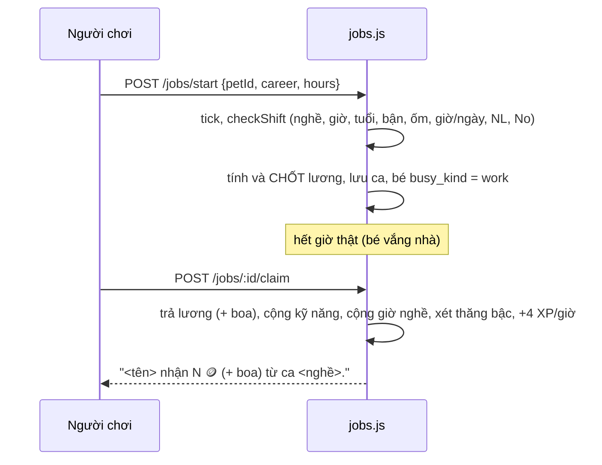

# Việc làm

> [!summary]
> 💼 Trung tâm việc làm cho bé nhận ca 1, 2 hoặc 4 giờ **thời gian thật** ở một trong 5 nghề, mỗi nghề 5 bậc. Bé bận suốt ca (đi làm cả khi tắt app); xong ca người chơi bấm nhận lương, bé được XP và điểm kỹ năng chính, có thể thăng bậc. Đây là nguồn xu đều đặn nhất của người chơi. Ngoài 5 nghề, bé còn có thể trực quầy hoặc đứng máy cho nhà mình hay làm thuê.

## Con số
| Nghề | Mã | Kỹ năng | Lương gốc/giờ bậc 1→5 | Đặc biệt | Ghi chú |
|---|---|---|---|---|---|
| 🧋 [[Nghề Pha chế\|Pha chế]] | `barista` | Khéo tay | 14 / 20 / 28 / 38 / 52 | | `petdex/server/rules/careers.js:13` |
| 📦 [[Nghề Giao hàng\|Giao hàng]] | `courier` | Nhanh nhẹn | 15 / 21 / 29 / 39 / 54 | | `petdex/server/rules/careers.js:14` |
| 🏋️ [[Nghề Bốc vác\|Bốc vác]] | `porter` | Sức mạnh | 16 / 22 / 30 / 40 / 55 | bé Hỏa +5% | `petdex/server/rules/careers.js:15` |
| 📚 [[Nghề Gia sư\|Gia sư]] | `tutor` | Thông minh | 13 / 20 / 30 / 42 / 58 | | `petdex/server/rules/careers.js:16` |
| 🎤 [[Nghề Ca sĩ đường phố\|Ca sĩ đường phố]] | `singer` | Duyên dáng | 10 / 16 / 24 / 36 / 50 | tiền boa 0–60% | `petdex/server/rules/careers.js:17` |

| Luật | Giá trị | Nguồn |
|---|---|---|
| Tên bậc | Học việc → Nhân viên → Lành nghề → Chuyên gia → Bậc thầy | `petdex/server/rules/careers.js:20` |
| Độ dài ca | 1, 2 hoặc 4 giờ | `petdex/server/rules/careers.js:21` |
| Tối đa mỗi ngày | 8 giờ, thấp hơn theo tuổi (Sơ sinh, Nhí nhố 2; Thiếu niên, Lão làng 4) | `petdex/server/rules/careers.js:22`, `public/ta-tua/game/js/shared/pets.js:82-113` |
| Năng lượng cần | 10 × số giờ (tụt dần trong ca, −10/giờ) | `petdex/server/rules/careers.js:23,68` |
| No bụng cần | ≥ 15 | `petdex/server/rules/careers.js:69` |
| XP khi nhận lương | 4 / giờ | `petdex/server/rules/careers.js:24` |
| Điểm kỹ năng chính | 0,6 / giờ (thô) | `petdex/server/rules/careers.js:33` |
| Cấp/tuổi tối thiểu | cấp 1, từ Sơ sinh | `petdex/server/rules/careers.js:34-35` |

### Thăng bậc
| Lên bậc | Giờ đã làm ở nghề đó | Kỹ năng chính | Nguồn |
|---|---|---|---|
| 2 Nhân viên | 16 | 20 | `petdex/server/rules/careers.js:27` |
| 3 Lành nghề | 60 | 40 | `petdex/server/rules/careers.js:28` |
| 4 Chuyên gia | 150 | 60 | `petdex/server/rules/careers.js:29` |
| 5 Bậc thầy | 300 | 80 | `petdex/server/rules/careers.js:30` |

## Công thức
```
lương gốc   = round( pay[bậc] × (0,8 + kỹ năng / 200) × giờ )                       (careers.js:44-47)
tuổi        = stage.work × (1 + thâm niên)       thâm niên = min(0,3, floor(giờ nghề / 10) × 0,01), chỉ Trưởng thành, Lão làng
elementPay  = 1 + 0,1 (hành vượng) + bộ đồ (0,03/0,05/0,08) + %Thu nhập ca làm/100 + 0,05 (bé Hỏa làm Bốc vác)
lương ca    = round( gốc × (1 + Văn phòng Hội) × payFactor × elementPay × tuổi )     (jobs.js:147-150)
payFactor   = 1 + 0,1·Chăm chỉ − 0,05·Ngủ nướng
tiền boa    = round( lương ca × 0,6 × rand ) chỉ Ca sĩ, tính lúc nhận                (careers.js:50)
```
Văn phòng Hội: +3% mỗi cấp (tối đa 3 cấp) cho mọi thành viên ([[Hội]], `petdex/server/jobs.js:88-91`).

> [!example] Ví dụ
> Bé Hỏa Thanh niên, Bốc vác bậc 2, Sức mạnh 30, ca 4 giờ, hôm nay Hỏa vượng, đeo bộ 3 món, +5% Thu nhập ca làm, Chăm chỉ, không Hội:
> gốc = round(22 × (0,8 + 0,15) × 4) = 84; elementPay = 1 + 0,1 + 0,03 + 0,05 + 0,05 = 1,23; lương = round(84 × 1,1 × 1,23 × 1) = **114 xu**.

## Cách hoạt động

- `startShift` (`petdex/server/jobs.js:97-157`), `claimShift` (`petdex/server/jobs.js:159-192`). Lương ghi sổ loại `salary` ("<nghề> N giờ, boa M"), là thu nhập chịu [[Thuế thu nhập]].
- Màn: "💼 Trung tâm việc làm · Ca làm tốn thời gian thật. Bé đi làm cả khi bạn tắt app, xong ca quay lại nhận lương." (`public/ta-tua/game/js/views/jobs.js:9`). Ô Việc làm trên bản đồ hiện "Lương sẵn sàng!" khi có ca xong chưa nhận (`public/ta-tua/game/js/views/map.js:46`, `petdex/server/service.js:48-49`).
- Nhận lương cộng nhiệm vụ "Nhận lương 1 ca làm" ([[Nhiệm vụ ngày]]).

### Ca trực quầy và đứng máy
| Loại | Gọi | Lương | Kỹ năng lên | Nguồn |
|---|---|---|---|---|
| Trực quầy nhà mình | `businessId` | 0 | Khéo tay 0,6/giờ | `petdex/server/jobs.js:131-145,195-208` |
| Làm thuê ở quầy người khác | `businessId` | 8–80 xu/giờ do chủ đặt, trừ ví chủ **lúc bắt đầu** | Khéo tay | `petdex/server/rules/business.js:35-36` |
| Đứng máy xưởng nhà mình / làm thuê | `factoryId` | 0 / lương chủ đặt | Sức mạnh 0,6/giờ | `petdex/server/jobs.js:116-130,211-224` |

Các ca này dùng chung luật giờ/ngày, năng lượng, no bụng, ốm (`careerId = 'shop' | 'factory'`), không hưởng hành vượng, bộ đồ, tính cách, tuổi. Chi tiết: [[Thuê bé làm việc]], [[Quầy trà sữa]], [[Khu công nghiệp]].

## Lời báo khi bị chặn
| Tình huống | Lời báo | Nguồn |
|---|---|---|
| Giờ sai | "Ca làm chỉ có 1, 2 hoặc 4 giờ." | `petdex/server/rules/careers.js:60` |
| Đang bận | "<tên> đang đi học / đang tắm / đang làm ca khác, xong rồi hẵng nhận ca." | `petdex/server/rules/careers.js:63` |
| Ốm | "<tên> đang ốm, đưa bé đi khám rồi hẵng đi làm." | `petdex/server/rules/careers.js:64` |
| Quá giờ ngày | "Hôm nay <tên> chỉ làm thêm được N giờ nữa (tuổi này làm tối đa M giờ/ngày)." | `petdex/server/rules/careers.js:65-67` |
| Thiếu NL | "<tên> cần N năng lượng cho ca H giờ." | `petdex/server/rules/careers.js:68` |
| Đói | "<tên> đói quá, cho ăn rồi hẵng đi làm." | `petdex/server/rules/careers.js:69` |
| Nhận sớm | "Ca làm chưa xong." | `petdex/server/jobs.js:164` |
| Chủ thuê hết tiền | "Chủ quầy/Chủ xưởng không đủ tiền trả lương lúc này." | `petdex/server/jobs.js:122,137` |

## Trường hợp đặc biệt
- **Lương chốt lúc bắt đầu ca**: vận khí, bộ đồ, kỹ năng, tuổi tại thời điểm nhận ca; đổi đồ trong ca không đổi lương.
- Mỗi lần nhận lương chỉ lên tối đa một bậc.
- Giờ tối đa/ngày tính theo ngày bắt đầu ca (`shifts.day`), nên ca 4 giờ bắt đầu 23:00 tính cho ngày hôm đó.
- Bé hết tuổi thọ khi đang có ca chưa nhận: lương được trả tự động lúc bé mất ([[Vòng đời và Đồi Sao]]).
- Trong lúc làm, No bụng tụt −12/giờ (×hệ số), bé không có ở nhà; vẫn cho ăn từ xa được ([[Chăm sóc ở nhà]]).

## Liên quan
- [[Nghề Pha chế]] · [[Nghề Giao hàng]] · [[Nghề Bốc vác]] · [[Nghề Gia sư]] · [[Nghề Ca sĩ đường phố]]
- [[Kỹ năng]] · [[Giai đoạn tuổi]] · [[Hành vượng]] · [[Bộ đồ ngũ hành]] · [[Tính cách]] · [[Thuê bé làm việc]] · [[Màn Việc làm]] · [[Module jobs]] · [[Module rules-careers]]
