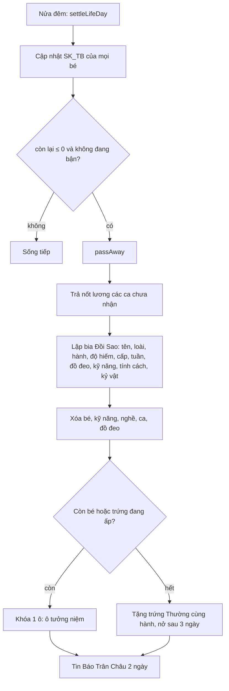

# Vòng đời và Đồi Sao

> [!summary]
> Bé không sống mãi: tuổi thọ khoảng **80–130 tuần** (tức 80–130 ngày thật), tùy hành, độ hiếm và cách chăm (sức khỏe trung bình cả đời). Hết tuổi thọ, lúc nửa đêm bé "về với sao trời": được lập bia ở 🌠 **Đồi Sao**, để lại **kỷ vật** (+5 kỹ năng sở trường) cho bé nuôi tiếp theo, và ô nuôi thành **ô tưởng niệm** (mở lại 3.000 xu). Bé cuối cùng mất thì người chơi được một trứng miễn phí để không bị kẹt.

## Công thức
```
tuổi thọ (tuần) = round( 90 + (Thổ ? 8 : 0) + thêm theo độ hiếm + clamp( (SK_TB − 70) / 1,5 , −10, +20 ) )
thêm theo độ hiếm: Thường 0, Hiếm 4, Quý 8, Huyền thoại 12
SK_TB mới (mỗi nửa đêm) = (SK_TB × n + Sức khỏe lúc 00:00) / (n + 1)      (bé mới: SK_TB = 80, n = 0)
còn lại = max(0, tuổi thọ − tuần tuổi);  báo trước khi còn ≤ 7
```
(`public/ta-tua/game/js/shared/pets.js:121-137`, `petdex/server/game.js:231-236`, `petdex/server/lifecycle.js:100-112`.)

## Con số
| SK_TB cả đời | Phần chăm sóc | Thường, không Thổ | Thường Thổ | Huyền thoại, không Thổ | Huyền thoại Thổ (Hoàng Long) |
|---|---|---|---|---|---|
| ≤ 55 | −10 | 80 | 88 | 92 | 100 |
| 70 | 0 | 90 | 98 | 102 | 110 |
| 80 (mặc định ban đầu) | +7 | 97 | 105 | 109 | 117 |
| 100 | +20 | 110 | 118 | 122 | 130 |

(Tính bằng `lifespanWeeks` của game. Hiếm và Quý nằm giữa: +4 và +8.)

| Hằng số `LIFE` | Giá trị | Nguồn |
|---|---|---|
| `warnWeeks` | 7 | `public/ta-tua/game/js/shared/pets.js:122` |
| `reopenCost` | 3.000 xu (× [[Chỉ số giá]]) | `public/ta-tua/game/js/shared/pets.js:123` |
| `memorialEggDays` | 3 | `public/ta-tua/game/js/shared/pets.js:124` |
| `heirloom` | +5 | `public/ta-tua/game/js/shared/pets.js:125` |
| `seniorityPer10h` / `seniorityMax` | 1% / 30% | `public/ta-tua/game/js/shared/pets.js:126-127` |

## Cách hoạt động

- `settleLifeDay` chạy trong `closeDay` sau phần sức khỏe/bảo hiểm (`petdex/server/scheduler.js:33-34`).
- `passAway` (`petdex/server/lifecycle.js:65-94`): ca chưa nhận được trả lương (`kind = salary`, "Lương ca cuối của <tên>", 67-70); kỷ vật = sở trường `fav` của loài, loài lạ thì kỹ năng cao nhất (76); nếu bé là [[Thú chính]] thì bé còn lại đầu tiên thay chỗ (82); tin "🌠 <tên> của <chủ> đã về với sao trời sau N tuần" giữ 2 ngày trên [[Báo Trân Châu]] (93).
- Bé **đang dở ca** (bận) thì hoãn, đêm sau mới đi (`petdex/server/lifecycle.js:109`).
- **Kỷ vật**: bé mới tiếp theo (nhận nuôi hoặc nở) lấy kỷ vật của bia cũ nhất chưa dùng, +5 vào kỹ năng đó (`petdex/server/lifecycle.js:57-62`, `petdex/server/eggs.js:27-28`). Lời chào có thêm "Kỷ vật của <tên>: +5 <kỹ năng>." (`petdex/server/eggs.js:60`).
- **Ô nuôi**: tối đa 4, tính bé + trứng đang ấp + ô tưởng niệm (`slotsOf`, `petdex/server/lifecycle.js:50-54`). Mở lại một ô: `POST /slots/reopen`, "🕯️ Đã mở lại một ô nuôi. Đồi Sao vẫn giữ tên bé cũ." (`petdex/server/lifecycle.js:115-123`).
- **Đồi Sao**: `GET /memorials` (của mình, 30 bia) hoặc `?scope=all` (cả phố, 40 bia mới nhất) (`petdex/server/routes.js:188`, `petdex/server/lifecycle.js:27-28,125-128`). Xem ở [[Bảng vàng]], tab "🌠 Đồi Sao": "<loài> của <chủ> · sống N tuần · về với sao trời <ngày>" (`public/ta-tua/game/js/app.js:954,968-985`).

## Giao diện
- Còn ≤ 7 tuần: "🌙 <tên> đã rất già, còn khoảng N ngày thật nữa là về với sao trời. Dành thời gian chơi với bé, mặc bộ đồ đẹp nhất, dắt bé ra công viên nhé." (`public/ta-tua/game/js/app.js:406-413`).
- Trong 3 ngày sau khi mất, màn Nhà hiện thẻ "🌠 <tên> đã về với sao trời sau N tuần, lên tới cấp L. Bé để lại kỷ vật…" với nút "Thăm Đồi Sao" (`public/ta-tua/game/js/app.js:416-424`, `petdex/server/lifecycle.js:131`).
- Nút "🕯️ Ô tưởng niệm · mở lại 3.000 🪙" trên thanh chọn bé (`public/ta-tua/game/js/app.js:476`).

## Trường hợp đặc biệt
- Sức khỏe trung bình chỉ lấy mẫu lúc nửa đêm: giữ Sức khỏe cao vào cuối ngày là đủ, không cần cao cả ngày.
- Mất bé thì mất luôn đồ đeo khỏi bé (bản trang phục vẫn trong tủ đồ vì bảng `gear` không bị xóa; chỉ dòng `pet_wear` bị xóa theo khóa ngoại `ON DELETE CASCADE`, `petdex/server/db.js:425-430,517-526`).
- **Quan sát giao diện**: khi không còn bé nào, màn Nhà hiện màn nhận nuôi "đầu tiên" và không hiện khung trứng (`first ? '' : eggPanel()`, `public/ta-tua/game/js/app.js:760`), nên trứng tưởng niệm chỉ thấy và cho nở được sau khi nhận nuôi một bé mới (miễn phí vì đang 0 bé).

> [!warning] Lệch tài liệu
> `petdex/README.md:55` ghi tuổi thọ "khoảng 90–130 tuần"; code cho phép thấp tới **80 tuần** khi chăm kém (`public/ta-tua/game/js/shared/pets.js:136`). Wiki người chơi (`lib/wiki/articles.ts:484`) đã ghi đúng 80–130.

## Liên quan
- [[Giai đoạn tuổi]] · [[Chỉ số của bé]] · [[Trứng ngũ hành]] · [[Bảng vàng]] · [[Báo Trân Châu]] · [[Quyết toán nửa đêm]] · [[Module lifecycle]]
