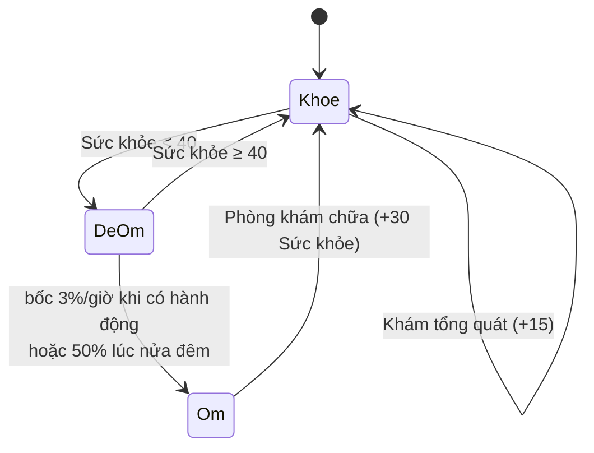

# Ốm và Phòng khám

> [!summary]
> Khi ❤️ Sức khỏe dưới 40, bé có thể đổ bệnh ([[Cảm lạnh]] hoặc [[Đau bụng]]). Bé ốm không đi làm, đi học, chơi mini-game, vào bếp được và không tự hồi sức khỏe, nên phải đưa tới 🩺 Phòng khám. Phòng khám cũng khám tổng quát cho bé khỏe để +15 Sức khỏe. [[Bảo hiểm sức khỏe]] trả một phần viện phí.

## Cách hoạt động
Bệnh có thể đến theo hai đường:
1. **Khi có hành động** (`mutatePet` gọi `rollSickness` với số giờ từ lần lưu trước, `petdex/server/service.js:68`): nếu sau `tick` Sức khỏe < 40 và bé chưa ốm, bốc xác suất `sickChance(h)` × hệ số loài × hệ số tuổi (`petdex/server/game.js:187-193`).
2. **Nửa đêm** (`settleCareDay`): mỗi bé chưa ốm có Sức khỏe < 40 lúc 00:00 bốc thêm 50% × hệ số loài × hệ số tuổi (`petdex/server/care.js:95-100`).

Bệnh được chọn 50/50 giữa `cold` và `stomach` (`petdex/server/game.js:192`, `petdex/server/care.js:98`).



## Con số
| Mục | Giá trị | Nguồn |
|---|---|---|
| Ngưỡng dễ ốm | Sức khỏe < 40 | `petdex/server/rules/production.js:15` |
| Xác suất theo giờ | `1 − 0,97^h` (3%/giờ) | `petdex/server/rules/production.js:14,62` |
| Xác suất nửa đêm | 50% | `petdex/server/care.js:97` |
| Hệ số loài | Thổ ×0,6, các hành khác ×1 | `public/ta-tua/game/js/shared/pets.js:42,260` |
| Hệ số tuổi | Sơ sinh 2, Nhí nhố 1,4, Thiếu niên 1, Thanh niên 0,9, Trưởng thành 0,8, Lão làng 2 | `public/ta-tua/game/js/shared/pets.js:82-113` |
| Khám tổng quát | 60 xu (× chỉ số giá), +15 Sức khỏe, +2 XP | `petdex/server/rules/production.js:24`, `petdex/server/care.js:53-59` |
| Chữa [[Cảm lạnh]] 🤧 | 120 xu, khỏi bệnh, +30 Sức khỏe, +2 XP | `petdex/server/rules/production.js:20,24` |
| Chữa [[Đau bụng]] 🤢 | 200 xu, khỏi bệnh, +30 Sức khỏe, +2 XP | `petdex/server/rules/production.js:21,24` |

## Công thức
```
P(ốm | hành động) = (1 − 0,97^giờ) × st.sickness × stage.sickness     (nếu Sức khỏe < 40 sau tick)
P(ốm | nửa đêm)   = 0,5 × st.sickness × stage.sickness
Viện phí phải trả = round( indexedPrice(giá gốc) × (1 − tỷ lệ bảo hiểm) )
```
(`petdex/server/game.js:191`, `petdex/server/care.js:32-36,97`.) Giá nhân [[Chỉ số giá]] của [[Ngân hàng Trung ương]].

## Bé ốm bị chặn những gì
| Việc | Lời báo | Nguồn |
|---|---|---|
| Nhận ca làm | "… đang ốm, đưa bé đi khám rồi hẵng đi làm." | `petdex/server/rules/careers.js:64` |
| Đi học | "… đang cảm lạnh, đưa bé đi khám rồi hẵng đi học." | `petdex/server/care.js:123`, `petdex/server/game.js:205-207` |
| Mini-game | "… đưa bé đi khám rồi hẵng chơi." | `petdex/server/minigames.js:49` |
| Vào [[Bếp]] | (kiểm tra `requireHealthy`) | `petdex/server/farm.js:216` |

Bé ốm vẫn ăn, chơi đùa, tắm được. Màn Nhà hiện khung đỏ "đang bị … : chưa đi làm, đi học hay chơi mini-game được" kèm nút đưa đi khám (`public/ta-tua/game/js/app.js:522-523`).

## Trường hợp đặc biệt
- Bốc ốm theo giờ chỉ xảy ra khi có hành động; nếu người chơi vắng lâu rồi quay lại thao tác, số giờ lớn nên xác suất cộng dồn cao (ví dụ 24 giờ: 1 − 0,97²⁴ ≈ 52%).
- Phòng khám không kiểm tra bé đang bận: có thể khám cho bé đang đi làm.
- Khám khi bé khỏe vẫn tính phí khám tổng quát; không có nút "khám miễn phí".
- Bé ốm vẫn già đi bình thường; Sức khỏe thấp kéo trung bình cả đời xuống và rút ngắn tuổi thọ ([[Vòng đời và Đồi Sao]]).

## Mã nguồn
- `petdex/server/rules/production.js`: `HEALTH`, `ILLNESSES`, `CLINIC`, `sickChance`.
- `petdex/server/care.js`: `billFor` (32), `clinicView` (38), `visitClinic` (49), `settleCareDay` (85).
- `petdex/server/game.js`: `rollSickness` (187), `requireHealthy` (205).
- Màn: `public/ta-tua/game/js/views/clinic.js` (tiêu đề "🩺 Phòng khám", dòng 10).

## Liên quan
- [[Cảm lạnh]] · [[Đau bụng]] · [[Bảo hiểm sức khỏe]] · [[Chỉ số của bé]] · [[Giai đoạn tuổi]]
- [[Màn Phòng khám]] · [[Module care]] · [[Quyết toán nửa đêm]]
