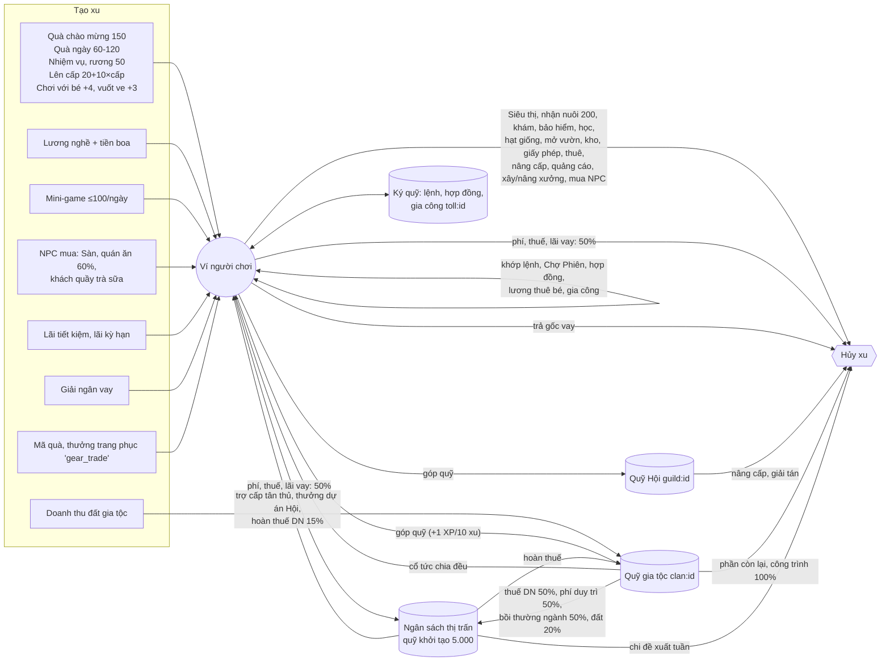

# Dòng xu trong game

> [!summary]
> Bản đồ toàn bộ đường đi của đồng xu 🪙: xu được **tạo ra** từ đâu (quà, lương, NPC mua hàng, lãi, giải ngân vay, doanh thu đất gia tộc), **chuyển** giữa người chơi qua đâu, và **bị hủy** ở đâu (Siêu thị, phí, thuế, tiền thuê, xây xưởng, mua đất...). Mọi biến động đều đi qua một hàm duy nhất `post()` của [[Sổ cái]], nên đây cũng là cách đọc sổ cái theo dòng tiền. Ngân hàng Trung ương đo đúng tổng lượng xu này mỗi tuần để chỉnh [[Chỉ số giá]] và lãi suất.

## Ba loại dòng tiền

| Loại | Ý nghĩa | Ví dụ |
|---|---|---|
| **Tạo xu (mint)** | Xu mới sinh ra, không ai mất | quà ngày, lương nghề, NPC mua hàng trên Sàn, lãi tiết kiệm, giải ngân vay, doanh thu quầy, doanh thu đất gia tộc |
| **Chuyển xu (transfer)** | Từ người này sang người khác hoặc sang quỹ chung | khớp lệnh giữa người chơi, Chợ Phiên, hợp đồng, lương thuê bé, góp quỹ Hội/gia tộc, cổ tức |
| **Hủy xu (sink)** | Xu biến mất khỏi nền kinh tế | Siêu thị, nhận nuôi, phòng khám, tiền thuê, giấy phép, xây xưởng, mua đất (80%), một nửa mọi phí và thuế |

> [!info] Quy tắc "một nửa"
> Phí giao dịch (`chargeFee`), thuế thu nhập và thuế doanh thu (`chargeTax`), lãi và phí vay (`chargeLoanCost`): người chơi trả đủ, **một nửa (làm tròn xuống) vào [[Ngân sách thị trấn]]**, nửa kia bị hủy (`petdex/server/ledger.js:82-87`, `petdex/server/ledger.js:132-137`, `petdex/server/credit.js:121-126`). Phí bán Chợ Phiên cũng vậy (`petdex/server/bazaar.js:129-134`).

## Sơ đồ

## Nguồn tạo xu (đầy đủ)

| Nguồn | `kind` sổ cái | Số xu | Nguồn code |
|---|---|---|---|
| Quà chào mừng khi tạo tài khoản | `opening` | 150 (`RULES.startCoins`) | `petdex/server/game.js:13`, `petdex/server/internal.js:101,124,165` |
| [[Quà ngày]] theo chuỗi | `daily` | `60 + 10 × (min(chuỗi,7) − 1)`: 60 → 120 | `petdex/server/rules/town.js:81`, `petdex/server/routes.js:150-167` |
| Trợ cấp tân thủ (7 ngày đầu, khi nhận quà ngày) | `stipend` | 30/ngày (50 khi có đề xuất "Quỹ chào tân thủ"), **lấy từ ngân sách**, không tạo mới | `petdex/server/town.js:59-73` |
| [[Nhiệm vụ ngày]] | `quest` | 20–40/nhiệm vụ, rương 50 | `petdex/server/rules/town.js:48-65`, `petdex/server/quests.js:72,80` |
| Lên cấp bé | `level` | `20 + cấp × 10` mỗi cấp | `petdex/server/game.js:218`, `petdex/server/service.js:73-76` |
| Chơi với bé | `play` | +4 mỗi lần | `petdex/server/game.js:278` |
| Vuốt ve ở [[Công viên]] | `cuddle` | +3 cho người vuốt | `petdex/server/playground.js:208` |
| Lương [[Việc làm]] + tiền boa | `salary` | theo nghề, bậc, kỹ năng | `petdex/server/jobs.js:146-172` |
| [[Mini-game]] | `minigame` | tối đa 100 xu/ngày | `public/ta-tua/game/js/shared/minigames.js:11`, `petdex/server/minigames.js:96-101` |
| Bán cho NPC trên [[Sàn Nguyên Liệu]] | `market_sell` | giá bid trừ tác động | `petdex/server/market.js:259-263` |
| Bán món cho quán ăn ([[Bếp]]) | `kitchen_sale` | 60% giá trị món | `petdex/server/farm.js:248-258` |
| Doanh thu [[Quầy trà sữa]] (khách là NPC) | `business_income` | ly × giá đặt | `petdex/server/business.js:139-149` |
| Thưởng "Thu nhập giao dịch" của [[Trang phục]] | `gear_trade` | % trên tiền bán (Sàn, Chợ Phiên, quán ăn) | `petdex/server/gear.js:218-223` |
| Lãi tiết kiệm, lãi kỳ hạn | `interest` | xem [[Ngân hàng Trân Châu]] | `petdex/server/bank.js:79-85,135-147` |
| Tưới vườn bạn | `garden_help` | +2/ô, tối đa 10 ô/ngày | `petdex/server/rules/production.js:84-90`, `petdex/server/farm.js:91-109` |
| Giải ngân vay | `loan_in` | xu mới; trả gốc thì hủy lại | `petdex/server/credit.js:112-115` |
| [[Mã quà]] | `gift_code` | theo mã | `petdex/server/gifts.js:153,263` |
| Doanh thu đất [[Clan]] (vào quỹ gia tộc) | `clan_revenue` | xem [[Bản đồ đất]] | `petdex/server/clans.js:650-651` |
| Quản trị viên điều chỉnh | `admin` | tùy | `petdex/server/internal.js:439-456` |
| Quỹ khởi tạo ngân sách (một lần, migration) | `town_seed` | 5.000 | `petdex/server/rules/town.js:18`, `petdex/server/migrate.js:35-37` |

## Nơi hủy xu (đầy đủ)

| Nơi | `kind` | Mức | Phần vào ngân sách | Nguồn |
|---|---|---|---|---|
| [[Siêu thị]] | `shop` | giá × [[Chỉ số giá]] | 0 | `petdex/server/routes.js:296,309` |
| Nhận nuôi bé thứ 2 trở đi | `adopt` | 200 | 0 | `petdex/server/game.js:14`, `petdex/server/routes.js:179` |
| [[Ốm và Phòng khám]] / [[Bảo hiểm sức khỏe]] / [[Trường học]] | `clinic` / `insurance` / `school` | xem ghi chú bên A | 0 | `petdex/server/care.js:55,90,130` |
| Mở lại ô tưởng niệm | `slot_reopen` | 3.000 | 0 | `petdex/server/lifecycle.js:119` |
| Mua của NPC trên Sàn | `market_buy` | giá ask cộng tác động | 0 | `petdex/server/market.js:255-258` |
| Phí Sàn (mua và bán) | `fee` | 1%, tối thiểu 1 | 50% | `petdex/server/rules/market.js:104`, `petdex/server/ledger.js:132-137` |
| Nâng cấp [[Kho Sàn]] | `warehouse` | 1.500 / 6.000 | 0 | `petdex/server/rules/market.js:33-37` |
| Hạt giống, mở rộng [[Vườn]] | `seeds`, `garden_expand` | 8–20; 300–9.000 | 0 | `petdex/server/rules/production.js:78-87` |
| Giấy phép, thuê mặt bằng, nâng cấp, quảng cáo quầy | `license`, `rent`, `biz_upgrade`, `marketing` | xem [[Quầy trà sữa]] | 0 | `petdex/server/rules/business.js:5-25` |
| Thuế doanh thu quầy 3% | `tax` | 3% doanh thu | 50% | `petdex/server/business.js:142-146` |
| Thuế thu nhập | `tax` | 0/5/10/15% | 50% | `petdex/server/town.js:130-150` |
| Xây, nâng cấp xưởng; thuê đất xưởng | `factory_build`, `factory_upgrade`, `rent` | 3.000–4.000; 2.000–8.000; 50/đêm | 0 | `petdex/server/rules/production.js:141-147` |
| Phí đăng tin Chợ Phiên | `fee` | 1% | 50% | `petdex/server/bazaar.js:113` |
| Phí bán Chợ Phiên | (trừ thẳng vào tiền bán) | 5% | 50% | `petdex/server/bazaar.js:129-134` |
| Lãi vay, phí giải ngân, phí trễ | `loan_interest`, `loan_fee` | xem [[Tín dụng và vay]] | 50% | `petdex/server/credit.js:121-126` |
| Trả gốc vay | `loan_repay` | gốc | 0 (hủy) | `petdex/server/credit.js:112` (chú thích) |
| Lập Hội | `guild_create` | 2.000 | 0 | `petdex/server/rules/town.js:85`, `petdex/server/social.js:223` |
| Nâng cấp Hội (từ quỹ Hội) | `guild_upgrade` | 2.500–20.000 | 0 | `petdex/server/social.js:284` |
| Hội giải tán còn quỹ | `guild_upgrade` | toàn bộ quỹ | 0 | `petdex/server/social.js:252-255` |
| Lập gia tộc | `clan_create` | 3.000 | 50% | `petdex/server/clans.js:286-288` |
| Bồi thường thâu tóm ngành | `clan_comp` | 20.000–500.000 | 50% | `petdex/server/clans.js:386-389` |
| Mua đất | `clan_land` | khoảng 154.000–10.800.000 (giá gốc 257.000–2.000.000 × khan hiếm 1–3 × chỉ số đất 0,6–1,8) | 20% (`treasuryShare`) | `petdex/server/clans.js:444-446` |
| Lắp ghép công trình | `clan_build` | 190–2.550/mảnh | 0 | `petdex/server/clans.js:483-485` |
| Phí duy trì gia tộc | `clan_upkeep` | 80×cấp + 200×lô mỗi đêm | 50% | `petdex/server/clans.js:663-666` |
| Thuế doanh nghiệp | `corp_tax` | 35% +5 điểm/ngành thêm | 50% | `petdex/server/clans.js:647-655` |
| Ngân sách chi đề xuất tuần | `town_spend` | 1.000–3.000 | (rút khỏi ngân sách, hủy) | `petdex/server/town.js:113-119` |

## Chuyển giữa người chơi

| Kênh | `kind` | Ghi chú | Nguồn |
|---|---|---|---|
| Khớp lệnh chờ trên Sàn | `market_buy` / `market_sell` | mỗi bên tự trả phí 1% | `petdex/server/market.js:163-188` |
| [[Chợ Phiên]] | `bazaar_buy` / `bazaar_sale` | người bán nhận giá − 5% | `petdex/server/bazaar.js:119-141` |
| [[Hợp đồng cung ứng]] | `contract_buy` / `contract_sell` / `contract_penalty` / `contract_comp` | qua tài khoản ký quỹ `contract:<id>` | `petdex/server/contracts.js:40-51,149-198` |
| [[Thuê bé làm việc]] | `wage` (chủ trả trước) → `salary` (bé làm thuê nhận khi xong ca) | xu nằm trong ca chưa nhận vẫn được tính vào lượng xu | `petdex/server/jobs.js:116-145,195-224` |
| Gia công thuê ([[Khu công nghiệp]]) | `toll_fee` → `toll_income` | qua `toll:<id>` | `petdex/server/factory.js:110-125,192-208` |
| Góp quỹ [[Hội]] / [[Clan]] | `guild_donation` / `clan_donation` | | `petdex/server/social.js:263-272`, `petdex/server/clans.js:363-374` |
| Cổ tức gia tộc | `clan_dividend` | chia đều, phần lẻ ở lại quỹ | `petdex/server/clans.js:409-419` |
| Thưởng dự án Hội (từ ngân sách) | `guild_reward` | 40 hoặc 50/thành viên | `petdex/server/social.js:308-315` |

## Lượng xu mà Ngân hàng Trung ương đo

`moneySupply` = xu trong ví + tiết kiệm + kỳ hạn đang mở + ký quỹ lệnh mua + lương ca thuê chưa nhận + **mọi tài khoản chung trừ ngân sách** (quỹ Hội, quỹ gia tộc, ký quỹ hợp đồng, ký quỹ gia công) (`petdex/server/bank.js:23-29`). Chia cho số người có ít nhất một dòng sổ cái trong 7 ngày (`petdex/server/bank.js:30,152-153`). Xem [[Ngân hàng Trung ương]].

> [!warning] Lệch tài liệu
> `petdex/README.md:61` chỉ nói Ngân hàng Trung ương "họp mỗi Chủ nhật" mà không nói đo những gì. Theo code, quỹ gia tộc (có thể hàng triệu xu) **được tính** vào lượng xu, nên một gia tộc giàu có thể kéo mức tăng trưởng và làm [[Chỉ số giá]] tăng cho cả thị trấn.

## Trường hợp đặc biệt
- Ví và tiết kiệm không bao giờ âm: `post()` ném "Không đủ xu." / "Tài khoản tiết kiệm không đủ tiền." (`petdex/server/ledger.js:111-129`). Thuế không đủ thì ghi nợ `tax_due` thay vì trừ âm (`petdex/server/town.js:143-146`).
- Trợ cấp tân thủ, thưởng dự án Hội, hoàn thuế doanh nghiệp chỉ trả khi ngân sách còn tiền (`petdex/server/town.js:68`, `petdex/server/social.js:311`, `petdex/server/clans.js:682`).
- Gia tộc giải tán: quỹ còn lại **vào hết ngân sách** (`petdex/server/clans.js:307-316`); Hội giải tán: quỹ bị **hủy** (`petdex/server/social.js:252-255`).

## Liên quan
- [[Sổ cái]] · [[Ví và tài sản ròng]] · [[Ngân sách thị trấn]] · [[Ngân hàng Trung ương]] · [[Chỉ số giá]]
- [[Mô phỏng kinh tế]] (kiểm tra đối soát sổ cái)
- [[Module ledger]] · [[Quyết toán nửa đêm]]
- [[MOC Kinh tế và cộng đồng]]
