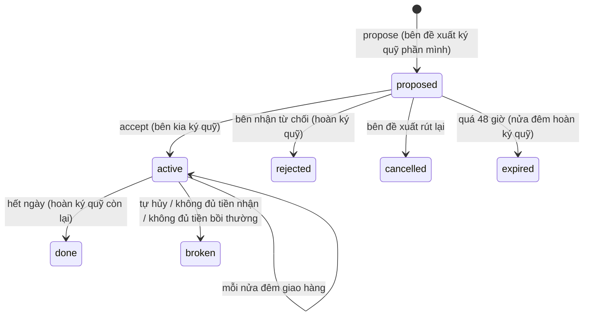

# Hợp đồng cung ứng

> [!summary]
> Hợp đồng kỳ hạn giữa hai người chơi (cấp 6): bên bán giao **1–20 lô mỗi đêm** một mặt hàng trong **3–14 ngày** với giá chốt 50–200% giá Sàn lúc ký. Hai bên ký quỹ; giao thiếu phải bồi thường, phá hợp đồng mất 10% giá trị phần còn lại và −30 [[Điểm tín dụng]]. Mỗi đêm giao đủ, cả hai +3 điểm. Công cụ phòng ngừa biến động giá của [[Sàn Nguyên Liệu]].

## Con số (`CONTRACTS`, `petdex/server/rules/production.js:162-164`)

| Thông số | Giá trị |
|---|---|
| Số lô mỗi ngày | 1–20 |
| Thời hạn | 3–14 ngày |
| Giá mỗi lô | 50–200% giá Sàn hiện tại (làm tròn), số nguyên |
| Ký quỹ bên mua | giá trị 1 ngày = `lô × giá` |
| Ký quỹ bên bán | 20% tổng giá trị = `round(lô × giá × ngày × 0,2)` |
| Đề xuất hết hạn | 48 giờ |
| Số hợp đồng mở tối đa | 5 mỗi người (tính cả đề xuất) |
| Bồi thường giao thiếu | `lô thiếu × (max(0, giá Sàn − giá chốt) + 10% giá chốt)` |
| Bồi thường khi phá | `min(ký quỹ bên phá, 10% × ngày còn lại × lô × giá)` |
| Điểm tín dụng | +3 mỗi bên mỗi đêm giao đủ; −30 bên phá (`petdex/server/rules/production.js:182`) |

## Vòng đời

## Giao hàng mỗi đêm (`deliver`, `petdex/server/contracts.js:149-198`)
1. Lấy `n = min(hàng bên bán có, lô × 10)` phần.
2. Nếu bên mua không đủ (ví + ký quỹ) để trả cho `n` phần → **bên mua phá hợp đồng**.
3. Chuyển hàng (giữ hạn dùng gốc); phần kho bên mua không chứa được trả lại bên bán và không tính là giao thiếu. Bên mua trả `amountFor(received, giá)`: lấy ví trước, thiếu thì trừ ký quỹ của mình (`contract_buy`); bên bán nhận `contract_sell` và ghi lãi chốt theo giá vốn.
4. Thiếu hàng: tính bồi thường; nếu bên bán không đủ (ví + ký quỹ) → **bên bán phá hợp đồng**; đủ thì trả cho bên mua (`contract_penalty` → `contract_comp`).
5. Giao đủ: +3 điểm mỗi bên. Giảm `days_left`; hết thì hoàn ký quỹ, `done`.
- Lượt giao đầu tiên là nửa đêm của ngày ký ("Lượt giao đầu tiên vào nửa đêm nay.") (`petdex/server/contracts.js:98`). Đêm ký được tính nếu `accepted_at < cuối ngày` (`petdex/server/contracts.js:23,206`).

## Phá hợp đồng (`breakBy`, `petdex/server/contracts.js:117-128`)
Bên kia nhận bồi thường từ ký quỹ bên phá (`contract_comp`), phần ký quỹ thừa về bên phá, bên kia nhận lại ký quỹ của mình; bên phá −30 điểm. Tự hủy báo "Đã hủy hợp đồng #… bồi thường X 🪙 cho đối tác … −30 điểm tín dụng." (`petdex/server/contracts.js:130-137`).

## Lỗi người chơi thấy
"Chọn bán hay mua.", "Mỗi ngày giao 1–20 lô.", "Hợp đồng kéo dài 3–14 ngày.", "Giá mỗi lô phải từ lo đến hi xu (giá Sàn đang X).", "Không tìm thấy người chơi này.", "Không ký hợp đồng với chính mình được.", "Bạn đã có 5 hợp đồng đang mở.", "Đề xuất này đã hết hạn." (`petdex/server/contracts.js:54-99`).

## Trường hợp đặc biệt
- Ký quỹ hợp đồng nằm trong tài khoản `contract:<id>`, tính vào [[Ví và tài sản ròng]] (`escrowOf`) (`petdex/server/contracts.js:33-36`).
- Đề xuất và chấp nhận cần cấp 6; từ chối và phá không khóa cấp (`petdex/server/routes-production.js:116-132`).
- Giá Sàn tham chiếu khi đề xuất là giá hiện tại làm tròn; bồi thường giao thiếu dùng giá Sàn lúc nửa đêm.

## Liên quan
- [[Sàn Nguyên Liệu]] · [[Điểm tín dụng]] · [[Khu công nghiệp]] · [[Kho Sàn]] · [[Module contracts]] · [[MOC Kinh tế và cộng đồng]]
