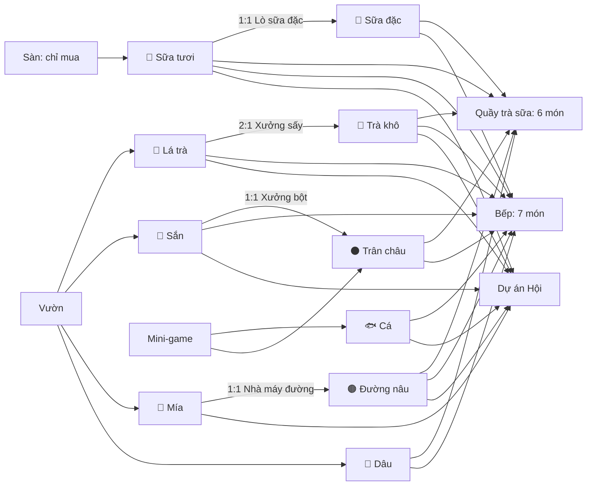

# Mặt hàng nguyên liệu

> [!summary]
> 10 mặt hàng giao dịch trên [[Sàn Nguyên Liệu]]: 6 hàng **thô** (giá theo [[Chỉ số giá]] và độ trôi riêng) và 4 hàng **chế biến** (giá bám theo giá hàng thô đầu vào). Mỗi mặt hàng có giá gốc, độ biến động, hạn dùng và cặp tiêu đề tin riêng. Mỗi mặt hàng có một ghi chú riêng (bấm tên trong bảng).

## Bảng tổng hợp

| Mặt hàng | Mã | Loại | Giá gốc/lô | Biến động/ngày | Hạn dùng | Làm từ | Nguồn |
|---|---|---|---|---|---|---|---|
| 🍃 [[Lá trà tươi]] | `tea_leaf` | thô | 12 | 12% | 2 ngày | [[Vườn]] (chè) | `petdex/server/rules/market.js:8` |
| 🥛 [[Sữa tươi]] | `milk` | thô | 30 | 10% | 3 ngày | chỉ mua | `petdex/server/rules/market.js:9` |
| 🥔 [[Củ sắn]] | `cassava` | thô | 8 | 10% | không hư | [[Vườn]] (sắn) | `petdex/server/rules/market.js:10` |
| 🎋 [[Mía]] | `cane` | thô | 8 | 8% | không hư | [[Vườn]] (mía) | `petdex/server/rules/market.js:11` |
| 🍓 [[Dâu tây]] | `strawberry` | thô | 40 | 15% | 3 ngày | [[Vườn]] (dâu) | `petdex/server/rules/market.js:12` |
| 🐟 [[Cá tươi]] | `fish` | thô | 60 | 12% | 2 ngày | [[Câu cá]] | `petdex/server/rules/market.js:13` |
| 🍂 [[Trà khô]] | `dried_tea` | chế biến | 35 | 6% | không hư | 2 lô lá trà ([[Xưởng sấy trà]]) | `petdex/server/rules/market.js:14` |
| ⚫ [[Trân châu (nguyên liệu)]] | `pearl` | chế biến | 15 | 6% | 5 ngày | 1 lô sắn ([[Xưởng bột trân châu]]), [[Hứng trân châu]] | `petdex/server/rules/market.js:15` |
| 🟤 [[Đường nâu]] | `sugar` | chế biến | 15 | 5% | không hư | 1 lô mía ([[Nhà máy đường]]) | `petdex/server/rules/market.js:16` |
| 🍼 [[Sữa đặc]] | `condensed` | chế biến | 40 | 6% | 7 ngày | 1 lô sữa ([[Lò sữa đặc]]) | `petdex/server/rules/market.js:17` |

## Chuỗi giá trị

## Điểm cần nhớ
- Hàng chế biến **không** nhân [[Chỉ số giá]] trực tiếp mà theo tỉ lệ giá đầu vào hiện tại / gốc (`petdex/server/rules/market.js:62-76`), nên biên lời xưởng không bị lạm phát bào mòn.
- Hàng chế biến có NPC "thương lái nơi khác mua sỉ": độ sâu gấp 3 (600 lô) nên mua bán số lớn ít trượt giá hơn (`petdex/server/rules/market.js:26,102`).
- Mỗi lô nhập kho mang giá vốn; quầy và bếp dùng giá gốc × chỉ số giá để tính giá tham chiếu, **không** dùng giá Sàn hiện tại (`petdex/server/rules/business.js:40-46`, `petdex/server/rules/production.js:133-136`).
- [[Sữa tươi]] là hàng thô duy nhất không tự làm được: phải mua trên Sàn hoặc qua [[Hợp đồng cung ứng]].

## Liên quan
- [[Sàn Nguyên Liệu]] · [[Kho Sàn]] · [[Tin tức thị trường]] · [[Khu công nghiệp]] · [[MOC Kinh tế và cộng đồng]]
