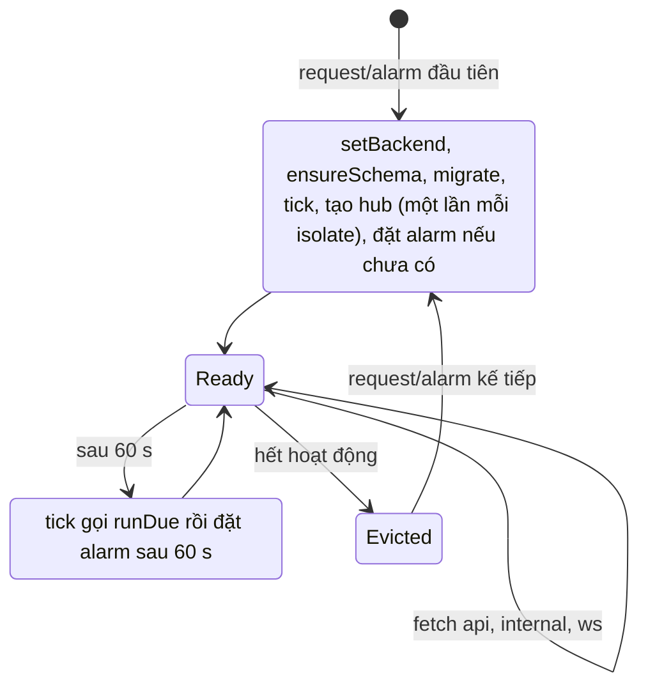

# Durable Object PetdexPark

> [!summary]
> `PetdexPark` là lớp Durable Object (SQLite) chứa toàn bộ máy chủ game trên Cloudflare: một object duy nhất tên `park`, dữ liệu nằm trong `ctx.storage.sql`, alarm mỗi phút thay cho bộ lập lịch, WebSocket thuần cho công viên. Mọi request game và mọi lệnh quản trị từ WorkHub đều đi qua `fetch()` của object này.

## Vòng đời object

| Bước | Dòng | Ghi chú |
|---|---|---|
| `setBackend(openDurableSql(ctx.storage))` | `durable.js:26` | Cắm [[Module sql-durable-sql]] vào [[Module sql-backend]] |
| `ensureSchema()` | `durable.js:27` | Tạo bảng/cột còn thiếu, chạy lại bao nhiêu lần cũng được ([[Lược đồ cơ sở dữ liệu]]) |
| `migrate()` | `durable.js:28` | Các bước dữ liệu một lần, đánh dấu trong `meta` ([[Migration]]) |
| `this.tick()` | `durable.js:29`, `40-46` | Chạy `runDue()` ngay khi dựng object; lỗi chỉ được log "Lỗi bộ lập lịch Petdex:" |
| Hub | `durable.js:30-34` | Biến `hub` mức module: chỉ tạo một lần mỗi isolate dù constructor chạy lại |
| Alarm | `durable.js:35-37`, `48-51` | `blockConcurrencyWhile` đặt alarm `Date.now() + 60_000` nếu chưa có; `alarm()` chạy tick rồi đặt lại |

## Định tuyến trong `fetch()`

| Đường dẫn | Xử lý | Dòng |
|---|---|---|
| `/ws` | Cần header `upgrade: websocket`, nếu không trả 426 "Cần WebSocket."; tạo `WebSocketPair`, `server.accept()`, `bindWebSocket(hub, server)`, trả 101 | `durable.js:56-63` |
| `/api`, `/api/*` | `handleFetch(api, request, { prefix: '/api', ip })` | `durable.js:64` |
| `/internal/*` | `handleFetch(internalApi, request, { prefix: '/internal', ip })` | `durable.js:65` |
| khác | 404 `{ error: 'Không tìm thấy.' }` | `durable.js:66` |

IP người chơi lấy từ `cf-connecting-ip` (`durable.js:55`), truyền vào `req.ip`.

## Ai gọi tới object

| Nguồn | Đường | Dòng |
|---|---|---|
| Worker, request trình duyệt | `/ta-tua/api/*` -> `/api/*`, `/ta-tua/ws` -> `/ws`, qua `env.PETDEX.get(idFromName('park'))` | `worker.ts:29-37` |
| Ứng dụng WorkHub (server) | `gameFetch()` -> `stub.fetch('https://petdex.internal/internal/...')` | `lib/petdex.ts:30-38` |
| Dev (Node) | `lib/petdex.ts` gọi `PETDEX_URL` (mặc định cổng 3200) kèm header khóa nội bộ | `lib/petdex.ts:28`, `43` |

## Lưu ý

> [!warning] Bảo mật `/internal`
> Trong object không có kiểm tra khóa cho `/internal/*`. An toàn dựa hoàn toàn vào việc `worker.ts:31-32` chỉ chuyển `/ta-tua/api` và `/ta-tua/ws`. Thêm một đường chuyển tiếp mới trong Worker mà không lọc `/internal` sẽ mở API quản trị ra Internet. Xem [[API nội bộ]].

- `runDue()` đồng bộ và có thể chạy bù tới 432 nhịp Sàn (3 ngày) cộng nhiều ngày quyết toán trong constructor; request đầu tiên sau thời gian dài object ngủ sẽ chậm. Xem [[Nhịp mỗi phút]].
- Ngoài hub ra, mọi trạng thái RAM (người trong công viên, cooldown vuốt ve, bộ đếm nhập mã quà) mất khi object bị đẩy khỏi bộ nhớ.
- Workers không có `process.env`, nên `durable.js` không gọi `configure()`: production dùng mặc định của [[Module settings]] (`openSignup: false`, `advancedFinance: true`, không có loài khách mời).

## Liên quan
- [[Module durable]] · [[Kiến trúc máy chủ]] · [[Worker và wrangler]]
- [[Nhịp mỗi phút]] · [[Hub WebSocket]] · [[Router]] · [[Lớp SQL]]
