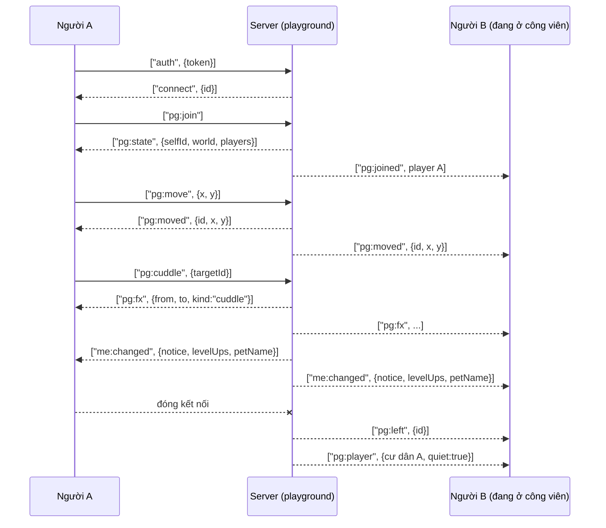

# Giao thức công viên

> [!summary]
> Công viên thời gian thực dùng WebSocket `/ta-tua/ws` với khung JSON `[event, payload]` qua [[Hub WebSocket]]. Note này liệt kê **mọi tin** hai chiều: 7 tin client gửi lên (kể cả `auth`) và 13 tin server gửi xuống, kèm payload, kiểm tra và giới hạn tốc độ. Tất cả sự kiện nghiệp vụ nằm trong `playground.js`; tất cả người chơi chung một room `park`.

## Trình tự điển hình

## Client gửi lên

| Sự kiện | Payload | Kiểm tra / hiệu ứng | Nguồn |
|---|---|---|---|
| `auth` (khung đầu) | `{ token }` | Middleware tìm token, chặn người bị khóa; lỗi -> `connect_error` "Bạn cần đăng nhập." | `playground.js:98-103`, `hub.js:146-149` |
| `pg:join` | không | Cần bé chính còn sống ("Hãy nhận nuôi và chọn một thú cưng chính trước khi ra công viên."). Mỗi người một bé: tab cũ nhận `pg:kicked` và bị ngắt. Vị trí ngẫu nhiên trong `WORLD`. Trả `pg:state` cho mình, `pg:joined` cho người khác (chỉ lần đầu) | `playground.js:138-170` |
| `pg:move` | `{ x, y }` | Bỏ qua nếu không phải số hữu hạn; kẹp trong `WORLD` (x 50-950, y 318-585), làm tròn | `playground.js:172-178`, `6` |
| `pg:chat` | `{ text }` | Gộp khoảng trắng, cắt 120 ký tự, rỗng thì bỏ; cách nhau ít nhất 1 giây ("Từ từ thôi, nói chậm lại nào!") | `playground.js:180-188`, `10` |
| `pg:emote` | `{ kind }` | Chỉ `wave`, `jump`, `spin`; khác thì bỏ qua im lặng | `playground.js:190-193`, `12` |
| `pg:cuddle` | `{ targetId }` | Mục tiêu là người online hoặc cư dân `r<userId>`; không tự vuốt bé mình; cooldown 30 giây cho mỗi cặp bé (`"petA>petB"`); bé mình `cuddle` + 3 xu (sổ `cuddle`) và nhiệm vụ `cuddle`, bé kia `cuddle` | `playground.js:195-224`, `9` |
| `pg:gift` | `{ targetId, itemId }` | Chỉ đồ ăn/đồ chăm sóc; cách nhau 2 giây; chuyển 1 món từ túi mình sang túi người kia trong transaction | `playground.js:226-241`, `11` |

Mọi handler bọc `try/catch`: `GameError` -> `pg:error { message }`, lỗi khác -> log và `pg:error { message: 'Có lỗi xảy ra.' }` (`playground.js:106-114`). Payload không phải object được thay bằng `{}`.

## Server gửi xuống

| Sự kiện | Payload | Gửi cho | Khi nào | Nguồn |
|---|---|---|---|---|
| `connect` | `{ id }` | mình | Xác thực xong | `hub.js:98` |
| `connect_error` | `{ message }` | mình (rồi đóng) | Token sai/bị khóa | `hub.js:89` |
| `pg:state` | `{ selfId, world, players: [view...] }` | mình | Sau `pg:join`; gồm người online và tối đa 50 cư dân vắng chủ | `playground.js:166-168` |
| `pg:joined` | `view` người mới | cả room trừ mình | Lần đầu vào | `playground.js:169` |
| `pg:moved` | `{ id, x, y }` | cả room | Di chuyển | `playground.js:177` |
| `pg:chat` | `{ id, username, text }` | cả room | | `playground.js:187` |
| `pg:emote` | `{ id, kind }` | cả room | | `playground.js:192` |
| `pg:fx` | `{ from, to, kind: 'cuddle' \| 'gift', icon? }` | cả room | Hiệu ứng vuốt ve/tặng quà | `playground.js:213`, `238` |
| `me:changed` | `{ notice, levelUps?, petName? }` | riêng từng người (`io.to(socketId)`) | Sau vuốt ve/tặng quà; client tải lại `/me` | `playground.js:214-223`, `239-240` |
| `pg:player` | `view` (+ `quiet: true` với cư dân) | cả room | Bé của ai đó đổi (sự kiện bus `pet:changed`), hoặc người rời công viên thì bé ở lại làm cư dân | `playground.js:70-84`, `94` |
| `pg:left` | `{ id, quiet? }` | cả room | Rời công viên, hoặc cư dân không còn bé sống | `playground.js:83`, `90` |
| `pg:kicked` | không | tab cũ | Cùng người mở tab mới | `playground.js:148` |
| `pg:error` | `{ message }` | mình | Lỗi trong handler | `playground.js:112` |

## Dữ liệu `view`
`{ id, userId, username, x, y, pet, offline }` (`playground.js:34`). `id` là socket id khi online, `r<userId>` khi là cư dân (`playground.js:38`). `pet` là thẻ `{ id, name, species, level, wear, element, stage, scale, mood }` (`playground.js:19-32`). Cư dân đứng ở chỗ cố định theo `userId` (hàm băm mulberry32, `playground.js:42-52`) nên mọi người thấy cùng vị trí.

## Cầu nối với REST
- Module khác phát `bus.emit('pet:changed', userId)` (`events.js`, `service.js:79`, `routes.js:182`...) để công viên cập nhật thẻ bé ([[Module events]]).
- `parkUsers` (Set userId đang ở công viên, `playground.js:17`) được `social.friendsView` và `internal` đọc để hiện trạng thái online.

## Liên quan
- [[Hub WebSocket]] · [[Module playground]] · [[Module hub]] · [[Công viên]]
- [[Socket phía trình duyệt]] · [[Vẽ công viên]]
