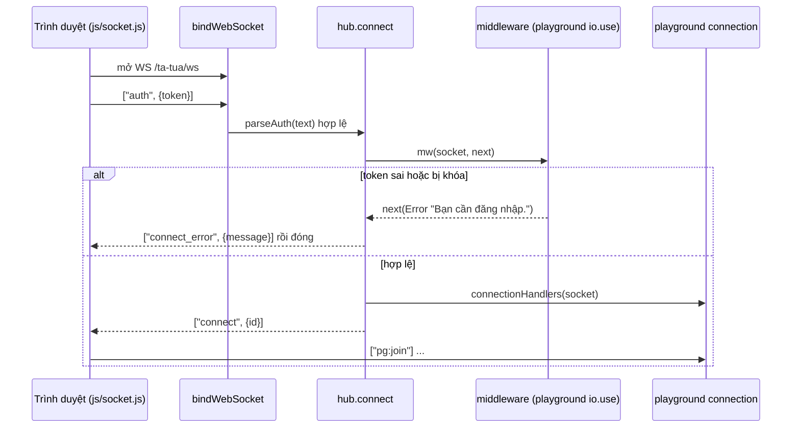

# Hub WebSocket

> [!summary]
> `hub.js` tái hiện đúng phần API socket.io mà công viên dùng (`io.use`, `io.on('connection')`, `io.to(room).emit`, `socket.on/emit/join/to/disconnect`, `io.sockets.sockets`) trên WebSocket thuần, để `playground.js` chạy được trong Durable Object (không có socket.io). Khung tin là JSON `[event, payload]`; khung đầu tiên bắt buộc là `['auth', { token }]`.

## Bắt tay

| Bước | Dòng | Ghi chú |
|---|---|---|
| Khung đầu không phải `auth` | `hub.js:146-148` | Đóng kết nối ngay, không trả gì |
| Middleware | `hub.js:79-86` | Chạy đồng bộ; middleware không gọi `next` thì dừng chuỗi (kết nối vẫn mở) |
| Lỗi middleware | `hub.js:87-95` | Gửi `connect_error` rồi `close()` |
| Thành công | `hub.js:96-99` | Lưu socket, chạy handler `connection`, gửi `['connect', { id }]` |
| Khung tiếp theo | `hub.js:103-113` | JSON không hợp lệ hoặc không phải mảng có tên sự kiện chuỗi thì bỏ qua im lặng |
| Đóng | `hub.js:116-122`, `151-156` | Xóa khỏi `sockets` và mọi room, phát sự kiện nội bộ `disconnect` |

## API mà hub cung cấp

| Thành phần | Dòng | Hành vi |
|---|---|---|
| `socket.id` | `hub.js:8`, `33` | `s` + thời gian base36 + bộ đếm base36 |
| `socket.emit(event, payload)` | `hub.js:43` | Gửi riêng cho socket đó |
| `socket.join(room)` | `hub.js:44-47` | Thêm vào room (Map room -> Set id) |
| `socket.to(room).emit` | `hub.js:48` | Gửi cả room **trừ** chính socket |
| `io.to(target).emit` | `hub.js:72` | `target` là tên room **hoặc** id một socket (`idsOf`, dòng 25), nên `io.to(me.id)` gửi riêng một người |
| `socket.disconnect(close = true)` | `hub.js:49-59` | Gọi `hub.closed` và đóng transport |
| `io.sockets.sockets` | `hub.js:73` | Map id -> socket, `playground.js:147` dùng để đá tab cũ |

Transport chỉ cần `{ send(text), close() }`; `bindWebSocket` dùng `ws.close(1000, 'bye')` (`hub.js:143`). Lỗi `send` (đường truyền vừa đứt) bị nuốt (`hub.js:19-23`).

## Lưu ý
- Không có ping/heartbeat, không có ack, không tự kết nối lại phía server: client tự lo ([[Socket phía trình duyệt]]).
- Không giới hạn kích thước khung hay tần suất ở tầng hub; giới hạn nằm trong handler (`CHAT_GAP_MS`, `GIFT_GAP_MS` ở `playground.js:10-11`).
- Một isolate một hub (`durable.js:21`, `30-33`), nên room `park` là toàn cục.

## Liên quan
- [[Module hub]] · [[Module playground]] · [[Giao thức công viên]] · [[Công viên]]
- [[Durable Object PetdexPark]] · [[Kiểm thử petdex]] (`tests/petdex-hub.test.ts`)
