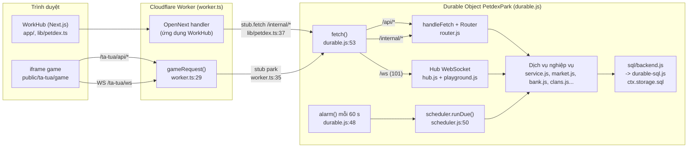
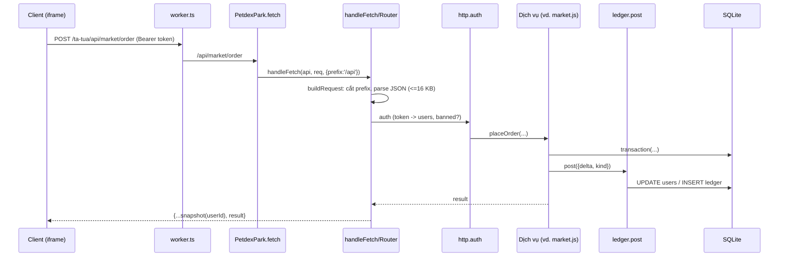
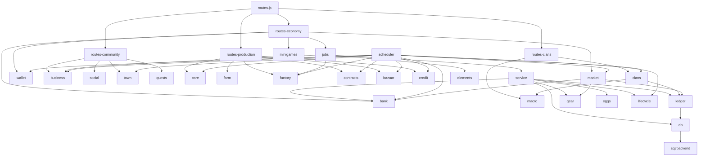

# Kiến trúc máy chủ

> [!summary]
> Toàn bộ máy chủ game Pet Town (mã nguồn `petdex/server/`) chạy trong **một** Durable Object có SQLite tên `park` trên Cloudflare, và chạy y hệt trên Node.js khi phát triển. Cùng một mã nghiệp vụ được cắm vào hai "vỏ" khác nhau: `durable.js` (Workers) và `index.js` (Node). Hiểu bức tranh này là điều kiện để sửa bất kỳ module nào mà không làm vỡ môi trường còn lại.

## Bức tranh tổng thể

| Tầng | Vai trò | Nguồn |
|---|---|---|
| Worker | Chỉ chuyển `/ta-tua/api*` (bỏ tiền tố `/ta-tua`) và `/ta-tua/ws` (đổi thành `/ws`) vào object `park`; mọi đường dẫn khác thuộc Next.js. Thiếu binding thì trả 503 "Pet Town chưa được bật trên máy chủ này." | `worker.ts:29-37` |
| Binding | `PETDEX` -> lớp `PetdexPark`, migration Workers `petdex-v1` khai `new_sqlite_classes` | `wrangler.jsonc:55-58` |
| Durable Object | Cắm backend SQL, tạo lược đồ, chạy migration, khởi động hub và alarm | `petdex/server/durable.js:23-67` |
| Router | Router nhỏ cùng API express (get/post/use, `:param`, `/{*rest}`, error handler 4 tham số) | `petdex/server/router.js:35-99` |
| Hub | Thay socket.io bằng WebSocket thuần, khung JSON `[event, payload]` | `petdex/server/hub.js:10-135` |
| Dịch vụ | Mỗi hệ thống một module, tiền chỉ đổi qua `ledger.post()` | xem [[MOC Máy chủ]] |
| SQL | Lớp `db.prepare().get/all/run` đồng bộ, backend cắm được | `petdex/server/sql/backend.js:37-45` |

## Hai vỏ chạy cùng một mã

| | Cloudflare (production) | Node.js (dev, test, mô phỏng) |
|---|---|---|
| Điểm vào | `PetdexPark` trong `durable.js:23`, được `worker.ts:13` re-export | `index.js` (`npm run petdex:dev`, cổng `PORT` mặc định 3200, `index.js:22`) |
| Backend SQL | `openDurableSql(ctx.storage)` cắm trong constructor (`durable.js:26`) rồi gọi `ensureSchema()` (`durable.js:27`) | `db.js:762-767` tự mở `node:sqlite` khi import (file `PETDEX_DB` hoặc `petdex/data/petdex.db`), rồi `ensureSchema()` |
| Migration dữ liệu | `migrate()` trong constructor (`durable.js:28`) | `migrate()` lúc khởi động (`index.js:45`) |
| Bộ lập lịch | alarm 60 giây (`durable.js:19`, `48-51`), mỗi lần gọi `runDue()` | `setInterval(runDue, 30_000)` (`scheduler.js:82-92`, gọi ở `index.js:46`) |
| WebSocket | `WebSocketPair`, `server.accept()` (`durable.js:56-62`) | gói `ws`, `noServer` + `upgrade` (`index.js:111-116`) |
| HTTP | `fetch(request)` -> `handleFetch` (`durable.js:64-65`) | `node:http` -> dựng `Request` Fetch API (`index.js:51-60`) -> `handleFetch` |
| `/internal/*` | Không có kiểm tra khóa: chỉ vào được qua stub nội bộ vì Worker không bao giờ chuyển `/internal` | Bắt buộc header `x-petdex-internal` khớp `PETDEX_INTERNAL_KEY` (`index.js:96-100`); ngoài production có khóa mặc định cho dev |
| File tĩnh game | Assets của Worker | `serveStatic()` phục vụ `public/ta-tua/game` (`index.js:67-78`) |
| Cài đặt | Mặc định trong `settings.js` (`openSignup: false`, `advancedFinance: true`, `guestPets: []`) | `configure()` từ biến môi trường `PETDEX_OPEN_SIGNUP=1`, `ADVANCED_FINANCE=off`, quét `pets/` (`index.js:40-44`) |

> [!info] Vì sao một object duy nhất
> Chỉ có một object tên `park` (`worker.ts:35`, `lib/petdex.ts:37`), nên mọi request được tuần tự hóa trong một isolate: trạng thái mức module (`bus` ở `events.js`, `players` ở `playground.js`, cache `gearConfig`/`clanConfig`, bộ đếm chống dò mã ở `gifts.js:217`) là trạng thái toàn cục thật sự. Đổi sang nhiều object sẽ phá các giả định này.

## Luồng một request API

Quy ước phản hồi: hành động trả `reply()` = toàn bộ `snapshot()` của người chơi kèm `result` (xem [[Module http]], [[Module service]]); màn xem trả JSON riêng của view. Lỗi người chơi là `GameError` -> 400 (xem [[Lỗi và thông báo lỗi]]).

## Nguyên tắc thiết kế quan sát được trong mã

- **Sổ cái là cửa duy nhất đổi xu**: `ledger.post()` từ chối số dư âm bằng `UPDATE ... WHERE coins + ? >= 0` (`ledger.js:92`, `117`). Xem [[Module ledger]], [[Sổ cái]].
- **Mô phỏng bù theo thời gian thay vì tiến trình nền**: quầy (`business.simulate`), xưởng (`factory.simulateFactory`), chỉ số thú (`game.tick`), lãi tiết kiệm (`bank.touch`) đều tính lại "từ lần lưu cuối tới bây giờ" khi có người xem hoặc lúc quyết toán. Vì thế alarm chỉ cần chạy nhịp Sàn và quyết toán ngày. Xem [[Nhịp mỗi phút]], [[Quyết toán nửa đêm]].
- **Luật thuần tách khỏi I/O**: `rules/*.js` và `game.js` không đụng DB; luật dùng chung với trình duyệt nằm ở `public/ta-tua/game/js/shared/` (`pets.js`, `gear.js`, `clan.js`, `minigames.js`).
- **Thời gian theo giờ Việt Nam** cho mọi khóa ngày/tuần: [[Đồng hồ và ngày giờ game]].
- **Câu lệnh SQL chuẩn bị ở mức module** (`const q = { ... db.prepare(...) }`) nhưng chỉ biên dịch lúc chạy lần đầu, nên import được trước khi cắm backend: [[Lớp SQL]].

## Đồ thị phụ thuộc chính

> [!warning] Lệch tài liệu
> `petdex/README.md:76-100` (mục "Cấu trúc") vẫn mô tả mã gốc: `playground.js` "qua Socket.IO", không nhắc `durable.js`, `hub.js`, `router.js`, `internal.js`, `routes-clans.js`, `sql/`. Mục "Chạy thử" (`petdex/README.md:9-27`) nói `npm start`, `npm run dev`, `npm run demo`, cổng 3000 và `scripts/demo-server.js`, nhưng `petdex/package.json` không có script nào và `petdex/scripts/` chỉ có `simulate-economy.js`, `gear-balance-sim.mjs`. Lệnh đúng trong repo này là `npm run petdex:dev` (cổng 3200) và `npm run test:petdex` ở `package.json` gốc. README gốc (`README.md:177-178`) thì đã đúng.

## Liên quan
- [[Durable Object PetdexPark]] · [[Router]] · [[Hub WebSocket]] · [[Lớp SQL]]
- [[Nhịp mỗi phút]] · [[Quyết toán nửa đêm]] · [[Đồng hồ và ngày giờ game]]
- [[Lược đồ cơ sở dữ liệu]] · [[Migration]]
- [[API người chơi]] · [[API nội bộ]] · [[Giao thức công viên]] · [[Lỗi và thông báo lỗi]]
- [[Worker và wrangler]] · [[Tổng quan hạ tầng]] · [[Đăng nhập một lần WorkHub]]
- [[Kiến trúc giao diện game]] · [[Socket phía trình duyệt]]
