# Lược đồ cơ sở dữ liệu

> [!summary]
> Dữ liệu game là **một file SQLite** (Durable Object `park` trên Cloudflare, `petdex/data/petdex.db` khi dev) gồm **69 bảng**, tất cả tạo trong `ensureSchema()` của `petdex/server/db.js:16-653` bằng `CREATE TABLE IF NOT EXISTS` cộng `addColumn()` cho cột mới. Thời gian luôn là mili-giây Unix (`INTEGER`), ngày là chuỗi `YYYY-MM-DD` giờ VN, xu là số nguyên. Note này liệt kê mọi bảng và cột, nhóm theo miền.

## Quy ước chung
- **Thời gian**: cột `*_at`, `since`, `at`, `starts_at`, `ends_at` là ms Unix. Cột `day` là khóa ngày VN, `week` là khóa tuần (thứ Hai, trừ `central_bank`), `month` là `YYYY-MM`. Xem [[Đồng hồ và ngày giờ game]].
- **Xu**: `INTEGER`; riêng giá Sàn (`price`, `limit_price`, `cost`) là `REAL` tính theo **lô** (1 lô = 10 phần, `rules/market.js:5`). Kho và lệnh tính bằng **phần**.
- **JSON trong TEXT**: `traits`, `menu`, `upgrades`, `watered`, `design`, `demand`, `progress`, `affixes`, `rewards`, `detail`, `breakdown`, `wear`, `skills`, `details`.
- **Khóa ngoại** chỉ có ở các bảng đời đầu; bảng giai đoạn sau (gia tộc, hợp đồng, tin đăng...) không khai FK. `PRAGMA foreign_keys = ON` ở `db.js:18`.
- Cột thêm sau bằng `addColumn(table, column, definition)` (`db.js:445-448`) được đánh dấu "(+ dòng N)".

## Sơ đồ quan hệ chính

```mermaid
erDiagram
  users ||--o{ sessions : "token"
  users ||--o{ pets : "owner_id"
  users ||--o{ inventory : "user_id"
  users ||--o{ ledger : "user_id"
  users ||--o| bank_accounts : "user_id"
  users ||--o{ deposits : "user_id"
  users ||--o{ loans : "user_id"
  users ||--o{ lots : "user_id"
  users ||--o{ orders : "user_id"
  users ||--o{ gear : "owner_id"
  users ||--o{ eggs : "user_id"
  users ||--o{ memorials : "user_id"
  users ||--o| businesses : "owner_id"
  users ||--o{ factories : "owner_id"
  users ||--o{ shifts : "user_id"
  users }o--o| guest_invites : "invite_id"
  pets ||--o{ pet_skills : "pet_id"
  pets ||--o{ careers : "pet_id"
  pets ||--o{ pet_wear : "pet_id"
  pets ||--o{ shifts : "pet_id"
  gear ||--o| pet_wear : "gear_id"
  businesses ||--o{ business_days : "business_id"
  businesses ||--o| job_posts : "business_id"
  factories ||--o{ factory_days : "factory_id"
  factories ||--o| factory_jobs : "factory_id"
  factories ||--o{ toll_orders : "factory_id"
  guilds ||--o{ guild_members : "guild_id"
  guilds ||--o{ guild_projects : "guild_id"
  clans ||--o{ clan_members : "clan_id"
  clans ||--o{ clan_industries : "clan_id"
  clans ||--o{ land_plots : "clan_id"
  clans ||--o{ clan_days : "clan_id"
  clans ||--o{ tax_evasion : "clan_id"
  gift_codes ||--o{ gift_redemptions : "code_id"
  users ||--o{ contracts : "seller_id / buyer_id"
  users ||--o{ listings : "seller_id / buyer_id"
```

Tài khoản chung (không có bảng riêng) nằm trong `accounts.id`: `treasury` (ngân sách thị trấn), `guild:<id>`, `clan:<id>`, `contract:<id>`, `toll:<id>` (xem [[Module ledger]]).

## 1. Tài khoản, phiên, quản trị

### `users` (`db.js:20-28`)
| Cột | Kiểu | Ý nghĩa |
|---|---|---|
| `id` | INTEGER PK AUTOINCREMENT | Mã người chơi |
| `username` | TEXT NOT NULL UNIQUE COLLATE NOCASE | Tên trong game (NOCASE chỉ gộp A-Z) |
| `pass_hash` | TEXT NOT NULL | `salt:hash` scrypt; chuỗi rỗng = chưa có mật khẩu ([[Module passwords]]) |
| `coins` | INTEGER NOT NULL | Số dư ví; chỉ đổi qua `ledger.post()` |
| `active_pet_id` | INTEGER | Bé chính (ra công viên) |
| `last_daily_at` | INTEGER DEFAULT 0 | Lần nhận quà ngày (ms) |
| `created_at` | INTEGER NOT NULL | |
| `warehouse` | INTEGER DEFAULT 0 (+453) | Cấp kho Sàn, chỉ số vào `MARKET.warehouse` |
| `advanced` | INTEGER DEFAULT 0 (+454) | Bật Tài chính nâng cao |
| `streak` | INTEGER DEFAULT 0 (+455) | Chuỗi quà ngày |
| `daily_day` | TEXT (+456) | Khóa ngày nhận quà gần nhất |
| `tax_due` | INTEGER DEFAULT 0 (+457) | Nợ thuế thu nhập |
| `credit` | INTEGER DEFAULT 500 (+467) | Điểm tín dụng 300-850 |
| `loan_ban_until` | INTEGER DEFAULT 0 (+468) | Cấm vay tới |
| `plots` | INTEGER DEFAULT 4 (+469) | Số ô vườn |
| `locked_slots` | INTEGER DEFAULT 0 (+478) | Ô nuôi bị khóa bởi tưởng niệm |
| `kind` | TEXT DEFAULT 'player' (+481) | `member` (WorkHub), `guest` (link mời), `player` (tự đăng ký) |
| `crm_user_id` | TEXT (+482) | Mã người dùng WorkHub; UNIQUE khi không NULL (`users_crm`, `db.js:493`) |
| `display_name` | TEXT (+483) | Tên hiển thị tự do |
| `banned` | INTEGER DEFAULT 0 (+484) | Bị khóa |
| `invite_id` | INTEGER (+485) | Link mời đã dùng |
| `last_seen_at` | INTEGER DEFAULT 0 (+486) | Mốc hoạt động (ghi tối đa 5 phút/lần, `db.js:836`) |
| `login_key` | TEXT (+488) | Tên chuẩn hóa NFC, viết thường cả chữ có dấu (`loginKey`, `db.js:14`); index `users_login_key` |

### Các bảng khác
| Bảng | Cột (kiểu, khóa) | Ý nghĩa | Nguồn |
|---|---|---|---|
| `sessions` | `token` TEXT PK, `user_id` INTEGER FK users CASCADE, `created_at` | Phiên đăng nhập; token 48 ký tự hex (`issueToken`, `db.js:811-815`) | `db.js:30-34` |
| `meta` | `key` TEXT PK, `value` TEXT | Khóa-giá trị hệ thống: `market_tick`, `settled_day`, `migrated_<bước>`, `gear_config`, `clan_config` | `db.js:60` |
| `guest_invites` | `id` PK, `code` TEXT UNIQUE (18 hex), `label`, `max_uses` NULL = vô hạn, `uses`, `expires_at`, `created_by`, `created_at`, `revoked_at` | Link mời khách | `db.js:495-505` |
| `password_links` | `code_hash` TEXT PK (sha256), `user_id`, `created_by`, `created_at`, `expires_at`, `used_at`; index `password_links_user` | Link đặt mật khẩu dùng một lần, chỉ lưu mã đã băm | `db.js:548-556` |
| `admin_log` | `id` PK, `actor`, `action`, `user_id`, `details` JSON, `created_at`; index `admin_log_time` | Nhật ký quản trị (cả "Sở thuế" tự ghi hồ sơ trốn thuế) | `db.js:506-514` |

## 2. Thú cưng, đồ đạc

| Bảng | Cột | Ý nghĩa | Nguồn |
|---|---|---|---|
| `pets` | `id` PK, `owner_id` FK users CASCADE, `name`, `species`, `born_at`, `level` DEFAULT 1, `xp` DEFAULT 0, `fullness` REAL 70, `happiness` REAL 80, `energy` REAL 100, `accessory` TEXT (đồ cũ một món), `updated_at`; + `busy_from`, `busy_until` INTEGER (+449-450), `busy_kind` TEXT `work`/`school`/`bath` (+451), `hygiene` REAL 80 (+461), `health` REAL 90 (+462), `sick` TEXT `cold`/`stomach` (+463), `traits` TEXT JSON '[]' (+464), `health_avg` REAL 80, `health_days` INTEGER 0 (+476-477). Index `pets_owner`, `pets_rank(level DESC, xp DESC)` | Chỉ số lưu ở thời điểm `updated_at`; giá trị hiện tại tính bằng `game.tick()` | `db.js:36-51` |
| `pet_skills` | PK (`pet_id` FK CASCADE, `skill`), `value` REAL | 5 kỹ năng 0-100 | `db.js:76-81` |
| `careers` | PK (`pet_id` FK CASCADE, `career`), `rank` 1, `hours` 0 | Bậc nghề và giờ đã làm | `db.js:83-89` |
| `pet_wear` | PK (`pet_id` FK CASCADE, `slot`), `item_id`, + `gear_id` INTEGER (+452) | Đồ đang đeo theo khe | `db.js:425-430` |
| `inventory` | PK (`user_id` FK CASCADE, `item_id`), `qty` | Túi đồ (đồ ăn, chăm sóc, đồ chơi, trứng). Trang phục không còn ở đây từ `gear_v1` | `db.js:53-58` |
| `gear` | `id` PK, `owner_id` FK CASCADE, `item_id`, `tier` (`blue`...), `affixes` JSON `{income, stats, trade, luck}`, `source` (`shop`/`minigame`/`admin`/`gift`/`legacy`), `listed` 0/1, `created_at`, + `sealed` 0/1 (+559); index `gear_owner` | Mỗi món trang phục là một bản riêng | `db.js:517-527` |
| `eggs` | `id` PK, `user_id` FK CASCADE, `element`, `species` (bốc lúc ấp), `started_at`, `hatch_at`, `hatched_at`, `pet_id` | Trứng đang ấp/đã nở | `db.js:398-407` |
| `memorials` | `id` PK, `user_id` FK CASCADE, `name`, `species`, `element`, `rarity`, `level`, `weeks`, `born_at`, `died_at`, `wear` JSON, `skills` JSON, `traits` JSON, `heirloom_skill`, `heirloom_used_at` | Bia Đồi Sao và kỷ vật | `db.js:408-424` |
| `gift_codes` | `id` PK, `code` UNIQUE NOCASE, `label`, `rewards` JSON `{coins, entries, choice}`, `max_uses`, `uses`, `expires_at`, `created_by`, `created_at`, `revoked_at` | Mã quà | `db.js:529-540` |
| `gift_redemptions` | PK (`code_id` FK CASCADE, `user_id`), `created_at` | Mỗi người nhận một mã một lần | `db.js:541-546` |

## 3. Tiền, sổ cái, ngân hàng, tín dụng

| Bảng | Cột | Ý nghĩa | Nguồn |
|---|---|---|---|
| `ledger` | `id` PK, `user_id` (NULL với tài khoản chung), `account` (`wallet`/`savings`/`treasury`/`clan:<id>`...), `delta`, `balance_after`, `kind` (khóa trong `KINDS`), `memo`, `created_at`; index `ledger_user(user_id, id)` | Mọi biến động xu | `db.js:63-73` |
| `accounts` | `id` TEXT PK, `balance` INTEGER | Số dư tài khoản chung | `db.js:74` |
| `bank_accounts` | `user_id` PK FK CASCADE, `savings`, `accrued` REAL (lãi lẻ chưa trả), `updated_at` | Tiết kiệm | `db.js:164-169` |
| `deposits` | `id` PK, `user_id` FK, `amount`, `rate` REAL/ngày, `term_days`, `opened_at`, `matures_at`, `closed_at`, `payout` | Gửi kỳ hạn | `db.js:170-180` |
| `central_bank` | `week` TEXT PK (ngày Chủ nhật), `money_per_player` REAL, `growth`, `price_index`, `base_rate`, `players`, `at` | Biên bản họp tuần | `db.js:181-189` |
| `networth` | PK (`user_id`, `day`), `total`, `detail` JSON | Ảnh chụp tài sản ròng mỗi đêm | `db.js:210-216` |
| `gains` | PK (`user_id`, `day`), `amount` | Lãi/lỗ đã chốt khi bán hàng, cơ sở thuế "trading" | `db.js:431` |
| `loans` | `id` PK, `user_id` FK, `principal`, `remaining`, `rate`, `term_days`, `opened_at`, `due_at`, `late_days`, `status` (`active`/`late`/`defaulted`/`repaid`), + `fees` (+474), `paid_days` (+475) | Khoản vay | `db.js:390-394` |
| `credit_events` | `id` PK, `user_id`, `delta`, `reason`, `at` | Lịch sử điểm tín dụng | `db.js:395-397` |
| `tax_days` | PK (`user_id`, `day`), `taxable`, `tax`, `paid`, `breakdown` JSON | Thuế thu nhập từng ngày | `db.js:276-284` |

## 4. Việc làm, trường, mini-game, nhiệm vụ

| Bảng | Cột | Ý nghĩa | Nguồn |
|---|---|---|---|
| `shifts` | `id` PK, `user_id` FK, `pet_id` FK CASCADE, `career` (nghề, `shop`, `factory`), `rank`, `hours`, `pay`, `day`, `starts_at`, `ends_at`, `claimed_at`; + `business_id` (+458), `wage` (+459), `factory_id` (+460); index `shifts_user(user_id, claimed_at)` | Ca làm. Lương làm thuê được giữ trước từ ví chủ | `db.js:91-104` |
| `school_log` | PK (`pet_id`, `day`, `skill`), `count` | Số buổi học mỗi môn mỗi ngày | `db.js:332-335` |
| `insurance` | `user_id` PK, `plan` (`basic`/`full`), `since` | Gói bảo hiểm | `db.js:331` |
| `minigame_sessions` | `id` TEXT PK (18 hex), `user_id` FK, `pet_id`, `game`, `seed`, `started_at`, `finished_at` | Ván chơi có hạt giống; dọn sau 2 ngày | `db.js:191-199` |
| `minigame_days` | PK (`user_id`, `day`), `coins`, `fish`, `pearl`, `plays` | Đã nhận bao nhiêu trong ngày (giới hạn thưởng) | `db.js:200-208` |
| `quests` | PK (`user_id`, `day`, `slot`), `quest`, `progress`, `claimed_at` | 3 nhiệm vụ ngày; `slot = -1` là rương | `db.js:433-441` |

## 5. Sàn Nguyên Liệu

| Bảng | Cột | Ý nghĩa | Nguồn |
|---|---|---|---|
| `commodity_state` | `commodity` PK, `price` REAL (xu/lô), `drift` REAL 1, `updated_at` | Giá hiện tại | `db.js:106-111` |
| `commodity_prices` | PK (`commodity`, `at`), `price` | Lịch sử nhịp 10 phút, giữ 14 ngày | `db.js:112-117` |
| `news` | `id` PK, `commodity` (NULL = tin chung), `headline`, `effect` REAL (hệ số giá), `created_at`, `starts_at`, `ends_at` | Báo Trân Châu, tin thị trường; mọi module đăng tin vào đây | `db.js:118-126` |
| `lots` | `id` PK, `user_id` FK, `commodity`, `qty` (phần), `acquired_at`, `expires_at` (NULL = không hư), + `cost` REAL/phần (+465); index `lots_user` | Kho theo từng lần nhập | `db.js:129-137` |
| `orders` | `id` PK, `user_id` FK, `commodity`, `side` (`buy`/`sell`), `qty`, `filled`, `limit_price`, `locked` (xu ký quỹ), `goods_expires_at`, `status` (`open`/`filled`/`cancelled`/`expired`), `day`, `created_at`, + `goods_cost` (+466); index `orders_book` | Lệnh giới hạn chờ khớp | `db.js:139-153` |
| `npc_flow` | PK (`user_id`, `day`, `commodity`), `bought`, `sold` | Hạn mức giao dịch với NPC mỗi ngày | `db.js:155-162` |

## 6. Quầy trà sữa, thị trấn

| Bảng | Cột | Ý nghĩa | Nguồn |
|---|---|---|---|
| `businesses` | `id` PK, `owner_id` UNIQUE FK, `name`, `location`, `reputation` REAL 1, `menu` JSON, `upgrades` JSON, `promo_until`, `unpaid_days`, `sim_at` (đã mô phỏng tới), `opened_at`, `closed_at` | Quầy | `db.js:219-232` |
| `business_days` | PK (`business_id`, `day`), `cups`, `customers`, `lost`, `revenue`, `cogs`, `rent`, `wages`, `tax` | Báo cáo ngày | `db.js:233-245` |
| `job_posts` | `business_id` PK FK CASCADE, `wage`, `slots`, `open` | Tin tuyển ở quầy | `db.js:246-251` |
| `town_effects` | `id` PK, `kind` (`traffic`/`tax_cut`/`stipend`/`news`), `target`, `value`, `label`, `starts_at`, `ends_at` | Hiệu ứng đang chạy (cả pha kinh tế của vĩ mô) | `db.js:254-262` |
| `proposals` | PK (`week`, `option`), `votes`, `status` (`open`/`lost`/`funded`/`unfunded`) | Đề xuất ngân sách tuần | `db.js:263-269` |
| `votes` | PK (`week`, `user_id`), `option` | Phiếu bầu | `db.js:270-275` |

## 7. Xã hội: bạn bè, Hội

| Bảng | Cột | Ý nghĩa | Nguồn |
|---|---|---|---|
| `friends` | PK (`user_id` FK, `friend_id` FK), `status` (`pending`/`accepted`), `since` | Quan hệ có hướng; khi chấp nhận ghi cả hai chiều | `db.js:286-292` |
| `friend_likes` | PK (`user_id`, `friend_id`, `day`) | Thả tim mỗi ngày | `db.js:293-298` |
| `gifts_sent` | PK (`user_id`, `day`), `count` | Giới hạn tặng quà | `db.js:299-304` |
| `guilds` | `id` PK, `name` UNIQUE NOCASE, `emblem`, `leader_id`, `upgrades` JSON, `prestige`, `created_at` | Hội | `db.js:306-314` |
| `guild_members` | `user_id` PK FK, `guild_id` FK CASCADE, `donated`, `joined_at` | Mỗi người tối đa một Hội | `db.js:315-320` |
| `guild_projects` | PK (`guild_id`, `week`), `project`, `progress` JSON (phần), `done_at` | Dự án tuần | `db.js:321-328` |

## 8. Sản xuất: vườn, bếp, xưởng, hợp đồng, Chợ Phiên

| Bảng | Cột | Ý nghĩa | Nguồn |
|---|---|---|---|
| `garden_plots` | PK (`user_id` FK, `idx`), `crop`, `planted_at`, `ready_at`, `watered` JSON (id người tưới), `pests_at`, `pests_cleared`, `seed_cost` | Ô vườn | `db.js:336-347` |
| `garden_help` | PK (`user_id`, `day`), `count` | Lượt tưới hộ | `db.js:348` |
| `recipes_known` | PK (`user_id`, `recipe`) | Công thức đã biết | `db.js:349` |
| `dishes` | `id` PK, `user_id` FK, `recipe`, `quality` 0-2, `made_at`, `expires_at` | Món đã nấu | `db.js:350-353` |
| `factories` | `id` PK, `owner_id` FK, `kind`, `level` 0, `toll_fee`, `toll_open`, `unpaid_days`, `sim_at`, `built_at`, `closed_at` | Xưởng | `db.js:354-365` |
| `factory_days` | PK (`factory_id`, `day`), `batches`, `toll_batches`, `toll_income`, `rent`, `wages` | Báo cáo xưởng | `db.js:366-370` |
| `factory_jobs` | `factory_id` PK FK CASCADE, `wage`, `slots`, `open` | Tin tuyển công nhân | `db.js:371-374` |
| `toll_orders` | `id` PK, `factory_id`, `user_id`, `batches`, `done`, `fee`/mẻ, `status` (`open`/`done`/`cancelled`), `created_at` | Đơn gia công thuê; phí giữ ở `accounts` `toll:<id>` | `db.js:375-378` |
| `contracts` | `id` PK, `seller_id`, `buyer_id`, `proposer_id`, `commodity`, `qty` (lô/ngày), `price` (xu/lô), `days`, `days_left`, `buyer_escrow`, `seller_escrow`, `status`, `created_at`, `accepted_at`; + `delivered` (phần), `broken_by`, `last_day`, `ended_at` (+470-473) | Hợp đồng cung ứng; quỹ ở `contract:<id>` | `db.js:379-384` |
| `listings` | `id` PK, `seller_id`, `kind` (`item`/`gear`/`dish`), `ref` (mã món, id gear dạng chuỗi, hoặc mã công thức), `quality`, `made_at`, `price`, `ref_price`, `created_at`, `expires_at`, `buyer_id`, `sold_at`, `status` | Tin đăng Chợ Phiên | `db.js:385-389` |

## 9. Gia tộc, đất, vĩ mô

| Bảng | Cột | Ý nghĩa | Nguồn |
|---|---|---|---|
| `clans` | `id` PK, `name` UNIQUE NOCASE, `emblem`, `color`, `leader_id`, `xp`, `declare_ratio` REAL 1, `created_at`, `dissolved_at` | Gia tộc; giải tán thì đổi tên thành `name #id` (`clans.js:118`) | `db.js:563-573` |
| `clan_members` | `user_id` PK, `clan_id`, `role` (`leader`/`elder`/`member`), `donated`, `joined_at`; index `clan_members_clan` | Thành viên | `db.js:574-581` |
| `clan_donations` | PK (`clan_id`, `user_id`, `week`), `amount` | Góp quỹ theo tuần (định mức) | `db.js:582-588` |
| `clan_industries` | PK (`clan_id`, `industry`), `fee`, `entered_at` | Ngành đã thâu tóm (tối đa 3) | `db.js:589-595` |
| `land_plots` | `id` PK (1-200, sinh từ `shared/clan.js`), `clan_id` NULL = còn trong quỹ đất, `industry`, `bought_at`, `bought_price`, `index_at_buy`, `design` JSON, `design_spent`, `price_override`; index `land_plots_clan` | 200 lô đất | `db.js:597-608` |
| `clan_days` | PK (`clan_id`, `day`), `revenue`, `declared`, `rate`, `tax`, `upkeep` | Báo cáo đêm | `db.js:609-618` |
| `clan_tax_refunds` | PK (`clan_id`, `month`), `taxed`, `refund`, `created_at` | Hoàn thuế cuối tháng | `db.js:619-626` |
| `tax_evasion` | `id` PK, `clan_id`, `day`, `revenue`, `declared`, `rate`, `evaded`, `status` (`open`/`collected`/`dismissed`), `collected`, `resolved_by`, `resolved_at`, `created_at`; UNIQUE (`clan_id`, `day`) | Hồ sơ Sở thuế, gia tộc không thấy | `db.js:628-642` |
| `macro_days` | `day` PK, `phase`, `weather`, `land_index` REAL, `gdp` REAL, `demand` JSON | Trạng thái vĩ mô mỗi ngày | `db.js:643-651` |

## Câu lệnh chuẩn bị đáng chú ý

| Câu lệnh | Ý nghĩa | Nguồn |
|---|---|---|
| `UPDATE users SET coins = coins + ? WHERE id = ? AND coins + ? >= 0` | Chặn số dư âm ở mức SQL; `changes = 0` -> "Không đủ xu." | `ledger.js:92`, `117` |
| `UPDATE inventory SET qty = qty - ? WHERE ... AND qty >= ?` | Lấy đồ có điều kiện, thiếu thì "Bạn không có đủ món này." | `db.js:703`, `756-758` |
| `SELECT u.* FROM sessions s JOIN users u ...` | Xác thực token | `db.js:669` |
| `INSERT ... ON CONFLICT (key) DO UPDATE` | Upsert `meta` | `db.js:657` |
| `userByLogin ... ORDER BY (pass_hash <> '') DESC, id` | Trùng `login_key` thì ưu tiên tài khoản có mật khẩu | `db.js:778` |
| `touchSeen ... AND last_seen_at < ?` | Ghi mốc hoạt động tối đa 5 phút/lần | `db.js:782`, `836` |
| `book`: `ORDER BY CASE WHEN side='sell' THEN limit_price ELSE -limit_price END, created_at` | Sổ lệnh giá tốt nhất trước | `market.js:45-47` |
| `moneySupply` | Tổng xu = ví + tiết kiệm + kỳ hạn + ký quỹ lệnh + lương giữ trước + tài khoản chung trừ `treasury` | `bank.js:23-29` |
| `taxpayers` (UNION 4 nguồn) | Ai phải quyết toán thuế ngày | `town.js:29-33` |
| `UPDATE gift_codes SET uses = uses + 1 WHERE ... (max_uses IS NULL OR uses < max_uses)` | Trừ lượt nguyên tử | `gifts.js:19` |
| `UPDATE listings SET status='sold' ... AND status='open'` | Chống hai người mua cùng một tin | `bazaar.js:26`, `135` |

## Lưu ý
- Không có cột phiên bản lược đồ: mọi thay đổi là cộng thêm (bảng/cột/index mới) và chạy lại được. Chuyển đổi dữ liệu nằm ở [[Migration]].
- Xóa người chơi (chỉ có trong test) kéo theo các bảng có FK CASCADE, nhưng **không** dọn `clan_members`, `contracts`, `listings`, `toll_orders`, `friend_likes`...
- `pets.accessory` là cột cũ, giữ để `wear_v1` chuyển đổi; `savePet` vẫn ghi lại nó (`db.js:676-679`).

## Liên quan
- [[Module db]] · [[Migration]] · [[Lớp SQL]] · [[Module ledger]] · [[Sổ cái]]
