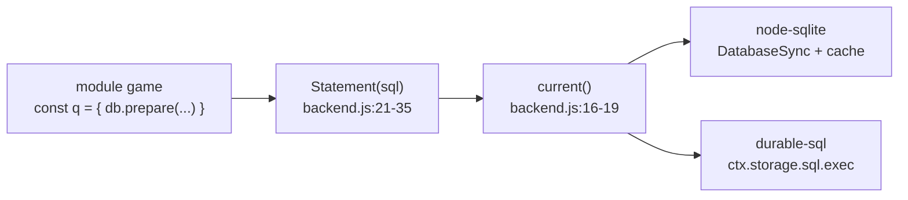

# Lớp SQL

> [!summary]
> Mọi module game truy cập SQLite qua một lớp mỏng `sql/backend.js` có API giống `node:sqlite` (`db.prepare(sql).get/all/run`, `db.exec`, `transaction(fn)`). Backend thật được cắm lúc chạy: `node-sqlite.js` trên Node, `durable-sql.js` trong Durable Object. Nhờ vậy cùng một câu SQL chạy ở cả dev, test và production.

## Cấu trúc

| API | `node-sqlite.js` | `durable-sql.js` |
|---|---|---|
| `get(sql, params)` | `stmt(sql).get(...)` với cache câu lệnh theo chuỗi SQL (`node-sqlite.js:11-19`, `23`) | `sql.exec(query, ...params).toArray()[0]` (`durable-sql.js:7`, `10`) |
| `all` | `stmt(sql).all(...)` | `toArray()` |
| `run` -> `{ changes, lastInsertRowid }` | Kết quả `node:sqlite`, ép `Number` (`node-sqlite.js:25-28`) | Chạy câu lệnh rồi `SELECT changes(), last_insert_rowid()` (`durable-sql.js:12-16`) |
| `exec(sql)` | `native.exec` rồi xóa cache (`node-sqlite.js:29-32`) | Tách câu bằng `splitStatements`, **bỏ qua** `PRAGMA journal_mode` (`durable-sql.js:17-22`) |
| `transaction(fn)` | `BEGIN IMMEDIATE` / `COMMIT` / `ROLLBACK`, lồng nhau dùng chung transaction ngoài (`node-sqlite.js:33-47`) | `storage.transactionSync(fn)`, lồng nhau gọi thẳng `fn()` (`durable-sql.js:23-31`) |
| Mở | `PRAGMA journal_mode = WAL; PRAGMA foreign_keys = ON;` (`node-sqlite.js:10`), file hoặc `:memory:` | Có sẵn trong object |

## Quy ước sử dụng
- Câu lệnh được "chuẩn bị" ở mức module nhưng `Statement` chỉ giữ chuỗi SQL; biên dịch thật xảy ra lần chạy đầu (`backend.js:1-4`). Nhờ vậy `import` module trước `setBackend` không lỗi; gọi `.get()` trước khi cắm backend thì ném "Chưa mở cơ sở dữ liệu của Petdex (gọi setBackend trước)." (`backend.js:17`).
- Gọi lồng `transaction()` luôn an toàn: dịch vụ gọi nhau (vd. `jobs.claimShift` gọi `mutatePet` có transaction riêng) đều nằm trong transaction ngoài cùng.
- `splitStatements` tách theo `;` cuối dòng và bỏ dòng chú thích `--` (`backend.js:48-53`): **lược đồ không được chứa `;` trong chuỗi**.
- `db.js` chọn backend: `isWorkers` khi `navigator.userAgent === 'Cloudflare-Workers'` (`db.js:7`); ngoài Workers và chưa có backend thì mở `node:sqlite` ngay khi import bằng top-level `await` (`db.js:762-767`).
- `node-sqlite.js` nạp `node:sqlite`, `node:fs`, `node:path` bằng chuỗi tính toán (`node-sqlite.js:4`) để trình đóng gói Workers không kéo import tĩnh.

> [!warning] Khác biệt ngầm giữa hai backend
> - `PRAGMA foreign_keys = ON` có trong `ensureSchema()` (`db.js:18`) và được chạy trên cả hai backend; `lifecycle.passAway` dựa vào `ON DELETE CASCADE` để xóa kỹ năng, nghề, ca làm, đồ đeo của bé (`lifecycle.js:79`).
> - Kiểu số: Durable Object trả số thực/nguyên theo SQLite; mã luôn bọc `Number(...)` ở chỗ cần id.
> - Yêu cầu Node >= 22.13 cho `node:sqlite` (`node-sqlite.js:1`).

## Liên quan
- [[Module sql-backend]] · [[Module sql-durable-sql]] · [[Module sql-node-sqlite]] · [[Module db]]
- [[Lược đồ cơ sở dữ liệu]] · [[Migration]] · [[Durable Object PetdexPark]]
