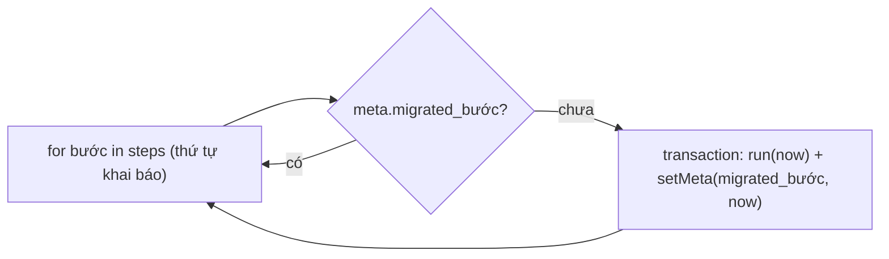

# Migration

> [!summary]
> Petdex không đánh số phiên bản lược đồ. Có ba lớp "migration" độc lập: (1) **lược đồ** tự bổ sung trong `ensureSchema()` (bảng/cột/index mới, chạy lại vô hại), (2) **dữ liệu** trong `migrate.js`: các bước có tên, mỗi bước chạy đúng một lần và được đánh dấu `meta.migrated_<tên>`, (3) migration **Cloudflare** `petdex-v1` khai báo lớp Durable Object dùng SQLite.

## 1. Lược đồ: `ensureSchema()`
- `CREATE TABLE IF NOT EXISTS` / `CREATE INDEX IF NOT EXISTS` cho 69 bảng (`db.js:16-653`).
- `addColumn(table, column, definition)` đọc `PRAGMA table_info` rồi `ALTER TABLE ... ADD COLUMN` nếu thiếu (`db.js:445-448`); 38 lần gọi (`db.js:449-488`, `559`).
- Bước vá dữ liệu nhúng trong lược đồ: điền `login_key` cho mọi user còn NULL (`db.js:489-491`).
- Gọi ở: `durable.js:27` (mỗi lần dựng object) và cuối `db.js:766` (Node, khi import).

> [!tip] Thêm cột mới
> Thêm một dòng `addColumn('bảng', 'cột', 'KIỂU ... DEFAULT ...')` vào cuối `ensureSchema()`. Cột `NOT NULL` phải có `DEFAULT` vì SQLite không cho thêm cột NOT NULL không mặc định vào bảng có dữ liệu. Muốn thêm bảng thì thêm vào một khối `db.exec(...)`; nhớ không dùng `;` trong chuỗi (xem [[Lớp SQL]]).

## 2. Dữ liệu: `migrate(now)`

`migrate.js:105-113`: mỗi bước trong một transaction cùng với việc đánh dấu, nên bước lỗi sẽ được thử lại ở lần khởi động sau. Thứ tự là thứ tự khai báo trong object `steps` (`migrate.js:21-103`).

| # | Bước | Dòng | Làm gì |
|---|---|---|---|
| 1 | `ledger_v1` | `migrate.js:22-26` | User có `coins > 0` mà chưa có dòng sổ cái nào: thêm dòng `opening` "Số dư khi mở sổ cái" để sổ cái khớp số dư |
| 2 | `age_weeks_v1` | `migrate.js:27-33` | Đổi nhịp tuổi (cũ: 1 giờ = 1 ngày tuổi): tính giai đoạn cũ theo `OLD_STAGE_DAYS = [0, 2, 7, 21, 60]` rồi đặt lại `born_at` sao cho giữ nguyên giai đoạn theo `STAGE_MIN_DAYS_V1 = [0, 14, 56, 147, 420]` ngày tuổi mới |
| 3 | `treasury_seed_v1` | `migrate.js:35-37` | Nạp `TREASURY_SEED` (5.000 xu, `rules/town.js:18`) vào `treasury`, loại sổ `town_seed` |
| 4 | `skills_v1` | `migrate.js:38-43` | Bé chưa có kỹ năng: bốc `initialSkills` (5-15 mỗi kỹ năng) |
| 5 | `traits_v1` | `migrate.js:45-52` | Bé chưa có tính cách: `rollTraits`; nếu có `charming` thì +5 Duyên dáng |
| 6 | `wear_v1` | `migrate.js:54-59` | Phụ kiện cũ một món (`pets.accessory`) chuyển sang khe `pet_wear` |
| 7 | `gear_v1` | `migrate.js:63-88` | Trang phục có cấp: mỗi phụ kiện trong `inventory` thành một bản `gear` cấp `blue`, `source: 'legacy'`, một dòng ngẫu nhiên; xóa khỏi `inventory`; khe đang đeo trỏ `gear_id` đúng bản; tin Chợ Phiên `kind = 'item'` bán phụ kiện đổi thành `kind = 'gear'` với `ref` là id bản mới, đánh dấu `listed` |
| 8 | `wear_limit_v1` | `migrate.js:94-102` | Luật số món đeo mới: bé đeo quá `wearLimitOf(pet)` thì tháo bớt món **cấp thấp nhất** (sắp theo `TIER_ORDER`), không mất món nào |

> [!warning] Bước dùng ngẫu nhiên
> `skills_v1`, `traits_v1`, `gear_v1` dùng `Math.random`, nên chạy trên hai bản sao DB sẽ cho kết quả khác nhau. Mỗi DB chỉ chạy một lần nhờ cờ `meta`.

- `migrate(T0)` được test gọi với thời điểm giả trước `runDue(T0)` ([[Kiểm thử petdex]]).
- Bước mới phải **thêm vào cuối** `steps` với tên mới; không sửa bước đã chạy (DB production đã có cờ `migrated_<tên>` nên thay đổi không bao giờ chạy lại).
- Tên bước có hậu tố `_v1` theo quy ước, không có cơ chế rollback.

## 3. Cloudflare: lớp Durable Object
`wrangler.jsonc:58`: `"migrations": [{ "tag": "petdex-v1", "new_sqlite_classes": ["PetdexPark"] }]`. Đây là migration của nền tảng (tạo lớp DO có SQLite), không liên quan tới bảng. Xem [[Worker và wrangler]].

## Liên quan
- [[Module migrate]] · [[Module db]] · [[Lược đồ cơ sở dữ liệu]]
- [[Trang phục]] · [[Cấp trang phục]] · [[Giai đoạn tuổi]] · [[Ngân sách thị trấn]]
