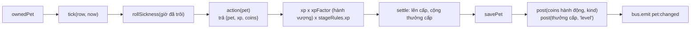

# Module service

> [!summary]
> `petdex/server/service.js` (81 dòng): ba hàm trung tâm mà mọi API dùng: `snapshot()` (toàn bộ trạng thái người chơi gửi về client), `ownedPet()` (kiểm quyền sở hữu bé) và `mutatePet()` (khuôn mẫu "tick, hành động, cộng XP, lên cấp, ghi sổ, lưu, báo công viên").

## Exports
| Tên | Dòng | Việc |
|---|---|---|
| `bus` | `service.js:13` | Re-export từ [[Module events]] |
| `snapshot(userId, now)` | `service.js:21-52` | `user` (gồm `dailyReadyAt` = 00:00 hôm sau nếu đã nhận quà hôm nay), `pets` (`describePet` + `skills`, `bonus`, `gear` đang đeo, `wearLimit`), `inventory`, `gear` (tủ đồ), `economy` (`priceIndex`, `baseRate`), `eggs`, `slots`, `memorials` (3 ngày), `fortune` (hành vượng hôm nay), `badges` (`jobs`: ca đã xong chưa nhận, `bank`: kỳ hạn đã đáo hạn) |
| `ownedPet(userId, petId)` | `service.js:54-58` | "Không tìm thấy thú cưng này." nếu không phải bé của mình |
| `mutatePet(userId, petId, action, { now, kind = 'play' })` | `service.js:65-81` | Xem dưới |

## Khuôn mẫu `mutatePet`

- Cả chuỗi nằm trong một `store.transaction` (`service.js:66-78`); `bus.emit` sau commit (dòng 79).
- Xu của hành động và xu thưởng lên cấp được ghi thành **hai dòng sổ cái** riêng (`kind` và `'level'`) (dòng 73-76).
- XP được làm tròn sau khi nhân hệ số (dòng 70-71).

## Bảng chạm tới
Trực tiếp: `shifts`, `deposits` (đếm huy hiệu, dòng 16-19); gián tiếp qua `db`, `ledger`, `gear`, `eggs`, `lifecycle`, `bank`.

## Ai gọi
`routes.js`, `internal.js`, `http.js` (`snapshot`), `jobs`, `care`, `farm`, `minigames`, `quests`, `social`, `playground`.

## Lưu ý
- `snapshot` đắt: mỗi bé `describePet` + `skillsOf` + `wornGear` + `wearLimitOf`; mỗi hành động trả về snapshot đầy đủ.
- `service.js` import `fortuneOf` từ `public/ta-tua/game/js/shared/pets.js`: luật dùng chung với trình duyệt.

## Liên quan
- [[Module game]] · [[Module http]] · [[Module elements]] · [[Cấp độ và XP]] · [[Chỉ số của bé]] · [[Hành vượng]]
