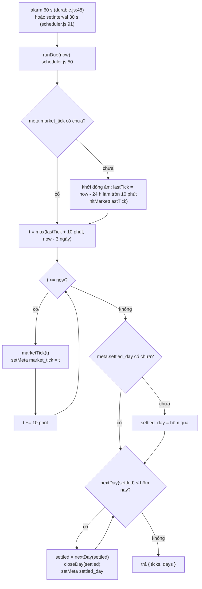

# Nhịp mỗi phút

> [!summary]
> Máy chủ không có tiến trình nền thật: Durable Object đặt **alarm mỗi 60 giây** (Node thì `setInterval` 30 giây), mỗi lần gọi `runDue(now)`. Hàm này chạy bù mọi **nhịp giá Sàn 10 phút** đã đến hạn và mọi **ngày chưa quyết toán**, dựa trên hai mốc lưu trong bảng `meta`. Vì lưu mốc, server tắt một thời gian rồi bật lại vẫn chạy bù đúng.

## Luồng `runDue`

| Hằng số | Giá trị | Nguồn |
|---|---|---|
| `TICK_MS` của alarm | 60.000 ms | `petdex/server/durable.js:19` |
| Chu kỳ Node | 30.000 ms | `petdex/server/scheduler.js:91` |
| `MARKET.tickMs` (nhịp giá) | 10 phút | `petdex/server/rules/market.js:21` |
| `MAX_CATCH_UP` nhịp giá | 3 ngày (tối đa 432 nhịp) | `petdex/server/scheduler.js:20`, `59` |
| Khởi động ấm | mở Sàn từ 24 giờ trước | `petdex/server/scheduler.js:52-57` |

## Một nhịp giá (`marketTick`)
`market.js:330-349`, trong một transaction:
1. Với từng mặt hàng (hàng thô trước, `RAW_FIRST`): có xác suất `newsPerDay * tickMs / DAY` sinh tin mới (`rollNews`), có hiệu lực sau 30 phút.
2. Nhân hệ số các tin đang có hiệu lực, cập nhật `drift` (chỉ hàng thô), tính giá trung bình `meanPrice` (gồm chỉ số giá của [[Ngân hàng Trung ương]]), bước giá Ornstein-Uhlenbeck `stepPrice`.
3. Ghi `commodity_state` và một điểm `commodity_prices`.
4. `matchRestingWithNpc(now)`: lệnh giới hạn đang chờ nào chạm giá NPC thì khớp (`market.js:312-325`).

Luật giá chi tiết: [[Sàn Nguyên Liệu]], [[Tin tức thị trường]], [[Module rules-market]].

## Lưu ý vận hành
- Nhịp giá bị bỏ nếu server tắt quá 3 ngày (chỉ chạy bù 3 ngày cuối), nhưng **ngày quyết toán không có giới hạn chạy bù**: vòng `while` ở `scheduler.js:73-78` sẽ đóng sổ từng ngày bị lỡ.
- `setMeta('market_tick')` và `setMeta('settled_day')` chạy sau mỗi nhịp/ngày, ngoài transaction của nhịp/ngày đó. Nếu `closeDay` ném lỗi giữa chừng, các bước đã commit của ngày đó không được hoàn tác, mốc `settled_day` chưa tiến, và lần sau sẽ chạy lại cả ngày. Xem cảnh báo ở [[Quyết toán nửa đêm]].
- Lỗi trong `runDue` chỉ được log (`durable.js:41-45`, `scheduler.js:84-88`); alarm vẫn được đặt lại.
- Test gọi trực tiếp `runDue(T0)` với thời điểm giả để điều khiển thời gian ([[Kiểm thử petdex]]).

## Liên quan
- [[Module scheduler]] · [[Module market]] · [[Durable Object PetdexPark]]
- [[Quyết toán nửa đêm]] · [[Đồng hồ và ngày giờ game]]
