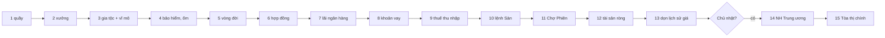

# Quyết toán nửa đêm

> [!summary]
> Mỗi khi qua 00:00 giờ Việt Nam, `runDue()` gọi `closeDay(day)` (`scheduler.js:28-47`) để đóng sổ ngày vừa qua theo một **thứ tự cố định** gồm 13 bước, cộng 2 bước nữa nếu ngày đó là Chủ nhật. Thứ tự quan trọng: doanh thu phải vào trước khi tính thuế, tiền thuê phải trừ trước khi ngân hàng trả lãi, và tài sản ròng chụp sau cùng.

## Thứ tự các bước

`end = startOfDay(nextDay(day))` = 00:00 ngày hôm sau (`scheduler.js:29`).

| # | Hàm | Dòng gọi | Việc làm | Bảng chính | Ghi chú luật |
|---|---|---|---|---|---|
| 1 | `settleBusinessDay(day, rand)` | `scheduler.js:30` | Mô phỏng bù mọi quầy tới nửa đêm, thu tiền thuê; nợ `BUSINESS.unpaidLimit` (3) đêm liền thì đóng quầy, trừ điểm tín dụng, đăng tin | `businesses`, `business_days`, `ledger` | `business.js:322-345`, [[Quầy trà sữa]] |
| 2 | `settleFactoryDay(day, rand)` | `scheduler.js:31` | Chạy bù xưởng, thu tiền thuê đất; nợ 3 đêm và không còn đơn gia công thì đóng | `factories`, `factory_days` | `factory.js:296-317`, [[Khu công nghiệp]] |
| 3 | `settleClansDay(day, rand)` | `scheduler.js:32` | Doanh thu lô đất, thuế doanh nghiệp trên phần khai báo, hồ sơ trốn thuế, phí duy trì; Chủ nhật phạt thiếu định mức góp quỹ; cuối tháng hoàn thuế; tạo vĩ mô ngày mai | `clans`, `clan_days`, `tax_evasion`, `clan_tax_refunds`, `macro_days` | `clans.js:627-691`, [[Clan]], [[Thuế doanh nghiệp]], [[Kinh tế vĩ mô]] |
| 4 | `settleCareDay(day, end, rand)` | `scheduler.js:33` | Thu phí bảo hiểm (thiếu xu thì hủy gói); bé sức khỏe dưới ngưỡng có thể đổ bệnh qua đêm | `insurance`, `pets` | `care.js:85-102`, [[Bảo hiểm sức khỏe]], [[Ốm và Phòng khám]] |
| 5 | `settleLifeDay(day)` | `scheduler.js:34` | Cập nhật `health_avg`; bé hết tuổi thọ (và không dở ca) thì về Đồi Sao | `pets`, `memorials`, `eggs`, `users.locked_slots` | `lifecycle.js:100-112`, [[Vòng đời và Đồi Sao]] |
| 6 | `settleContractsDay(day)` | `scheduler.js:35` | Giao hàng mọi hợp đồng đang chạy, hủy đề xuất quá 48 giờ | `contracts`, `lots`, `accounts` | `contracts.js:201-212`, [[Hợp đồng cung ứng]] |
| 7 | `settleBankDay(end)` | `scheduler.js:36` | Cộng lãi tiết kiệm phần nguyên, tự tất toán kỳ hạn đã đáo hạn | `bank_accounts`, `deposits` | `bank.js:135-147`, [[Ngân hàng Trân Châu]] |
| 8 | `settleLoansDay(day)` | `scheduler.js:37` | Trừ kỳ trả góp, phí trễ, vỡ nợ, thu nợ 30% thu nhập | `loans`, `credit_events` | `credit.js:192-228`, [[Tín dụng và vay]] |
| 9 | `settleTaxes(day, end)` | `scheduler.js:38` | Thuế thu nhập lũy tiến trên lương + lãi + phí gia công + lãi quầy + lãi giao dịch; thiếu thì ghi `tax_due` | `tax_days`, `users.tax_due` | `town.js:130-150`, [[Thuế thu nhập]] |
| 10 | `expireOrders(nextDay(day), end)` | `scheduler.js:39` | Lệnh giới hạn của ngày cũ hết hạn, hoàn ký quỹ/hàng | `orders`, `lots` | `market.js:305-309`, [[Sàn Nguyên Liệu]] |
| 11 | `expireListings(end)` | `scheduler.js:40` | Tin Chợ Phiên hết hạn trả hàng về người bán | `listings` | `bazaar.js:154-161`, [[Chợ Phiên]] |
| 12 | `snapshotNetWorth(day, end)` | `scheduler.js:41` | Chụp tài sản ròng của người có giao dịch trong 7 ngày | `networth` | `wallet.js:86-91`, [[Ví và tài sản ròng]] |
| 13 | `pruneHistory(end - 14 * DAY)` | `scheduler.js:42` | Xóa điểm giá Sàn cũ hơn 14 ngày | `commodity_prices` | `market.js:351` |
| 14 | `centralBankWeek(day, end)` (Chủ nhật) | `scheduler.js:44` | Ngân hàng Trung ương đo lượng xu bình quân, chỉnh chỉ số giá và lãi cơ bản, đăng tin | `central_bank`, `news` | `bank.js:150-166`, [[Ngân hàng Trung ương]] |
| 15 | `closeWeek(weekKey(day), end, rand)` (Chủ nhật) | `scheduler.js:45` | Đóng phiên bầu, chi ngân sách nếu đủ, áp hiệu ứng, mở phiên tuần sau | `proposals`, `town_effects`, `news` | `town.js:107-127`, [[Tòa thị chính]], [[Ngân sách thị trấn]] |

## Vì sao thứ tự này
- Quầy (1) và xưởng (2) phải mô phỏng xong để `business_days` có lợi nhuận và ledger có `toll_income` trước bước thuế (9), vì `settleTaxes` đọc `business_days` và các dòng ledger `salary`, `interest`, `toll_income` của ngày (`town.js:22-28`).
- Lãi ngân hàng (7) được ghi với `now = end` (00:00 ngày D+1, `bank.js:141`), trong khi `settleTaxes` chỉ cộng các dòng có `created_at < end` (`town.js:24`, `131-132`). Vì vậy lãi tiết kiệm của đêm nay **không** bị tính thuế cho ngày D mà rơi vào khoản chịu thuế của ngày D+1.
- Vay (8) trước thuế (9): kỳ trả góp được ưu tiên trừ ví trước, thuế lấy phần còn lại, thiếu thì thành nợ thuế.
- Tài sản ròng (12) chụp sau cùng để phản ánh mọi khoản đã trừ.

## Lưu ý và bẫy

> [!warning] Không phải một transaction duy nhất
> Mỗi hàm `settle*` tự mở transaction riêng; `closeDay` không bọc chung. `setMeta('settled_day')` chỉ chạy sau khi `closeDay` xong (`scheduler.js:75-76`). Nếu một bước ném lỗi, các bước trước đã commit, mốc ngày không tiến, lần `runDue` sau chạy lại **cả** ngày: quầy và xưởng an toàn (đã có `sim_at`), hợp đồng an toàn (`last_day`), hoàn thuế an toàn (`INSERT OR IGNORE`), nhưng tiền thuê, phí bảo hiểm, lãi ngân hàng có thể bị trừ/cộng lần nữa.

- Mốc thời gian bút toán không thống nhất: đa số dùng `end - 1` (thuộc ngày D), nhưng `settleBankDay(end)`, `settleTaxes(day, end)` và `snapshotNetWorth` ghi `now = end` (00:00 ngày D+1). Hệ quả: lãi tiết kiệm và thuế của ngày D xuất hiện trong báo cáo ví của ngày D+1 theo `dayKey`.
- Lần chạy đầu tiên của một DB mới đặt `settled_day` = hôm qua (`scheduler.js:68-71`), nên hôm qua không bao giờ được quyết toán.
- `settleClansDay` tự tạo bản ghi `macro_days` cho chính `day` nếu chưa có, rồi `rollNextDay` tạo trước ngày mai (`clans.js:633`, `689`).
- `settleLifeDay` và `settleCareDay` duyệt **mọi** bé (`allPets`), chi phí tuyến tính theo số thú.
- Có thể gọi tay `closeDay(day, rand)` trong test để quyết toán một ngày cụ thể.

## Liên quan
- [[Module scheduler]] · [[Nhịp mỗi phút]] · [[Đồng hồ và ngày giờ game]]
- [[Dòng xu trong game]] · [[Sổ cái]] · [[Lược đồ cơ sở dữ liệu]]
