# Router

> [!summary]
> Mã gốc dùng Express; bản trong repo thay bằng một router tự viết (`router.js`) cùng API với `express.Router` để chạy được cả trên Node lẫn Workers. Nó hiểu `get/post/use`, tham số `:id`, mẫu bắt tất cả `/{*rest}`, middleware với `next()`, router lồng nhau và error handler 4 tham số. Hiểu cách nó duyệt layer giúp tránh các bẫy về thứ tự route và middleware `auth`.

## Thành phần

| Hàm | Dòng | Việc |
|---|---|---|
| `compile(path, prefix)` | `router.js:7-23` | Đổi đường dẫn thành regex. Route (`get/post`) neo cuối `/?$`; `use` (prefix = true) chỉ cần khớp đầu `(?=/\|$)`. `/` hoặc rỗng khớp mọi thứ |
| `Router()` | `router.js:35-99` | Danh sách `layers`; `use(router)` tự lấy `router.handle` làm middleware |
| `handle(req, res, done)` | `router.js:53-96` | Duyệt layer theo thứ tự, gộp `req.params`, phân biệt handler thường và handler lỗi (`handler.length === 4`) |
| `buildRequest()` | `router.js:104-123` | Cắt `prefix`, dựng `req = { method, url, path, query, params, body, get(), ip }`; body tối đa 16 KB (`BODY_LIMIT`, dòng 101) |
| `buildResponse()` | `router.js:126-157` | `res.status/set/json/send/end`, gom thành `{ status, headers, body }` qua một Promise |
| `handleFetch(router, request, { prefix, ip })` | `router.js:160-172` | Cầu nối Fetch API: lỗi dựng request trả JSON ngay; chạy router; không ai trả lời thì 404 |

## Thuật toán duyệt layer

```mermaid
flowchart TD
  S["layer kế tiếp"] --> M{"method và regex khớp?"}
  M -- không --> S
  M -- có --> H[chạy từng handler của layer]
  H --> E{"đang có lỗi?"}
  E -- "có, handler 4 tham số" --> EH["handler(err, req, res, next)"]
  E -- "có, handler thường" --> SKIP[bỏ qua]
  E -- "không, handler thường" --> N["handler(req, res, next)"]
  N --> T{"ném lỗi?"}
  T -- có --> ERR["error = err, sang handler sau"]
  T -- không --> C{"gọi next hay đã trả lời?"}
  C -- "next()" --> H
  C -- "chưa trả lời, handler dưới 3 tham số" --> S
  C -- đã trả lời --> END[dừng]
```

- Handler không gọi `next()` và không trả lời nhưng khai báo dưới 3 tham số (ví dụ route kiểu `(req, res) => ...` ném lỗi bất đồng bộ hay router con không khớp) được coi như "đi tiếp" (`router.js:85-86`).
- Router con được gắn bằng `handle` (3 tham số) nên khi không khớp nó gọi `done()` = `next` của cha và cha đi tiếp (`router.js:95`).
- Lỗi không ai bắt thì `handle` ném ra ngoài (`router.js:91-94`); `handleFetch` không bắt, nên trên Node `index.js:104-108` trả 500.

## Bẫy đã biết

> [!warning] `auth` chạy nhiều lần mỗi request
> `economyApi`, `communityApi`, `productionApi` đều `use(auth)` ở đường dẫn gốc (`routes-economy.js:15`, `routes-community.js:17`, `routes-production.js:20`). Vì `api.use(economyApi)` khớp mọi đường dẫn (`routes.js:315-318`), một request tới `/clinic` sẽ chạy `auth` trong `economyApi`, rồi `communityApi`, rồi `productionApi` (3 lần `userForToken` + `touchSeen`). Hệ quả thứ hai: đường dẫn lạ không kèm token nhận **401** ("Phiên đăng nhập đã hết...") thay vì 404, vì `auth` của `economyApi` chặn trước catch-all ở `routes.js:320`.

- `routes.js:324` xử lý `err.type === 'entity.parse.failed'` nhưng với `handleFetch` lỗi JSON xảy ra trong `buildRequest` và được trả thẳng 400 với thông điệp gốc ("Chỉ nhận JSON." / "JSON không hợp lệ.") ở `router.js:165-167`, nên nhánh đó thực tế không chạy.
- Body chỉ được parse khi `content-type` chứa `application/json`; body rỗng thì `req.body` là `undefined` (mọi route đều dùng `req.body?.x`).
- `req.query` là object phẳng từ `URLSearchParams`; `req.params` được giải mã `decodeURIComponent` (`router.js:30`).

## Liên quan
- [[Module router]] · [[Module http]] · [[Module routes]]
- [[API người chơi]] · [[API nội bộ]] · [[Lỗi và thông báo lỗi]]
- [[Kiến trúc máy chủ]] · [[Kiểm thử petdex]] (`tests/petdex-router.test.ts`)
