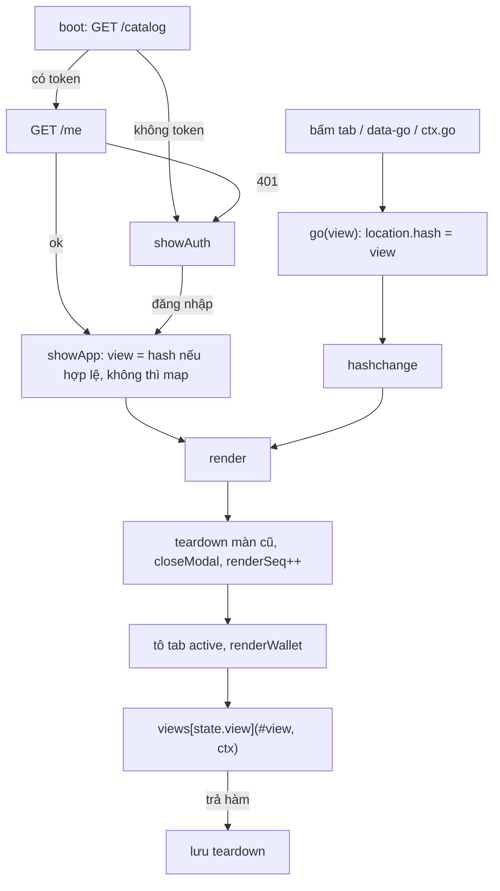

# App shell

> [!summary]
> Khung ứng dụng của game: `index.html` (64 dòng) chỉ có màn đăng nhập, thanh trên, `<main id="view">`, gốc hộp thoại và vùng toast; `app.js` (1254 dòng) giữ trạng thái `state`, định tuyến bằng `location.hash` giữa 24 màn, vẽ lại cả màn sau mỗi hành động, tự tải lại `/me` mỗi 30 giây, và cấp cho các màn trong `views/` một đối tượng `ctx`. `api.js` lo gọi HTTP kèm token, `ui.js` cung cấp toast, hộp thoại, nhãn và hàm định dạng. Không dùng framework hay bundler: ES module thuần.

## Cấu trúc `index.html`

| Phần tử | Vai trò | Nguồn |
|---|---|---|
| `<title>Petdex Park</title>`, favicon emoji 🧋, Google Fonts Baloo 2 + Nunito | | `public/ta-tua/game/index.html:6-10` |
| 8 stylesheet | `style`, `economy`, `community`, `townmap`, `games`, `production-a`, `production-b`, `clans` | `index.html:11-18` |
| `#auth-screen` | [[Màn Đăng nhập]] | `index.html:21-37` |
| `#app` > `header.topbar` | logo, `nav#tabs`, cụm ví (xem [[Thanh điều hướng và menu tài khoản]]) | `index.html:39-55` |
| `main#view.view` | nơi mọi màn vẽ vào (rộng tối đa 1180 px) | `index.html:56`, `css/style.css:136` |
| `#modal-root`, `#toasts` | hộp thoại, thông báo (`aria-live="polite"`) | `index.html:59-60` |
| `<script type="module" src="js/app.js">` | điểm vào duy nhất | `index.html:62` |

## Trạng thái

| Trường | Ý nghĩa | Nguồn |
|---|---|---|
| `state.catalog` | `GET /catalog`: items, species, rules, stages, careers, commodities, skills, unlocks, gear, kinds, ... | `public/ta-tua/game/js/app.js:62-70` |
| `state.me` | `GET /me` hoặc phần còn lại của mọi phản hồi hành động: user, pets, inventory, economy, badges, gear, eggs, slots, memorials, fortune | |
| `state.view` | màn đang xem | |
| `state.petId` | bé đang xem ở Nhà/Túi đồ | |
| `state.shopFilter`, `adopting`, `adoptSpecies`, `adoptElement`, `ranksBy` | trạng thái phụ của Siêu thị, Nhận nuôi, Bảng vàng | |
| Biến module | `teardown` (hàm dọn màn hiện tại), `homeStage` (sân khấu hiệu ứng ở Nhà), `renderSeq` (chống race), `busy` (khóa hành động chồng) | `app.js:79-83` |

Các màn trong `views/` giữ thêm trạng thái của riêng mình ở biến module (bộ lọc, nháp form) để không mất khi vẽ lại.

## Định tuyến

`VIEW_NAMES` (24): `map`, `home`, `shop`, `bag`, `park`, `ranks`, `jobs`, `games`, `bank`, `market`, `wallet`, `news`, `business`, `townhall`, `community`, `garden`, `kitchen`, `school`, `clinic`, `factory`, `contracts`, `bazaar`, `credit`, `clans` (`app.js:72-75`). Hash lạ bị bỏ qua. Cùng hash thì `go()` gọi `render()` trực tiếp (`app.js:201-233`). Bảng ánh xạ hash → màn: [[Kiến trúc giao diện game]].

## Hành động và làm mới

| Cơ chế | Chi tiết | Nguồn |
|---|---|---|
| `act(path, body, {fx, onDone, onResult})` | bỏ qua nếu đang `busy`; `POST`; tách `result` khỏi `me`; vẽ lại (trừ Công viên: chỉ ví); toast `result.message`; `onResult`; hiệu ứng ở Nhà; chúc mừng lên cấp; lỗi 401 thì đăng xuất, lỗi khác thì toast đỏ | `app.js:300-322` |
| `refreshMe()` | mỗi 30 giây khi tab hiện; chỉ vẽ lại Nhà/Túi đồ/Siêu thị khi không mở hộp thoại, không có form nhận nuôi, không gõ ô nhập; các màn khác chỉ cập nhật ví | `app.js:281-294` |
| Poll riêng từng màn | Sàn, Khu công nghiệp, Hợp đồng, Chợ Phiên (tab Mua): 60 giây; Vườn: 60 giây và khi cây chín; đồng hồ 1 giây ở Việc làm, Quầy, Vườn, Bếp, Trường, Hợp đồng, Tín dụng | các note `Màn …` |
| Trình xử lý chung | một listener `click` trên `#view` xử lý `data-act`, `data-pet`, `data-go` (+ `data-filter`, `data-ranks-go`), `data-incubate`, `data-adopt-el`, `data-ranks`, `data-buy`, `data-open-gear`, `data-species`, `data-use`, `data-toy`, `data-equip-gear`, `data-unequip-slot`; một listener `submit` cho form nở trứng và nhận nuôi | `app.js:1183-1252` |

Vì listener `data-go` nằm trên `#view`, mọi nút `data-go` trong các màn con (kể cả nút "← Về phố" của `viewHead`) đều chạy qua `app.js`.

## Đối tượng `ctx` cho các màn

| Thành viên | Việc | Nguồn |
|---|---|---|
| `catalog`, `me` | getter tới `state` | `app.js:236-242` |
| `act(path, body, opts)` | như trên | `app.js:243` |
| `go(view)` | chuyển màn | `app.js:244` |
| `refresh()` | vẽ lại màn hiện tại | `app.js:245` |
| `refreshMe()` | tải lại `/me` rồi vẽ ví (không vẽ màn) | `app.js:246-249` |
| `applyResult(res)` | cập nhật `me` từ phản hồi có `result` mà không vẽ lại (dùng khi đang có lớp phủ mini-game) | `app.js:251-256` |
| `fail(err)` | 401 thì đăng xuất, còn lại toast lỗi "Có lỗi xảy ra." mặc định | `app.js:257-260` |
| `toast`, `bestLevel()`, `activePet()` | tiện ích | `app.js:261-263` |

## `api.js`

| Xuất | Chi tiết | Nguồn |
|---|---|---|
| `BASE` | `location.pathname` bỏ phần `/game/...` (WorkHub: `/ta-tua`); API ở `BASE/api`, công viên ở `BASE/ws` | `public/ta-tua/game/js/api.js:3-4` |
| `wsUrl`, `embedded` | xem [[Socket phía trình duyệt]], [[Khung nhúng WorkHub]] | `api.js:5-18` |
| `session.token` | đọc/ghi `localStorage['petdex.token']`, bọc `try` khi trình duyệt chặn lưu trữ | `api.js:1`, `api.js:20-43` |
| `api(path, body)` | có `body` thì `POST` JSON, không thì `GET`; gắn `Authorization: Bearer`; lỗi HTTP ném `Error(data.error ?? 'Không kết nối được máy chủ.')` kèm `status` | `api.js:45-58` |

## `ui.js`

| Xuất | Chi tiết | Nguồn |
|---|---|---|
| `$`, `esc` | chọn phần tử; thoát HTML 5 ký tự | `public/ta-tua/game/js/ui.js:1-4` |
| `STAT_LABELS`, `STAT_ICONS` | No bụng 🍙, Vui vẻ 💖, Năng lượng ⚡, Sạch sẽ 🫧, Sức khỏe ❤️ | `ui.js:6-7` |
| `TYPE_LABELS` | Đồ ăn, Chăm sóc, Đồ chơi, Phụ kiện, Trứng, Món nấu | `ui.js:8` |
| `MOOD_ICONS` | great 🥰, ok 🙂, hungry 😋, tired 😴, sad 🥺, sick 🤒, dirty 🫧 | `ui.js:9` |
| `effectText(item)` | chuỗi hiệu quả món | `ui.js:11-20` |
| `toast(message, kind)` | `info`/`error`/`level`; tự ẩn sau 3,2 giây (lỗi 4,2 giây) | `ui.js:22-31` |
| `openModal({title, html, onPick})`, `closeModal`, `modalOpen` | mỗi lúc một hộp; đóng bằng nền, nút ✕, phím Esc; `onPick(data-pick)` | `ui.js:33-64` |
| `BUSY`, `busyOf(pet)` | work 💼 "đang đi làm" (vắng nhà), school 📚 "đang đi học" (vắng nhà), bath 🛁 "đang tắm" (ở nhà) | `ui.js:66-72` |
| `fmt`, `fmtLots` (phần → lô, 1 lô = 10 phần), `fmtPrice`, `pct`, `clock` | định dạng vi-VN | `ui.js:74-80` |
| `countdown(ms)` | "xong", "n ngày Hg", "Hg MMp", "Mp SSs", "Ns" | `ui.js:82-90` |
| `ago(ts)`, `ageText(days)` | "vừa xong / n phút / giờ / ngày trước"; "n tuần m ngày tuổi" | `ui.js:92-106` |
| `viewHead(title, subtitle, extra)` | đầu màn chung có nút "← Về phố" (`data-go="map"`) | `ui.js:108-116` |
| `formatWait(ms)` | "3g05" hoặc "45p" (chip Quà ngày) | `ui.js:118-122` |

## Liên quan
- [[Kiến trúc giao diện game]], [[Thanh điều hướng và menu tài khoản]], [[Màn Đăng nhập]], [[Socket phía trình duyệt]], [[Khung nhúng WorkHub]], [[Phong cách và CSS]]
- [[API người chơi]], [[Lỗi và thông báo lỗi]], [[Phiên chơi và token]]
