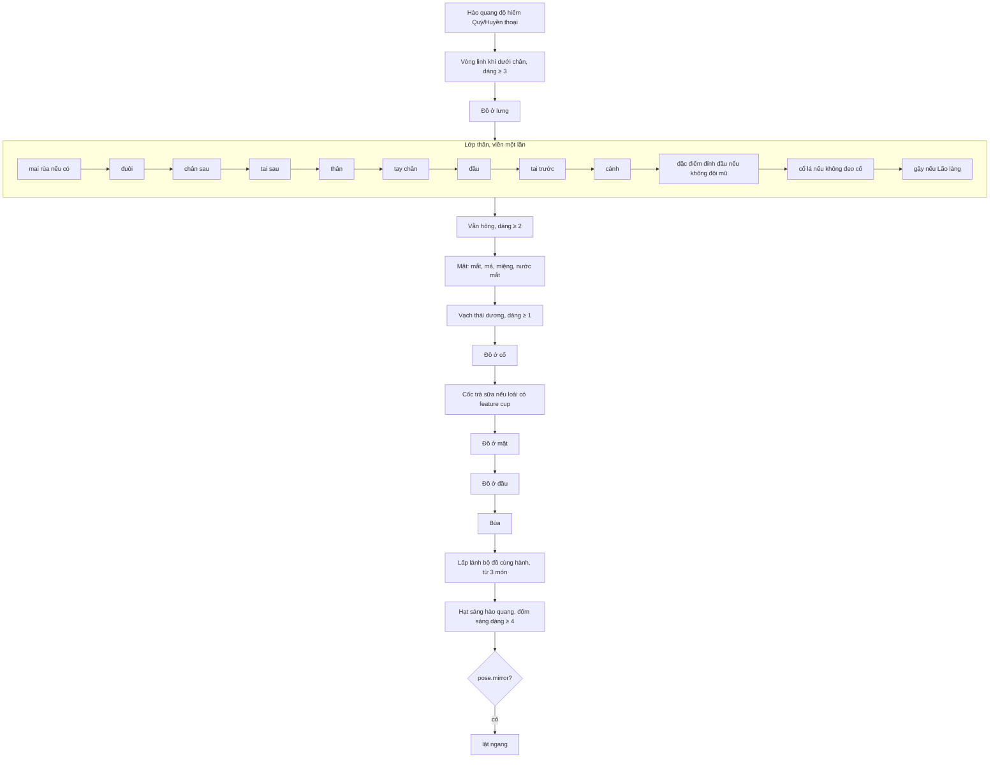

# Bộ khung thú

> [!summary]
> `rig.js` (1047 dòng) là bộ vẽ pet ngũ hành theo kiểu "rig": mọi loài lắp từ cùng một bộ phận (thân, đầu, tai, đuôi, tay chân, cánh, mặt) trên một bộ xương có 5 điểm neo đồ đeo (đầu, mặt, cổ, lưng, bùa). Mỗi khung hình tính lại bộ xương theo dáng (nhún, nhảy, cúi đầu), nên đồ đeo luôn dính đúng chỗ. Kết quả là canvas 46×52 pixel nghệ thuật cho mỗi khung, được [[Sprite và bảng hình]] ghép thành spritesheet. Bộ khung còn vẽ các nét theo giai đoạn tuổi, theo dáng cấp (cứ 10 cấp một bậc), hào quang độ hiếm và lấp lánh bộ đồ.

## Kích thước và bộ xương

| Hằng | Giá trị | Nguồn |
|---|---|---|
| Khung | `RIG_W = 44`, `RIG_H = 50`, tâm `CX = 22`, mặt đất `GROUND = 46`; canvas ra `(44+2) × (50+2)` vì viền 1 px | `public/ta-tua/game/js/rig.js:6-9` |
| Kiểu thân `ARCH` | `biped` (tay), `quad` (chân trước), `round` (đầu thân một khối, núm tay), `bird` (cánh), `serpent` (tay) với kích thước thân/đầu/chân gốc | `rig.js:43-49` |
| `skeleton(sp, stage, pose)` | tính `body`, `head` (đầu cúi thêm 1 px nếu là Lão làng), mắt, và `anchors` | `rig.js:55-99` |

### 5 điểm neo

| Khe | Điểm neo | Ghi chú |
|---|---|---|
| `head` | `(head.x, head.top)` | đồ đầu có `sink` (lún xuống) và `side` (lệch theo bề ngang đầu) |
| `face` | `(head.x, eyeY)` | kính, mặt nạ |
| `neck` | dưới cằm, lệch nửa `hx` | để khăn, vòng không đè mặt |
| `back` | vai `(body.x, body.y − body.ry + 1)` | áo choàng buông, cánh xòe từ đây |
| `charm` | bên hông phải, ngoài cả đầu lẫn thân + 3 px | bùa đung đưa 1 px theo nhịp `tick % 4` |

Nguồn `rig.js:86-97`, `rig.js:858-876` (`wearSpotAt`), `rig.js:1018`. Khe và tên hiển thị: Đầu, Mặt, Cổ, Lưng, Bùa (`public/ta-tua/game/js/shared/pets.js:359-365`). Luật số món đeo được ở [[Trang phục]].

## Thứ tự vẽ một khung (`drawFrame`)

Nguồn: `rig.js:965-1039`. Tùy chọn `anchors: true` chấm 5 điểm neo màu (đầu `#ff3b6b`, mặt `#3bb3ff`, cổ `#ffb800`, lưng `#7a5cff`, bùa `#3bd18a`) để soi trong [[Xưởng tạo hình Pet Lab]] (`rig.js:1024-1030`).

## Dáng theo cấp (level forms)

`LEVEL_FORMS` ở mã dùng chung, đổi mỗi 10 cấp; `formStage` nhân hệ số `grow` vào `look.scale` của giai đoạn tuổi (`rig.js:880-885`).

| Bậc | Từ cấp | Tên | `grow` | Nét vẽ thêm trong `rig.js` |
|---|---|---|---|---|
| 0 | 1 | Mầm non | 1 | không |
| 1 | 10 | Chớm lớn | 1,03 | 2 vạch ở thái dương ngoài đuôi mắt (`drawTempleMarks`) |
| 2 | 20 | Cứng cáp | 1,06 | + vằn hai bên hông (`drawFlankStripes`) |
| 3 | 30 | Tinh anh | 1,09 | + vòng linh khí màu hành dưới chân, lấp lánh (`drawSpiritRing`) |
| 4 | 40 | Linh khí | 1,12 | + 2 đốm sáng màu nhấn bay quanh người (`drawMotes`) |
| 5 | 50 | Thần thái | 1,15 | vạch hóa vàng `#e0a21c`, vòng ánh vàng `#ffd75e`, 4 đốm vàng |

Nguồn: `public/ta-tua/game/js/shared/pets.js:382-392`, `rig.js:887-933`, `rig.js:1001-1023`. Màu vạch = màu nhấn hành trộn 25% viền (`markColor`). Huy hiệu dáng trên [[Màn Nhà]] lấy cùng bảng này. Luật: [[Dáng theo cấp]].

## Giai đoạn tuổi

Bộ xương dùng `stage.look` (`scale`, `head`, `body`, `leg`, `eye`, `elder`) của 6 giai đoạn: Sơ sinh 0,62, Nhí nhố 0,74, Thiếu niên 0,86, Thanh niên 0,95, Trưởng thành 1, Lão làng 0,97 (còng, có gậy) (`shared/pets.js:78-115`). Bé đầu to mắt to khi nhỏ, thân dày khi trưởng thành. Luật tuổi: [[Giai đoạn tuổi]].

## Độ hiếm và đặc điểm loài

| Thứ | Chi tiết | Nguồn |
|---|---|---|
| Hào quang `AURAS` | Quý: tím nhạt, 3 hạt; Huyền thoại: vàng kim, đậm hơn, 5 hạt; vầng sáng dither "thở" theo khung, đốm dưới chân | `rig.js:490-559` |
| Tai `EARS` | `cat`, `fox`, `bunny`, `round`, `mouse` | `rig.js:120-162` |
| Đỉnh đầu | `tuft`, `horns`, `antler` (giấu khi đội mũ) | `rig.js:350-379` |
| Cổ lá | `leafcollar` (ẩn khi đeo đồ cổ) | `rig.js:381-386` |
| Bong bóng | `bubble`: bọt nhỏ bay lên cạnh đầu | `rig.js:1004-1013` |
| Cốc trà sữa | `cup` (nét riêng của [[Linh vật Boba]]): cốc to/nhỏ theo cỡ thân, ống hút hồng nối miệng, tay không giơ thì ôm cốc; vẽ sau đồ cổ nên khăn nằm sau cốc | `rig.js:456-488` |
| Lấp lánh bộ đồ | `fullSetOf(wear)`: từ 3 món cùng hành thì vài ngôi sao màu hành nhấp nháy | `rig.js:439-454`, `shared/pets.js:318-329` |

## Đồ đeo (`WEAR_ART`)

55 món có hình (đếm theo trường `pivot`), mỗi món là bản đồ ký tự + bảng màu + màu viền + `pivot` (điểm dính vào neo) và tùy chọn `sink`, `side`, `dx` (`rig.js:573-847`). Ví dụ: `crown`, `tophat`, `beret`, `nonla`, `leafband`, `bow`, `flower`, `glasses`, `shades`, `scarf`, `leafscarf`, `bell`, `pearls`, `bowtie`, `cape`, `angel`, `dragonwings`, `halo`, `strawhat`, `devilhorns`, `monocle`, `partymask`, `medal`, `jade`, `lei`, `backpack`, `batwings`, `phoenix`, `fairy`, `lantern`, `clover`, `luckycoin`, `seashell`, `gourd`, `balloon`, `goggles`, `khandong`, `aotoi`, `lotus`, `goldmask`, `quat`, `trongdong`, `starcape`. Hàm xuất:

| Hàm | Việc | Nguồn |
|---|---|---|
| `wearImage(id)` | canvas đã viền của món (lưu đệm), dùng cả cho [[Hình vật phẩm]] | `rig.js:849-856` |
| `wearSpotAt(id, anchors, headRx)` | góc trên trái để đặt món; dùng chung cho bé bộ khung và bé khách mời Petdex | `rig.js:858-874` |

## Hoạt ảnh `RIG_ANIMS`

| Tên | fps | Số khung | Dáng chính |
|---|---|---|---|
| idle | 5 | 6 | đuôi đung đưa, nhún, chớp mắt |
| wave | 6 | 4 | giơ tay phải, há miệng |
| jump | 9 | 6 | bẹp, bật lên 6 px, giơ hai tay |
| sad | 3 | 4 | cúi đầu, cụp tai, nước mắt |
| run | 10 | 6 | bước chân, nhìn hướng chạy |
| think | 3 | 6 | đảo mắt trái phải |
| busy | 6 | 4 | hai tay luân phiên |
| spin | 8 | 4 | lật ngang (`mirror`) |

Nguồn `rig.js:937-958`. `animFrames(species, stage, anim, wear, opts)` trả sẵn mọi khung của một hoạt ảnh (`rig.js:1041-1045`).

## Liên quan
- [[Sprite và bảng hình]], [[Vẽ pixel]], [[Xưởng tạo hình Pet Lab]], [[Hình vật phẩm]]
- [[Trang phục]], [[Dáng theo cấp]], [[Giai đoạn tuổi]], [[Loài và độ hiếm]], [[Bộ đồ ngũ hành]], [[Thiết kế pet ngũ hành]]
