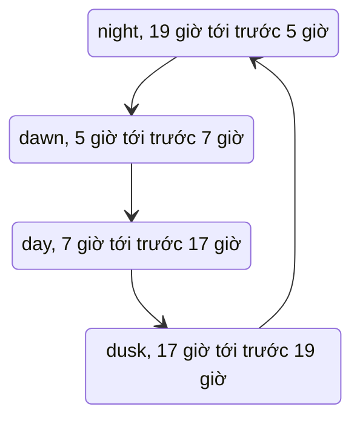

# Cảnh nhà và thời gian trong ngày

> [!summary]
> `scenes.js` (806 dòng) vẽ hai cảnh nền pixel art: căn phòng ở [[Màn Nhà]] (`mountRoomScene`) và nền công viên ở [[Màn Công viên]] (`mountParkScene`). Mỗi cảnh có 3 lớp canvas: lớp tĩnh vẽ một lần, lớp chuyển động (mây, bụi nắng, kim đồng hồ, bướm, cánh hoa) và lớp ánh sáng ban đêm. Tông màu đổi theo **giờ trên máy người chơi** qua 4 buổi: bình minh, ban ngày, hoàng hôn, ban đêm; tham số `?time=` ép một buổi để kiểm tra.

## Thời gian trong ngày

`timeOfDay(now)` đọc `new URLSearchParams(location.search).get('time')`; nếu là `dawn`, `day`, `dusk` hoặc `night` thì trả luôn giá trị đó, không thì tính theo `now.getHours()` (giờ địa phương của trình duyệt, không phải giờ VN của máy chủ) (`public/ta-tua/game/js/scenes.js:5-12`). Mỗi cảnh kiểm lại mỗi 60 giây và dựng lại khi buổi đổi (`scenes.js:552`, `scenes.js:798`).

> [!tip] Xem thử ban đêm
> Mở thẳng trang game với `?time=night` (ví dụ `/ta-tua/game/?time=night#home`). Khi game nằm trong khung của WorkHub thì tham số phải nằm trên URL của khung (`location.search` của iframe), không phải trang ngoài.

| Buổi | Bầu trời (3 màu dọc) | Phủ cảnh `TINTS` (multiply) | Phủ phòng `ROOM_TINTS` | Mây |
|---|---|---|---|---|
| dawn | `#a9bde6` `#f2c4c8` `#ffe4c8` | `#fff0e4` | `#fff4ea` | `#fff4ee` / `#f3cbd2` |
| day | `#74c2ea` `#9bd6f1` `#cbeef8` | không | không | `#ffffff` / `#d8eaf6` |
| dusk | `#5a4a98` `#c9739a` `#ffb88a` | `#ffcdb8` | `#ffe0cc` | `#ffd7c8` / `#e3a1b0` |
| night | `#0f1433` `#1b2350` `#2c3770` | `#6670b8` | `#bfa2a8` | `#4d5688` / `#3a4274` |

Nguồn `scenes.js:14-28`. `tinted(src, color)` phủ multiply nhưng giữ chỗ trong suốt để bầu trời không bị phủ (`scenes.js:262-273`).

## Căn phòng (`mountRoomScene`)

| Mục | Chi tiết | Nguồn |
|---|---|---|
| Độ thô | `ROOM_PX = 4` (mỗi pixel cảnh = 4 px màn hình); kích thước canvas = khung chứa / 4 | `scenes.js:563`, `scenes.js:733-735` |
| Bố cục `roomLayout(W, H)` | sàn ở 68% chiều cao; cửa sổ bên phải (hẹp hơn khi `W < 110`), kệ sách trái, tranh (bỏ khi hẹp), đồng hồ ở giữa, đèn cây trái, chậu cây phải, thảm tròn giữa sàn | `scenes.js:565-579` |
| Lớp tĩnh | giấy dán tường sọc chấm hoa, ốp gỗ chân tường, sàn gỗ, vệt nắng, cửa sổ khung trắng (kính trống cho trời), rèm hồng, kệ sách và lọ trân châu, tranh, mặt đồng hồ, thảm; trời và mặt trời/trăng vẽ trong ô cửa | `scenes.js:581-712`, `scenes.js:741-744` |
| Lớp chuyển động (10 fps) | 2 đám mây trôi trong ô cửa; sao nhấp nháy ngoài cửa ban đêm; song cửa; 12 hạt bụi trong vệt nắng (ngày, bình minh); **kim đồng hồ theo giờ thật** (kim phút nâu, kim giờ hồng) | `scenes.js:749-783` |
| Lớp sáng | hoàng hôn và đêm: quầng đèn cây 3 vòng vàng cam, nhấp nháy nhẹ | `scenes.js:785-791` |
| Đặt bé | `onLayout({x, y})` trả tâm tấm thảm (px), [[Màn Nhà]] đặt `#figure-slot` vào đó | `scenes.js:746`, `public/ta-tua/game/js/app.js:567-573` |
| Đổi cỡ | `ResizeObserver` dựng lại toàn cảnh | `scenes.js:796-797` |
| Thuộc tính | `container.dataset.time = time` (CSS có thể dựa vào `[data-time]`) | `scenes.js:737` |

## Nền công viên (`mountParkScene`)

| Mục | Chi tiết | Nguồn |
|---|---|---|
| Độ thô | `PARK_PX = 3`, canvas 334×200, chân trời ở y = 70; gắn vào `world` 1000×600 | `scenes.js:302-305`, `scenes.js:435-436` |
| Bố cục `PARK` | đài phun nước (167,104), hồ (46,95), quảng trường elip, 2 cột đèn, 2 ghế đá, cây anh đào (72,86) | `scenes.js:307-314` |
| Lớp tĩnh | đồi xa hai lớp, bãi cỏ có vân, cây tròn, thông, bụi có quả, đài phun nước, ghế, đèn, hàng rào, hoa | `scenes.js:316-433` |
| Lớp chuyển động (12 fps) | mây, sao đêm, bướm 2 khung (`BUTTERFLY_FRAMES`), cánh hoa anh đào bay, nước | `scenes.js:224-228`, `scenes.js:450-532` |
| Lớp sáng | hoàng hôn và đêm: quầng 2 cột đèn, 16 đom đóm | `scenes.js:534-547` |

Hình dựng sẵn dùng chung: `roundTree`, `pineTree`, `bush`, `cloud`, `fountain`, `bench`, `lampPost(lit)`, `fenceSegment`, `cactusPot`, `floorLamp(lit)`, `pottedPlant` (`scenes.js:35-222`). Tiện ích: `makeLayer` (canvas lớp `px-layer` phóng `px` lần), `resizeLayer`, `animate(fps, draw)` (rAF có giới hạn khung) (`scenes.js:232-260`).

## Liên quan
- [[Màn Nhà]], [[Màn Công viên]], [[Vẽ công viên]], [[Vẽ pixel]], [[Vẽ bản đồ phố]] (cũng có ngày đêm)
- [[Kiến trúc giao diện game]]
