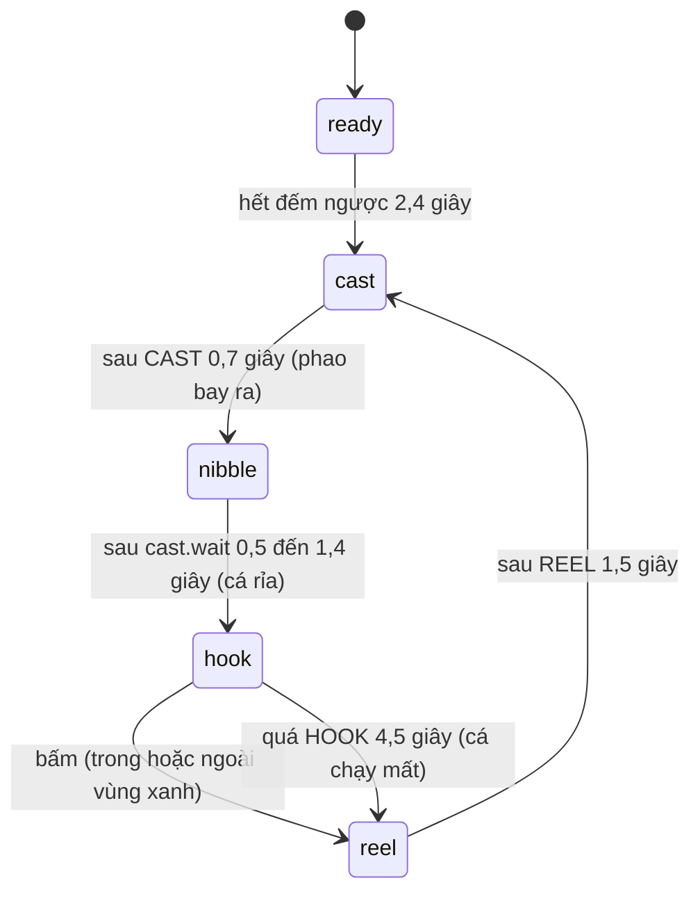

# Giao diện mini-game

> [!summary]
> Ba trò chơi trình duyệt trong `js/games/`: [[Câu cá]] (`fishing.js`), [[Hứng trân châu]] (`pearls.js`), [[Ghép hình nhớ]] (`memory.js`). Mỗi file xuất đúng một hàm `mount(container, { seed, duration, onFinish })` trả về hàm dọn. Cả ba vẽ pixel art trên canvas 240×150 phóng to không làm mờ, dùng chung `pixel.js` và `fx.js`, và sinh mọi thứ ngẫu nhiên từ hạt giống phiên chơi bằng `shared/minigames.js` để máy chủ dựng lại đúng ván đó mà chấm điểm.

## Hợp đồng chung

| Mục | Giá trị | Nguồn |
|---|---|---|
| Hàm | `mount(container, { seed, duration, onFinish }) → cleanup` | `public/ta-tua/game/js/games/fishing.js:164`, `pearls.js:124`, `memory.js:122` |
| Canvas | `W = 240`, `H = 150`, `imageSmoothingEnabled = false`; phóng theo `stage.clientWidth / W` | `fishing.js:6-7`, `fishing.js:187` |
| Đếm ngược | `COUNTDOWN = 2.4` giây, hiện "Sẵn sàng 3-2-1" kèm hướng dẫn | `fishing.js:8`, `pearls.js:8`, `memory.js:8` |
| HUD | viên `⏱` thời gian còn lại, viên điểm, nút "Kết thúc" | `fishing.js:172-176` |
| Kết thúc | "Hết giờ!" (hẹn giờ `duration × 1000 + 50` ms), "Đã kết thúc" (nút), "Hoàn thành!" (Ghép hình) ; thêm lớp `is-over` và băng rôn | `fishing.js:406-418` |
| `onFinish` | gọi đúng một lần với kết quả thô, máy chủ tính điểm và thưởng | xem bảng dưới |
| Hạt giống | `rng(seed)` (mulberry32) dùng chung client/server | `public/ta-tua/game/js/shared/minigames.js:13-22` |
| Hiệu ứng | `burst`, `floatText` vẽ vào lớp `.mg-fx` | [[Hiệu ứng hạt]] |

## Từng trò

| Trò | Điều khiển | Kết quả gửi lên | Đặc điểm giao diện |
|---|---|---|---|
| 🎣 Câu cá (40 giây) | chuột, chạm, Space hoặc Enter (bỏ qua khi đang gõ trong ô nhập) | `{ caught: [true/false, …] }` mỗi lần giật cần | phao chạy qua lại trên thanh, vùng xanh rộng theo loài cá; bấm sớm hiện "Chờ cá cắn câu…"; hụt "Hụt rồi!", quá giờ "Cá chạy mất!"; câu được thì thẻ cá bật lên "+n phần cá" hoặc "Cá hiếm! +n xu" (Cá vàng, Cá mặt trăng) kèm lóe sáng |
| 🧋 Hứng trân châu (30 giây) | di chuột, kéo ngón tay, phím ←/→ hoặc A/D (tốc độ phím 200 px/giây) | `{ caught: [chỉ số vật đã hứng] }` | quầy trà sữa vẽ pixel, cốc có độ nảy (`squash`) và lạnh (`chill`); trân châu +1, trân châu vàng +5, đá lạnh −3 |
| 🧩 Ghép hình nhớ (60 giây) | chạm thẻ; phím mũi tên chọn, Enter/Space lật | `{ moves, pairs }` | lưới 4 cột thẻ 30×33, 8 cặp hình pixel (boba, cá, tim, sao, dâu, bánh…); sai thì thẻ rung; đúng "Đúng rồi!", đủ 8 cặp "Tuyệt vời!" rồi "Hoàn thành!" |

Nguồn: `fishing.js:1`, `fishing.js:262-269`, `fishing.js:422-432`; `pearls.js:1`, `pearls.js:9-13`, `pearls.js:136`, `pearls.js:166-168`; `memory.js:1`, `memory.js:9-16`, `memory.js:134`, `memory.js:196-216`, `memory.js:294`. Bảng cá (tỷ lệ, độ rộng vùng xanh, tốc độ) ở `minigames.js:27-33`; điểm vật rơi ở `minigames.js:49-53`.

### Các pha của Câu cá

Nguồn: `fishing.js:9-12`, `fishing.js:210-215`, `fishing.js:285-298`. `MIN_GAP = 1.25` giây giữa hai lần giật vì máy chủ chặn quá một lần quăng mỗi 1,2 giây (`fishing.js:9`, `MIN_CAST_SECONDS = 1.2` ở `minigames.js:35`). Vị trí vùng xanh của lần quăng thứ i lấy từ `rng(seed + i)` nên máy chủ biết được; còn chỗ phao rơi chỉ để trang trí (`Math.random`).

### Chống gian lận ở client Ghép hình nhớ

Ghép đủ 8 cặp quá nhanh thì client chờ cho tới mốc `MIN_DONE = 8.5` giây mới gửi kết quả, vì máy chủ từ chối ván hoàn thành dưới 8 giây (`memory.js:16`, `memory.js:216`).

## Hình vẽ

Cá được vẽ bằng thuật toán (`fishArt`: elip thân, đuôi quạt chẻ đôi, vảy, bóng `shadeBlob`, viền `outline`) rồi lưu `toDataURL` để dùng cả trong canvas lẫn thẻ `` (`fishing.js:22-76`). Hồ câu (`drawPond`) gồm trời chuyển màu, mặt trời, mây, đồi, nước có lăn tăn, lá sen có hoa, cầu gỗ và xô (`fishing.js:88-150`). Các hàm vẽ: [[Vẽ pixel]].

## Liên quan
- [[Màn Khu vui chơi]], [[Mini-game]], [[Câu cá]], [[Hứng trân châu]], [[Ghép hình nhớ]]
- [[Vẽ pixel]], [[Hiệu ứng hạt]], [[Module minigames]]
