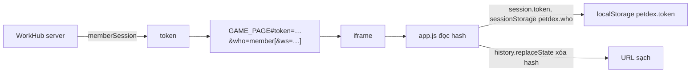

# Khung nhúng WorkHub

> [!summary]
> Game là một trang HTML tĩnh độc lập (`public/ta-tua/game/`) luôn được mở trong một `<iframe>` do WorkHub (Next.js) dựng. Có hai trang bọc: mục **Pet Town** trong WorkHub (`/ta-tua`, nhân viên đã đăng nhập) và trang chơi toàn màn hình **play.petfarm.online/server1** (nhân viên, khách mời, người chơi tên + mật khẩu). Cả hai truyền phiên chơi vào khung qua `#token=…&who=…`, nhắc đặt mật khẩu bằng thanh `CredentialsNotice`, và trang đăng nhập dùng nền đồng cỏ có các bé của game chạy nhảy (`meadow.tsx`). Ghi chú này nhìn từ phía giao diện; luồng đăng nhập, tên miền, middleware thuộc [[Trang chơi server1]], [[Đăng nhập một lần WorkHub]], [[Phiên chơi và token]].

## Hai trang bọc

| | Pet Town trong WorkHub | Trang chơi server1 |
|---|---|---|
| Đường dẫn | `/ta-tua` (trong layout `(app)` của WorkHub) | `/server1` trên `play.petfarm.online` (`PLAY_PATH`) |
| Ai vào | nhân viên đang đăng nhập WorkHub | nhân viên WorkHub đăng nhập trên trang này, phiên khách đã lưu trong trình duyệt, hoặc tài khoản tên + mật khẩu |
| Tạo phiên | máy chủ gọi `memberSession(me)` rồi `gameFrameUrl(token)` | máy chủ gọi `memberSession(me)` nếu có thành viên (bỏ qua khi `mustChangePassword`); không thì client đọc `localStorage['tatua.guest']` và gọi `POST /api/ta-tua/guest {resume}` |
| Đầu trang | `PageHeader` "Pet Town" · "Nuôi bé, đi làm, buôn bán và gặp đồng nghiệp ở công viên Phố Trân Châu."; nút "Quản lý" (chỉ quản trị viên, tới `/ta-tua/quan-ly`), "Tải lại" (đổi `key` của iframe), "Mở tab riêng" (`window.open('/server1')`) | thanh 48 px: biểu tượng tay cầm, "Pet Town", "{tên} · tài khoản WorkHub" / "Khách mời · {tên}" / "{tên}"; nút "Đăng xuất" hoặc "Đổi tên khác" (khách mời chưa có mật khẩu) |
| Khung | cao `calc(100dvh − 11.5rem)`, tối thiểu 560 px, bo góc | chiếm toàn bộ phần còn lại `h-dvh` |
| Lỗi | `EmptyState` "Chưa vào chơi được" + thông báo `GameError` hoặc "Máy chủ game gặp sự cố, thử lại sau." | nền đồng cỏ với form đăng nhập/tạo tài khoản, ô "Link hoặc mã mời" + "Mở", nút "Nhân viên WorkHub đăng nhập" |
| Nguồn | `app/(app)/ta-tua/page.tsx:10-22`, `app/(app)/ta-tua/game-frame.tsx:9-49` | `app/server1/page.tsx:8-20`, `components/tatua/play-screen.tsx:64-189` |

## URL khung và hash

| Mục | Giá trị | Nguồn |
|---|---|---|
| `GAME_PAGE` | `/ta-tua/game/` khi production, `/ta-tua/game/index.html` khi dev | `lib/petdex-public.ts:38` |
| `gameFrameUrl(token)` | `#token=…&who=member`, thêm `ws=` khi chạy `next dev` (không chuyển tiếp được WebSocket) | `lib/petdex.ts:73-78` |
| `frameSrc(token, {member})` | như trên ở trang server1; dev dùng `ws://127.0.0.1:3200/ta-tua/ws` | `components/tatua/play-screen.tsx:15-23` |
| Đọc ở game | token vào `localStorage['petdex.token']`, `who` vào `sessionStorage['petdex.who']`, rồi xóa hash (không lọt vào log vì không dùng query) | `public/ta-tua/game/js/app.js:7-20` |
| `embedded` | đúng khi hash có `token`, có `ws`, hoặc game không nằm ở gốc (`BASE !== ''`) | `public/ta-tua/game/js/api.js:18` |

Hệ quả giao diện của `embedded`: màn đăng nhập trong game ẩn form mật khẩu và chỉ hiện "Phiên chơi đã hết hoặc chưa đăng nhập. Mở lại mục **Pet Town** trong WorkHub, hoặc mở lại link mời của bạn." (`public/ta-tua/game/index.html:26`, `app.js:147-162`); nút tên người chơi mở menu tài khoản thay vì hỏi đăng xuất (xem [[Thanh điều hướng và menu tài khoản]]).

## Đăng xuất qua `postMessage`

Trong game, "🚪 Đăng xuất" ở menu tài khoản: nếu đang trong khung thì gửi `window.parent.postMessage({type: 'petdex:logout'}, location.origin)` (`app.js:1174-1180`). Trang server1 nghe sự kiện `message` cùng origin và chạy `leave()`: gọi `POST /ta-tua/api/auth/logout` với `keepalive`, xóa `localStorage['petdex.token']` và `tatua.guest`, rồi về form đăng nhập hoặc về link mời (`components/tatua/play-screen.tsx:46-73`, `play-screen.tsx:129-133`). Phiên `who=member` không có nút đăng xuất trong game: "Bạn đang chơi bằng tài khoản WorkHub: đăng xuất ở WorkHub."

## Thanh nhắc đặt mật khẩu (`CredentialsNotice`)

Gọi `POST /api/ta-tua/guest {resume: token}`; nếu tài khoản chưa có mật khẩu thì hiện dải "Mới: đặt **tên đăng nhập và mật khẩu** để lần sau vào thẳng {playUrl}, không cần link mời hay WorkHub. Bé và xu giữ nguyên." với "Đặt ngay" / "Để sau", và tự mở hộp "Bổ sung mật khẩu cho tài khoản chơi" một lần (cờ `localStorage` `tatua_cred_asked`, hoãn bằng `tatua_cred_later`). Lưu xong: "Đã lưu. Lần sau vào {playUrl} và đăng nhập bằng tên …" (`components/tatua/account.tsx:16-17`, `account.tsx:231-309`). Cả hai trang bọc đặt thanh này ngay trên iframe. Menu tài khoản trong game cũng có form đặt/đổi mật khẩu riêng.

## Nền đồng cỏ (`meadow.tsx`)

| Mục | Chi tiết | Nguồn |
|---|---|---|
| Dùng ở | `MeadowShell` (nền cố định + thẻ giữa màn) cho trang server1 khi chưa đăng nhập, trang khách mời, trang đặt mật khẩu; `MeadowCanvas` (nền tuyệt đối) cho trang giới thiệu `app/petfarm/page.tsx` | `components/tatua/meadow.tsx:17-55`, các file gọi |
| Cảnh | nắng đồng cỏ: chuồng, cối xay gió quay, mây trôi, bướm, hoa; nền gradient `#9fd6ff → #6fb554` hiện ngay trước khi canvas vẽ | `meadow.tsx:6-15`, `meadow.tsx:116-121` |
| Thú | **chính các bé của game**: nạp động `public/ta-tua/game/js/petsheet.js` và `shared/pets.js`, dùng `rigSheet(id, stage)` với giai đoạn baby…adult; 13 bé (7 khi rộng dưới 640 px); hành động idle, wave, jump, spin, think | `meadow.tsx:118-119`, `meadow.tsx:174-178`, `meadow.tsx:670` |
| Tương tác | trỏ vào bé: bé nhảy, hiện tim và thẻ tên loài + độ hiếm; bấm: xoay trong mưa tim; sự kiện trên thẻ đăng nhập để lại cho thẻ | `meadow.tsx:607-667` |
| Hiệu năng | DPR tối đa 1,5, 30 fps, dừng khi tab ẩn hoặc canvas khuất, dựng lại 200 ms sau khi đổi cỡ (giữ nguyên các bé), khung tĩnh khi `prefers-reduced-motion` | `meadow.tsx:12-15`, `meadow.tsx:116-117`, `meadow.tsx:144` |

> [!info] Giao diện hai thế giới
> Phần bọc dùng hệ thiết kế WorkHub (Tailwind, shadcn: `Button`, `Input`, `Modal`, `lucide-react`), còn trong khung là phong cách trà sữa của game ([[Phong cách và CSS]]). Nền đồng cỏ là chỗ duy nhất hai bên dùng chung mã vẽ.

## Liên quan
- [[Trang chơi server1]], [[Đăng nhập một lần WorkHub]], [[Phiên chơi và token]], [[Link mời]], [[Link đặt mật khẩu]], [[Tên miền Petfarm]], [[Trang giới thiệu petfarm.online]], [[Bảng quản lý Pet Town]]
- [[App shell]], [[Thanh điều hướng và menu tài khoản]], [[Màn Đăng nhập]], [[Sprite và bảng hình]], [[Tài khoản người chơi]]
