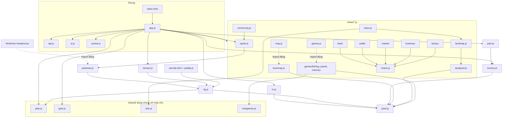
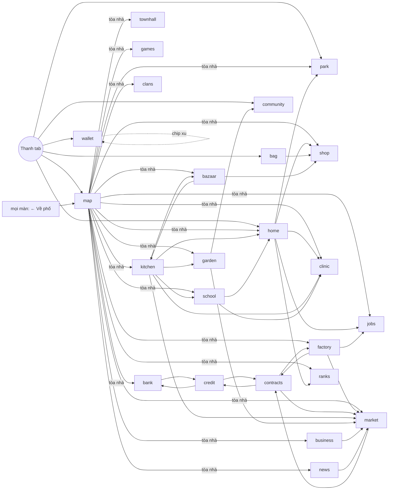
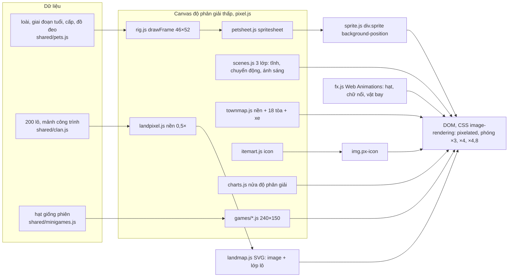

# Kiến trúc giao diện game

> [!summary]
> Client của Pet Town (Petdex Park) là một ứng dụng một trang viết bằng JavaScript thuần (ES module, `package.json` chỉ có `{"type": "module"}`), không framework, không bước build, phục vụ tĩnh ở `public/ta-tua/game/` và luôn được nhúng trong iframe của WorkHub. Kiến trúc gồm: khung `app.js` (định tuyến bằng hash, trạng thái, hành động), 19 màn trong `views/` cộng 5 màn viết thẳng trong `app.js`, các bộ vẽ pixel art trên canvas, 3 mini-game, và thư mục `shared/` chứa luật dùng chung với máy chủ. Mọi nội dung hiển thị bằng tiếng Việt, ghép HTML bằng template string và `esc()`.

## Sơ đồ mô-đun

## Bảng màn

| Hash | Màn | Mã | Tòa trên bản đồ | Khóa cấp |
|---|---|---|---|---|
| `map` | [[Màn Phố]] | `views/map.js` | (trang chủ) | |
| `home` | [[Màn Nhà]] / [[Màn Nhận nuôi]] | `app.js` `renderHome`, `renderAdopt` | 🏠 Nhà | |
| `shop` | [[Màn Siêu thị]] | `app.js` `renderShop` | 🏪 Siêu thị | món riêng có `minLevel` |
| `bag` | [[Màn Túi đồ]] | `app.js` `renderBag` | (tab) | |
| `wallet` | [[Màn Ví]] | `views/wallet.js` | (tab, chip xu) | công tắc nâng cao: 8 |
| `community` | [[Màn Bạn bè]] | `views/community.js` | (tab) | lập Hội: 3 |
| `park` | [[Màn Công viên]] | `app.js` `renderPark` + `park.js` | 🌳 Công viên | |
| `ranks` | [[Màn Bảng vàng]] | `app.js` `renderRanks` | 🏆 Bảng vàng | |
| `jobs` | [[Màn Việc làm]] | `views/jobs.js` | 💼 Việc làm | |
| `games` | [[Màn Khu vui chơi]] | `views/games.js` | 🎮 Khu vui chơi | |
| `bank` | [[Màn Ngân hàng]] | `views/bank.js` | 🏦 | 3 |
| `credit` | [[Màn Tín dụng]] | `views/credit.js` | (từ Ngân hàng) | vay: 8 |
| `market` | [[Màn Sàn]] | `views/market.js` | 📈 | giao dịch: 2 |
| `contracts` | [[Màn Hợp đồng]] | `views/contracts.js` | (từ Sàn, Xưởng) | 6 |
| `news` | [[Màn Báo Trân Châu]] | `views/news.js` | 📰 | |
| `townhall` | [[Màn Tòa thị chính]] | `views/townhall.js` | 🏛️ | 3 |
| `school` | [[Màn Trường học]] | `views/school.js` | 🏫 | 2 |
| `clinic` | [[Màn Phòng khám]] | `views/clinic.js` | 🩺 | |
| `garden` | [[Màn Vườn]] | `views/garden.js` | 🌱 | 2 |
| `kitchen` | [[Màn Bếp]] | `views/kitchen.js` | 🍳 | 3 |
| `bazaar` | [[Màn Chợ Phiên]] | `views/bazaar.js` | 🛒 | 4 |
| `business` | [[Màn Quầy trà sữa]] | `views/business.js` | 🧋 | 4 |
| `factory` | [[Màn Khu công nghiệp]] | `views/factory.js` | 🏭 | gửi gia công 2, xây 6 |
| `clans` | [[Màn Clan]] | `views/clans.js` | 🏘️ Gia tộc & Nhà Đất | 4 (cấu hình được) |

Số cấp: `UNLOCKS` ở `petdex/server/routes-economy.js:18-20` và `clan` = `clanConfig().unlockLevel` (`petdex/server/routes.js:72`, mặc định `petdex/server/clans.js:20`). Mọi khóa tính theo **bé cấp cao nhất** của người chơi. Bảng đầy đủ: [[Mở khóa theo cấp]]. Ngoài 24 hash còn [[Màn Đăng nhập]] (không có hash) và trang riêng [[Xưởng tạo hình Pet Lab]].

## Điều hướng giữa các màn

## Mẫu chung của một màn trong `views/`

1. Xuất `renderX(root, ctx)`; vẽ khung `viewHead(...)` + "Đang tải…".
2. Kiểm khóa cấp ở client trước (`ctx.bestLevel() < ctx.catalog.unlocks.X` thì hiện thẻ 🔒 và dừng).
3. `api('/x')` một lần; chỉ vẽ nếu phần tử còn gắn vào DOM (`view.isConnected`), tránh vẽ vào màn đã rời.
4. Hành động gửi qua `ctx.act(...)`, sau đó app vẽ lại cả màn (vì vậy trạng thái giao diện cần giữ được để ở biến module).
5. Trả về hàm dọn (`clearInterval`, hủy hình bé, đóng hộp thoại) để `app.js` gọi khi rời màn.

Nguồn: ví dụ `public/ta-tua/game/js/views/bank.js:8-118`, `views/garden.js:10-298`.

## Đường ống vẽ (rendering pipeline)

Mỗi bộ vẽ lưu đệm kết quả (`toDataURL`, `Map` theo khóa) và chỉ vẽ lại khi dữ liệu, cỡ khung hoặc buổi trong ngày đổi. Chi tiết: [[Vẽ pixel]], [[Bộ khung thú]], [[Sprite và bảng hình]], [[Cảnh nhà và thời gian trong ngày]], [[Vẽ bản đồ phố]], [[Vẽ bản đồ đất]], [[Vẽ công viên]], [[Hiệu ứng hạt]], [[Hình vật phẩm]], [[Biểu đồ]], [[Giao diện mini-game]].

## Mã dùng chung với máy chủ

`shared/pets.js` (dữ liệu ngũ hành, 6 giai đoạn tuổi, 50 loài, 55 món đồ đeo, quan hệ hành, dáng theo cấp), `shared/gear.js` (cấp trang phục, dòng chỉ số, trần cộng dồn), `shared/clan.js` (ngành, địa hình, 200 lô đất, 200 mảnh lắp ghép, vẽ SVG công trình), `shared/minigames.js` (luật và hạt giống mini-game) được máy chủ import thẳng bằng đường dẫn tương đối, ví dụ `petdex/server/eggs.js:6`, `petdex/server/bazaar.js:8`. Nhờ vậy số trên giao diện và số máy chủ tính là một. Các note luật ở 10 và 20 dẫn nguồn từ các file này.

## Nguyên tắc giao diện thấy trong mã

- Pixel art thống nhất: mọi hình vẽ trên canvas nhỏ rồi phóng `image-rendering: pixelated`, viền `#2e1d14` chung ([[Vẽ pixel]]).
- Ngẫu nhiên có hạt giống để cảnh và bản đồ ai cũng thấy giống nhau.
- Thời gian trong ngày theo giờ máy người chơi ([[Cảnh nhà và thời gian trong ngày]]).
- Lỗi luôn là chữ tiếng Việt từ máy chủ, hiện bằng toast đỏ ([[Lỗi và thông báo lỗi]]).
- Nhiều số trên giao diện là ước tính ở client (lương/giờ, phí Sàn, ký quỹ hợp đồng, lịch trả góp, sản lượng vườn); số thật do máy chủ tính.

## Liên quan
- [[MOC Giao diện]], [[App shell]], [[Phong cách và CSS]], [[Khung nhúng WorkHub]], [[Kiến trúc máy chủ]], [[API người chơi]], [[Bản đồ hệ thống]]
