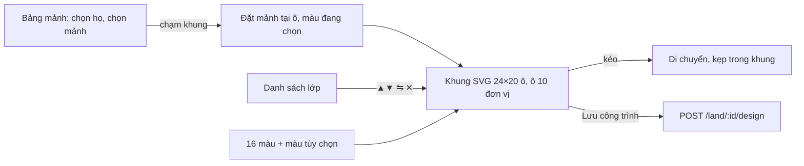

# Màn Clan

> [!summary]
> "🏯 Gia tộc & Sở Nhà Đất" (`#clans`, tòa 🏘️ Gia tộc & Nhà Đất, cần `unlocks.clan` = `clanConfig().unlockLevel`, mặc định 4). Màn lớn nhất của client (739 dòng) với 5 tab: 🏯 Gia tộc, 🗺️ Bản đồ đất, 🏗️ Xây dựng và 🧾 Thuế (chỉ khi đã có gia tộc), 📊 Vĩ mô. Luật ở [[Clan]], [[Bản đồ đất]], [[Thuế doanh nghiệp]], [[Kinh tế vĩ mô]].

## Tải dữ liệu và trạng thái

- Mở màn gọi song song `GET /clans` và `GET /land` (`public/ta-tua/game/js/views/clans.js:73-77`).
- Trạng thái `ui` là biến module: tab, lô đang chọn, ngành xem trước (mặc định `tea`), chế độ tô màu bản đồ (mặc định `zone`), biểu tượng và màu khi lập gia tộc (mặc định `#c0392b`), bản nháp công trình `build` (`clans.js:21-26`). Vì `ctx.act` vẽ lại cả màn sau mỗi hành động, trạng thái này giữ người chơi ở đúng tab.
- Tab Xây dựng/Thuế bị ẩn và tự chuyển về tab Gia tộc nếu chưa có gia tộc (`clans.js:11-17`, `clans.js:59-64`).
- Mọi hành động dùng `ctx.act(path, payload)`.

## Tab 🏯 Gia tộc

### Chưa có gia tộc (`drawNoClan`)

| Khối | Nội dung | Nguồn |
|---|---|---|
| Gia tộc là gì? | 4 gạch đầu dòng: góp quỹ và lên cấp chung; thâu tóm tối đa 3 ngành (ngành đầu 20.000–50.000 xu, ngành sau ×`expandMultiplier`); mua đất trên bản đồ 200 lô (giá `minPrice`–`maxPrice`), lắp ghép công trình; thuế doanh nghiệp `baseTax` (+`extraTaxPerIndustry` mỗi ngành), hoàn `refundRate` cuối tháng | `clans.js:181-189` |
| ✨ Lập gia tộc | "Cần một bé đạt cấp n để lập hoặc gia nhập gia tộc." khi khóa; ô tên 3–24 ký tự; hàng biểu tượng; ô màu; nút "Lập gia tộc · createCost" → `POST /clans/create {name, emblem, color}` | `clans.js:190-199`, `clans.js:728` |
| 🏯 Các gia tộc | chấm biểu tượng tô màu gia tộc, tên, "Cấp · n/max người · n lô", icon các ngành, nút "Gia nhập" → `POST /clans/:id/join` | `clans.js:200-209`, `clans.js:611` |

### Đã có gia tộc (`drawClan`)

| Khối | Nội dung | Nút / API | Nguồn |
|---|---|---|---|
| Đầu gia tộc | biểu tượng, tên, "Cấp n", vai trò (👑 Tộc trưởng / 🎖️ Trưởng lão / Thành viên), số người/đất, thuế suất; thanh XP tô màu gia tộc (`--clan`); "x / y XP để lên cấp n+1" hoặc "Đã đạt cấp tối đa", "sản lượng +p%"; quỹ và "Phí duy trì n/đêm" | | `clans.js:18`, `clans.js:91-101` |
| 💰 Góp quỹ tuần này | định mức `quota`/tuần, "Thiếu định mức thì gia tộc bị trừ kinh nghiệm vào cuối tuần. Cứ 10 xu góp được 1 XP."; thanh tiến độ của mình; ô số (bước 10, mặc định phần còn thiếu) | "Góp quỹ" → `POST /clans/donate {amount}`; tộc trưởng thêm "Chia cổ tức đều" → `POST /clans/dividend {amount}` | `clans.js:103-116`, `clans.js:729-730` |
| 👥 Thành viên | tên, vai trò, tổng góp, `tuần/quota` (đỏ nếu thiếu); tộc trưởng có `<select>` vai trò (Thành viên, Trưởng lão, Nhường tộc trưởng) và "Mời ra" | đổi vai → `POST /clans/role {userId, role}` (nhường chức hỏi lại); "Mời ra" → `POST /clans/kick {userId}`; "Rời gia tộc" → `POST /clans/leave` (người cuối: cảnh báo giải tán, đất về Sở Nhà Đất, quỹ về ngân sách) | `clans.js:118-133`, `clans.js:612-616`, `clans.js:712-715` |
| 🏭 Thâu tóm ngành nghề (n/3) | giải thích phí; mỗi ngành: icon, tên, "n gia tộc đang nắm" / "Chỉ gia tộc bạn nắm" / "Chưa ai nắm", "Đã thâu tóm" hoặc nút "Thâu tóm · phí" (chỉ tộc trưởng, dưới 3 ngành, đủ cấp `nextIndustryLevel`) | `POST /clans/industries {industry}` sau `confirm` | `clans.js:135-154`, `clans.js:617-619` |
| 🏘️ Đất của gia tộc | bảng Lô, Địa hình (+ khí hậu), Ngành ("Chưa chọn"), Công trình ("✅ n mảnh" / "n mảnh, chưa đủ" / "Chưa xây"), Giá mua, Giá trị, Doanh thu/ngày ước tính, nút "Xem" (mở tab Bản đồ tại lô) | | `clans.js:156-170`, `clans.js:620-623` |

## Tab 🗺️ Bản đồ đất

- Thanh số liệu: "🏘️ Còn n/200 lô", "📈 Hệ số khan hiếm ×s", "🏦 Chỉ số giá đất x", pha kinh tế và thời tiết hôm nay (`clans.js:256-262`).
- "Tô màu theo": Địa hình, Khí hậu, Giá đất, % tăng giá, Độ hợp ngành (chọn thêm ngành). Màu nhiệt `heatColor(t)` nội suy đỏ `#e8665a` → vàng `#f4d35e` → xanh `#5fbf77`; khí hậu dùng 4 màu cố định (`clans.js:32-38`, `clans.js:215-227`, `clans.js:263-270`).
- Bản đồ là chuỗi SVG từ `landMapSvg({key, fillFor, infos, selected, showClimate})`; khóa bộ nhớ đệm đổi theo chế độ, theo ngành (chế độ hợp ngành) hoặc theo toàn bộ dãy giá (chế độ giá) (`clans.js:229-241`). Chi tiết vẽ: [[Vẽ bản đồ đất]].
- Chú giải theo chế độ (`clans.js:243-248`).
- Bấm một lô chỉ đổi lớp `sel`, đưa lô lên trên cùng và vẽ lại khung bên, không vẽ lại bản đồ (`clans.js:624-631`).

### Khung lô (`plotPanel`)

Chưa chọn: lời hướng dẫn và "Đất đắt ở trung tâm, ven biển, ven sông có % tăng giá và tốc độ sản xuất cao hơn (tối đa 18%). Khi quỹ đất cạn, giá các lô còn lại tăng rất mạnh." Đã chọn: "Lô {mã}", nhãn chủ (màu và biểu tượng gia tộc) hoặc "Còn trống", địa hình + mô tả, khí hậu, Giá bán / Giá trị hiện tại, "Tăng giá mỗi tháng", "Tốc độ sản xuất", Ngành, hình công trình `designSvg`, chọn "Xem trước với ngành", khung xem trước (`clans.js:279-317`).

Xem trước: `GET /land/:id/preview?industry=` (có `previewSeq` chống kết quả cũ), liệt kê sản lượng gốc/ngày và các hệ số: tốc độ sản xuất của lô, địa hình, khí hậu, thời tiết, chu kỳ kinh tế, cầu ngành, cạnh tranh (n gia tộc), cấp gia tộc, công trình; tổng "≈ n/ngày · sau thuế t%: m" (`clans.js:319-346`).

| Nút | Ai thấy | API | Nguồn |
|---|---|---|---|
| "Mua lô bằng quỹ · giá" | tộc trưởng/trưởng lão, lô trống | `POST /land/:id/buy` (confirm) | `clans.js:311`, `clans.js:632-634` |
| "Làm ngành này trên lô" | quản lý lô mình, ngành đã thâu tóm khác ngành hiện tại | `POST /land/:id/industry {industry}` | `clans.js:312`, `clans.js:637` |
| "🏗️ Lắp ghép công trình" | quản lý lô mình | chuyển tab Xây dựng | `clans.js:313`, `clans.js:638-641` |
| "Bán lại cho Sở Nhà Đất (r% giá trị)" | tộc trưởng | `POST /land/:id/sell` (confirm "Công trình trên lô sẽ bị dỡ bỏ.") | `clans.js:314`, `clans.js:635-636` |

## Tab 🏗️ Xây dựng (xưởng lắp ghép)

| Phần | Chi tiết | Nguồn |
|---|---|---|
| Kích thước | `DESIGN = { cols: 24, rows: 20, maxPieces: 20, cell: 10, minPieces: 3 }` | `public/ta-tua/game/js/shared/clan.js:192` |
| Bảng mảnh | chọn lô; chip họ mảnh (`PIECE_FAMILIES`); lưới mảnh có hình SVG, kích thước, giá; "Bộ mẫu có n mảnh (k họ × 10 kiểu)" | `clans.js:417-426` |
| Khung | lưới mờ, nền trời `#eaf6fb` và cỏ `#cfe6b0`; mảnh lật bằng `scale(-1 1)`; lớp chọn có viền nét đứt | `clans.js:381-398` |
| Trạng thái | "Lô X · n/20 mảnh", "✅ Đủ điều kiện vận hành · +p% sản lượng" (`designBonus`) hoặc "⚠️ Cần ≥ 3 mảnh và có móng nền" | `clans.js:428-429` |
| Màu | 16 ô `PALETTE` + `<input type=color>`; đổi màu áp vào lớp đang chọn | `clans.js:431-432`, `clans.js:689-694`, `shared/clan.js:193` |
| Mẫu sẵn | "Nhà phố" (7 mảnh), "Nhà máy" (8 mảnh), "Tháp văn phòng" (6 mảnh); "Hoàn tác" (nạp lại bản đã lưu), "Xóa hết" | `clans.js:361-379`, `clans.js:433-437`, `clans.js:672-682` |
| Chi phí | "Tổng giá mảnh n · đã chi cho lô m · **cần thêm max(0, n − m)**" (`designCost`); nút "Lưu công trình" chỉ cho tộc trưởng/trưởng lão | `clans.js:411-412`, `clans.js:438-441` |
| Lớp | danh sách "lớp sau đè lớp trước": màu, tên, tọa độ, ▲ (ra sau), ▼ (lên trước), ⇋ (lật), ✕ (bỏ) | `clans.js:443-458`, `clans.js:655-671` |
| Con trỏ | `pointerdown` trên khung: nếu đang chọn mảnh thì đặt (quá 20 mảnh thì toast lỗi "Tối đa 20 mảnh mỗi công trình."); nếu chạm một lớp thì chọn và bắt đầu kéo; `pointermove` dời theo ô, chỉ vẽ lại khung (`redrawCanvas`); `pointerup` vẽ lại toàn tab | `clans.js:468-523` |

Rỗng: "Gia tộc cần mua ít nhất một lô đất trước khi xây công trình." (`clans.js:402-405`). Lưu: `POST /land/:id/design {design}` (`clans.js:683-686`).

## Tab 🧾 Thuế

Thuế suất hiện tại, giải thích (thuế tính trên doanh thu khai báo, trừ thẳng vào quỹ mỗi đêm), thuế đã đóng tháng này, dự kiến hoàn cuối tháng; "📝 Tờ khai doanh thu" là thanh trượt 0–100% bước 5 (chỉ tộc trưởng, "Nộp tờ khai" → `POST /clans/declare {ratio}`); "📒 Sổ thuế 14 ngày" (Ngày, Doanh thu, Khai báo, Thuế suất, Thuế, Phí duy trì) và danh sách hoàn thuế (`clans.js:527-558`, `clans.js:719-721`, `clans.js:731`).

> [!question] Tờ khai dưới 100%
> Giao diện cho tộc trưởng khai báo thấp hơn doanh thu thật và chỉ ghi "Gia tộc tự chịu trách nhiệm về tờ khai của mình" (`clans.js:542`). Hệ quả (kiểm tra, phạt) thuộc luật máy chủ, xem [[Thuế doanh nghiệp]].

## Tab 📊 Vĩ mô

`GET /macro` mỗi lần mở tab: thẻ chu kỳ kinh tế (icon, tên, hệ số sản lượng, lưu lượng khách quầy, xu hướng giá đất, tăng trưởng năm), thẻ thời tiết (hệ số theo địa hình và khí hậu), biểu đồ SVG tự vẽ "Chỉ số giá đất 14 ngày" (đường nâu `#9b6238` và dải màu pha bên dưới: Phục hồi, Tăng trưởng nóng…), và "📦 Cầu từng ngành hôm nay" với thanh màu bạc hà/hồng (`clans.js:562-600`).

## Liên quan
- [[Clan]], [[Bản đồ đất]], [[Thuế doanh nghiệp]], [[Kinh tế vĩ mô]], [[Hội]] (hệ khác)
- [[Vẽ bản đồ đất]], [[Màn Phố]], [[Phong cách và CSS]], [[Module clans]], [[Module routes-clans]]
