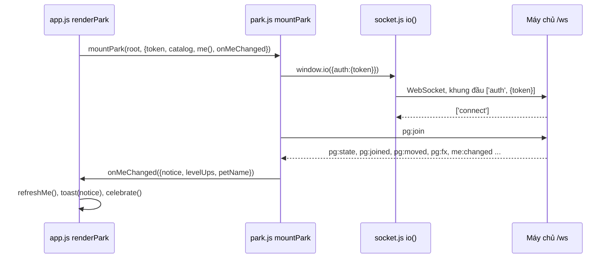

# Màn Công viên

> [!summary]
> Tab 🌳 Công viên (`#park`, cũng là tòa 🌳 trên bản đồ và nút "Ra công viên" ở [[Màn Nhà]]): sân chơi nhiều người theo thời gian thực, nơi [[Thú chính]] của mỗi người đi lại, vẫy, nhảy, xoay, nói chuyện, được vuốt ve và nhận quà. Hàm `renderPark` trong `app.js` chỉ lo trạng thái rỗng và nối `mountPark`; phần vẽ và mạng ở [[Vẽ công viên]].

## Người chơi thấy gì

| Vùng | Nội dung | Nguồn |
|---|---|---|
| Sân (`#park-wrap`) | cảnh pixel ngày/đêm, các bé với tên "Tên **Lv n** · người chơi", bong bóng thoại; dòng trạng thái "Đang vào công viên…", "Mất kết nối, đang thử lại…", "Bạn vừa vào công viên từ một tab khác." | `public/ta-tua/game/js/park.js:14-19` |
| Thanh bên | "🌳 Công viên · n bạn"; nút 👋 Vẫy, 🦘 Nhảy, 🌀 Xoay; danh sách người có mặt (mình đứng đầu, "(bạn)", người vắng "· vắng"); nhật ký chat; ô "Nói gì đó…" (120 ký tự) + "Gửi"; gợi ý "Bấm lên bãi cỏ để đi tới đó. Bấm vào bé khác để vuốt ve 💖 hoặc tặng quà 🎁." | `park.js:20-34`, `park.js:133-140` |
| Menu bé khác | "💖 Vuốt ve", "🎁 Tặng quà từ túi đồ" | `park.js:240-268` |

## Trạng thái rỗng

Chưa có bé nào: "🌳 Công viên đang chờ bạn · Nhận nuôi một bé trước rồi dắt bé ra đây chơi nhé." + nút "Nhận nuôi ngay" → [[Màn Nhà]] (`public/ta-tua/game/js/app.js:1018-1027`).

## Nối với app

- Khi đang ở Công viên, `act()` chỉ cập nhật chip ví, không vẽ lại cả màn (để không ngắt socket) (`app.js:307`).
- `onMeChanged` gọi `refreshMe()`; vì Công viên không nằm trong nhóm Nhà/Túi đồ/Siêu thị nên chỉ chip ví được vẽ lại (`app.js:281-292`, `app.js:1032-1036`).
- Rời màn: hàm dọn ngắt socket (sự kiện `disconnect` với lý do `io client disconnect`) (`park.js:413-422`).

## Luật liên quan

Vuốt ve, tặng quà, số lần mỗi ngày, XP và cảm xúc do máy chủ quyết định; xem [[Công viên]], [[Bạn bè]], [[Nhiệm vụ ngày]] ("Vuốt ve một bé ở công viên"), [[Giao thức công viên]].

## Liên quan
- [[Vẽ công viên]], [[Socket phía trình duyệt]], [[Cảnh nhà và thời gian trong ngày]], [[App shell]], [[Màn Bạn bè]]
