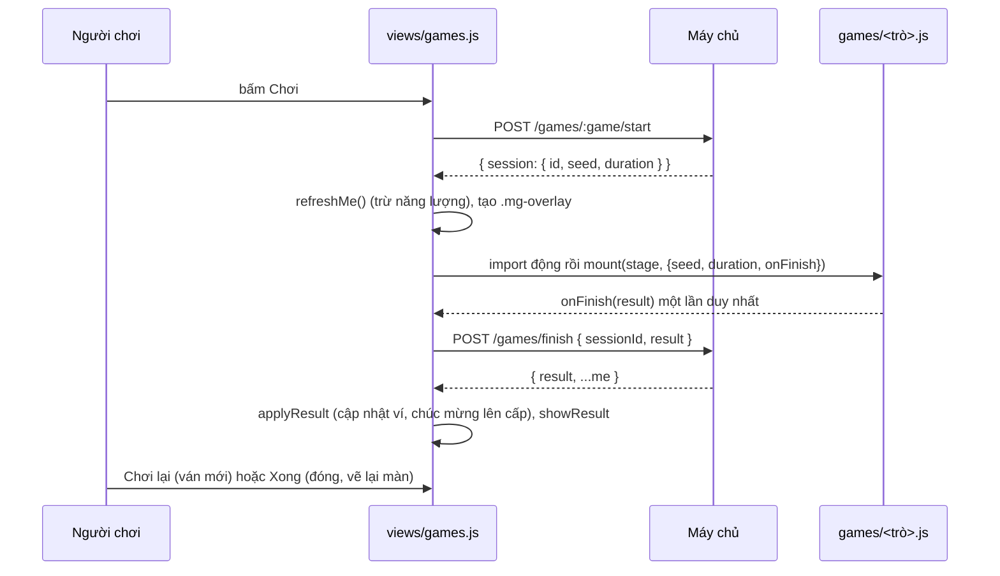

# Màn Khu vui chơi

> [!summary]
> "🎮 Khu vui chơi & Hồ câu" (`#games`, tòa 🎮 Khu vui chơi): đồng hồ phần thưởng hôm nay, 3 thẻ mini-game và lớp phủ toàn màn để chơi. Màn xin phiên chơi (hạt giống) từ máy chủ, nạp động file game trong `js/games/`, gửi kết quả thô lên máy chủ chấm rồi hiện bảng thưởng. Chi tiết từng trò ở [[Giao diện mini-game]]; luật ở [[Mini-game]].

## Màn chính

| Phần | Nội dung | Nguồn |
|---|---|---|
| Phụ đề | "Mỗi ván tốn 5 năng lượng của bé chính. Xu và nguyên liệu nhận được có giới hạn mỗi ngày." | `public/ta-tua/game/js/views/games.js:7` |
| 🎁 Phần thưởng hôm nay | 3 thanh: 🪙 Xu `used.coins/gameCaps.coins`, 🐟 Cá (phần) `/portions.fish`, 🧋 Trân châu (phần) `/portions.pearl`; "{bé chính} còn ⚡ n năng lượng. Đã chơi n ván hôm nay." | `games.js:14-29` |
| Thẻ trò | icon, tên, mô tả, "⏱ n giây · ⚡ n năng lượng", nút "Chơi" (khóa khi không có bé chính hoặc thiếu năng lượng) | `games.js:30-39` |

Trần ngày hiện tại: 100 xu, 10 phần cá, 20 phần trân châu (`DAILY_CAPS` ở `public/ta-tua/game/js/shared/minigames.js:11`). Ba trò: Câu cá 40 giây, Hứng trân châu 30 giây, Ghép hình nhớ 60 giây, mỗi trò 5 ⚡ (`minigames.js:4-8`).

## Luồng một ván

Nguồn: `games.js:78-127`. Cờ `finished` chặn gửi kết quả hai lần (`games.js:107-113`). Nếu `/games/finish` lỗi thì toast lỗi và đóng lớp phủ.

## Bảng kết quả (`showResult`)

| Dòng | Điều kiện | Nguồn |
|---|---|---|
| Điểm lớn `r.score` + "điểm" | luôn có | `games.js:65-68` |
| "🪙 +n xu (chạm giới hạn ngày)" | `r.coins`; chú thích khi `rawCoins > coins` | `games.js:52` |
| "+n lô cá tươi / trân châu vào kho" | `r.portions.fish` / `.pearl` | `games.js:53-54` |
| "{kỹ năng} +n" | `r.skill.gain` | `games.js:55` |
| "⭐ +3 XP" | luôn có (chữ cố định ở client) | `games.js:56` |
| "Rớt vật liệu: +n lô X vào kho" hoặc "Rớt X nhưng kho đã đầy" | `r.drops.material` | `games.js:57-59` |
| "🎀 Rớt trang phục: tên + chip cấp + các dòng" | `r.drops.gear` | `games.js:60-64` |
| "Một phần thưởng đã chạm giới hạn hôm nay. Mai chơi tiếp nhé!" | `r.capped` | `games.js:70` |
| Nút "Chơi lại" / "Xong" | | `games.js:71-74` |

> [!warning] Chữ cố định
> Dòng "⭐ +3 XP" luôn hiện dù máy chủ thực cộng bao nhiêu (`games.js:56`). Nếu luật XP mini-game đổi ở [[Module minigames]], giao diện sẽ sai mà không ai biết. Xem [[Mini-game]].

## Lớp phủ

`.mg-overlay` gắn thẳng vào `document.body` (không nằm trong `#view`), có khung `.mg-frame card`, tiêu đề, nút ✕ (`data-close-game`) và `.mg-host`. Đóng thì gọi cleanup của trò, xóa lớp phủ và `ctx.refresh()`. Rời màn khi đang chơi thì hàm dọn của màn cũng xóa lớp phủ (`games.js:42-48`, `games.js:86-95`, `games.js:135-138`). Kiểu dáng ở `css/games.css` (xem [[Phong cách và CSS]]).

## Liên quan
- [[Giao diện mini-game]], [[Mini-game]], [[Câu cá]], [[Hứng trân châu]], [[Ghép hình nhớ]]
- [[Màn Sàn]] (kho nhận cá và trân châu), [[Trang phục]], [[Module minigames]], [[API người chơi]]
