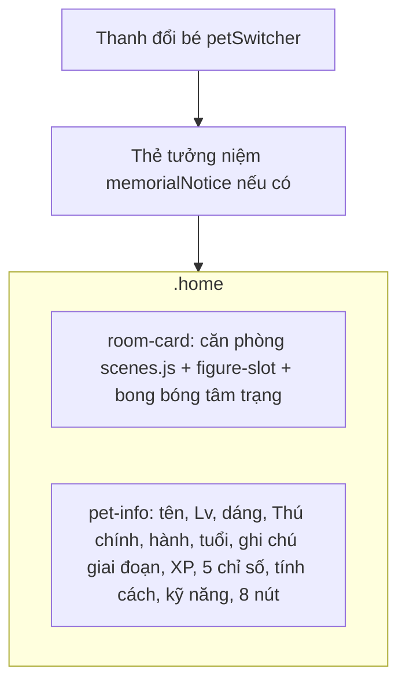

# Màn Nhà

> [!summary]
> Màn chăm sóc chính (`#home`, tab 🏠 Nhà): căn phòng pixel có bé đứng giữa, bảng chỉ số, kỹ năng và 8 nút hành động. Đây là nơi mọi hiệu ứng "bay đồ vào miệng", "LÊN CẤP!" được diễn. Toàn bộ mã nằm trong `app.js` (không có file riêng trong `views/`). Khi người chơi chưa có bé hoặc bấm "Nhận nuôi thêm", màn này chuyển sang [[Màn Nhận nuôi]].

## Bố cục

| Vùng | Nội dung | Nguồn |
|---|---|---|
| Thanh đổi bé | Mỗi bé một nút `⭐ Tên · Lv n` (⭐ nếu là [[Thú chính]]); thêm nút "➕ Nhận nuôi thêm · {adoptCost} 🪙" khi còn ô trống, "🕯️ Ô tưởng niệm · mở lại {reopenCost} 🪙" khi có ô khóa, "🐣 n trứng nở rồi!" / "🥚 n trứng đang ấp" | `public/ta-tua/game/js/app.js:464-483` |
| Thẻ tưởng niệm | "🌠 {tên} đã về với sao trời sau n tuần, lên tới cấp L", kỷ vật +{LIFE.heirloom} kỹ năng cho bé kế tiếp, nút "Thăm Đồi Sao" (mở [[Màn Bảng vàng]] tab Đồi Sao qua `data-ranks-go="stars"`) | `app.js:416-423` |
| Căn phòng | `mountRoomScene` vẽ phòng theo giờ thật, gọi `onLayout({x,y})` để đặt chân bé; bé là `createPetFigure(..., 1.25)` | `app.js:548-573`, xem [[Cảnh nhà và thời gian trong ngày]] |
| Bé vắng nhà | Khi bận việc có `away: true` (đi làm, đi học) thì ẩn bé và hiện hộp `away-note pixel-box` "💼 Tên đang đi làm / về lúc HH:MM · còn …"; tắm thì bé vẫn ở nhà, chỉ đổi bong bóng | `app.js:504-508`, `app.js:553`, `public/ta-tua/game/js/ui.js:188-193` |
| Bong bóng tâm trạng | `MOOD_ICONS[mood.key]` + nhãn tâm trạng | `app.js:508`, `ui.js:130` |
| Huy hiệu | `Lv n`, huy hiệu dáng `✨ {LEVEL_FORMS[i].name}` (tooltip gợi ý dáng kế), `⭐ Thú chính` | `app.js:100-105`, `app.js:513-517` |
| Dòng hành | chip hành (tooltip tính khí + lợi thế), sao độ hiếm theo màu, tên loài, "· linh vật" / "· khách mời", huy hiệu "🌟 Hôm nay hành X vượng: +{fortune×100}% XP và lương" nếu trùng `me.fortune` | `app.js:426-438` |
| Tuổi | "🎂 {ageText} · {nhãn giai đoạn} · còn n ngày nữa thành …" (lưu ý: tính `ceil((minDays - days)/7)` nhưng ghi "ngày") | `app.js:492-493`, `app.js:519` |
| Ghi chú giai đoạn | `LIFE_STAGES[].note`, và cảnh báo "🌙 … đã rất già, còn khoảng n ngày thật nữa là về với sao trời" khi `pet.life.warn` | `app.js:406-413` |
| Thanh XP và 5 chỉ số | `meter()`; chỉ số dưới 25% có lớp `low` (đỏ, trừ XP) | `app.js:395-403`, `app.js:521-524` |
| Ốm | Hộp `sick-note` "đang bị {bệnh}: chưa đi làm, đi học hay chơi mini-game được" + nút "🩺 Đưa đi khám" | `app.js:522-523` |
| Tính cách | chip `trait-chip` có tooltip mô tả | `app.js:525-526` |
| Kỹ năng | chip icon + điểm nguyên của mỗi kỹ năng trong `catalog.skills` | `app.js:527-530` |

> [!warning] Lệch tài liệu
> Nút 🎀 Trang phục ghi cứng "Đang đeo n/4 món" (`app.js:539`) trong khi số món được đeo thật là `pet.wearLimit` (3 dưới cấp 30, 4 từ cấp 30, +1 với bé Huyền thoại: `public/ta-tua/game/js/shared/pets.js:372-376`). Hộp thoại Trang phục và Túi đồ thì dùng đúng `wearLimit`.

> [!warning] Lệch tài liệu
> Dòng "còn n ngày nữa thành …" (`app.js:493`) chia số ngày cho 7 rồi vẫn ghi đơn vị "ngày", nên thực chất đang hiển thị số tuần.

## Các nút hành động

| Nút | Điều kiện / nhãn phụ | Hành động | API | Hiệu ứng |
|---|---|---|---|---|
| 🍽️ Cho ăn | "n món trong túi" | mở hộp chọn đồ ăn (`pickConsumable('food')`); mỗi dòng ghi "×qty" và "🌟 +{ELEMENT_RULES.food×100}% XP" nếu đồ cùng hành; túi rỗng thì "Túi chưa có đồ ăn nào" + nút "Ghé cửa hàng" | `POST /pets/:id/use {itemId}` | món bay vào miệng (`flyTo`), vụn bánh rơi + tim (`useItemFx`) |
| 🎾 Chơi đùa | khóa khi bé bận; nhãn "−15 ⚡ · +4 🪙" | không có đồ chơi thì chơi ngay; có thì hộp chọn "🤸 Chơi tay không (💖 +12 ⭐ +10 XP)" hoặc đồ chơi | `POST /pets/:id/play {toyId?}` | bé xoay, đồ chơi bay qua lại (`playFx`) |
| 💼 Đi làm | "Chọn nghề, nhận ca" hoặc "Về/Rảnh sau …" | chuyển [[Màn Việc làm]] | không | |
| 🛁 Tắm | khóa khi bận; "Miễn phí · 🫧 {hygiene}" | | `POST /pets/:id/bath` | `sparkleFx('jump')` |
| 💊 Chăm sóc | "n món trong túi" | hộp chọn đồ chăm sóc | `POST /pets/:id/use` | bong bóng nếu `item.id === 'bath'`, lấp lánh với món khác |
| 🎀 Trang phục | "Đang đeo n/4 món" hoặc "Chưa đeo gì" | mở tủ đồ 5 khe (xem dưới) | `POST /pets/:id/equip`, `POST /gear/:id/open` | `sparkleFx('spin')` |
| 🌳 Ra công viên / ⭐ Chọn thú chính | bé chính thì đi [[Màn Công viên]]; bé phụ thì đặt làm thú chính | | `POST /pets/:id/active` | `sparkleFx('wave','heart')` |
| 🩺 Phòng khám | hồng khi ốm; "Bé đang ốm!" hoặc "❤️ {health}" | chuyển [[Màn Phòng khám]] | không | |

Nguồn: `app.js:531-544` (nút), `app.js:597-695` (bảng `ACTIONS`). Các số "−15 ⚡ · +4 🪙" và "+12 / +10 XP" là chữ cố định ở client; máy chủ dùng đúng các số này ở `petdex/server/game.js:268-280` (năng lượng −15, vui +12, XP 10, xu 4). Luật chăm sóc: [[Chăm sóc ở nhà]], [[Chỉ số của bé]].

### Hộp thoại Trang phục (tủ đồ 5 khe)

- Liệt kê theo `SLOTS` (Đầu 🎩, Mặt 👓, Cổ 🧣, Lưng 🦋, Bùa 🏮: `shared/pets.js:359-365`), mỗi khe sắp theo cấp trang phục giảm dần rồi id mới nhất (`app.js:651-652`).
- Khe đang có đồ có dòng "🚫 Tháo {tên}" (`data-pick="slot:<khe>"`, gửi `{slot}`).
- Món là **hộp kín** (`g.sealed`) hiện "🎁 … Hộp chưa mở · Mở hộp để xem 1–2 dòng chỉ số", bấm gọi `POST /gear/:id/open` (`app.js:659-665`, `app.js:689`).
- Món thường: icon `itemIcon(item,3)`, chip cấp, các dòng affix (`gearLines`), "· đang đeo cho {bé khác}" nếu món đeo ở bé khác, nhãn "{icon hành} Đeo · {quan hệ ngắn}" theo `RELATIONS[relation(item.element, pet.element)]` (`app.js:667-676`). Bấm gửi `{gearId}`.
- Phần đầu hộp thoại là `outfitSummary`: dòng "Đang đeo x/limit món", gợi ý "Lên Lv 30 đeo thêm 1 món", "Bé Huyền thoại được đeo thêm 1 món", luật hợp mệnh (+10% tương sinh, +5% cùng hành, −5% kỵ, trần `ELEMENT_RULES.wearCap`), thưởng lương theo bộ, giải thích cấp trang phục và `STACKING.softCap` / `totalCap`, cuối cùng là `gearBonusLine` tổng % đang có (`app.js:108-113`, `app.js:441-462`).
- Bé khách mời có thêm câu "Bé khách mời Petdex ôm đồ trước ngực nên đồ ở cổ nằm khuất phía sau" (`app.js:684`).
- Không có món nào thì hiện ô trống "Túi chưa có phụ kiện nào" với nút "Ghé cửa hàng" (lọc Siêu thị theo `accessory`).

Luật đồ: [[Trang phục]], [[Cấp trang phục]], [[Bộ đồ ngũ hành]], [[Hợp mệnh và kỵ mệnh]]. Cách vẽ đồ lên bé: [[Bộ khung thú]].

## Hiệu ứng và vòng đời màn

| Cơ chế | Chi tiết | Nguồn |
|---|---|---|
| `homeStage` | đối tượng `{room, figure, feet, at(frac), react(anim)}`; `at(0)` là chân, `at(1)` là đỉnh khung | `app.js:555-566` |
| `act(..., {fx})` | sau khi vẽ lại, cuộn phòng vào tầm nhìn rồi chạy `fx(homeStage, result)` | `app.js:300-322` |
| `celebrate(levelUps)` | toast "🎉 {tên} lên cấp L! Thưởng R 🪙" (loại `level`), sau 900 ms bé nhảy, 14 hạt lấp lánh, chữ vàng "LÊN CẤP!" | `app.js:324-334` |
| `showGain` | chữ nổi "+n XP" (vàng) và "+n 🪙" | `app.js:338-342` |
| `moodTick` | mỗi 2,6 giây: mệt thì "zzz", buồn thì giọt nước mắt, rất vui thì 50% có lấp lánh | `app.js:386-391`, `app.js:574` |
| Chạm vào bé | bé vẫy tay + 2 tim (`#figure-slot`) | `app.js:1184-1189` |
| Hoạt ảnh chờ | theo tâm trạng: `IDLE_BY_MOOD` (great/ok → idle, hungry/dirty → wait, tired → think, sad/sick → sad) | `app.js:77`, `app.js:117` |
| Dọn dẹp | `teardown` xóa interval tâm trạng, gỡ phòng, hủy figure | `app.js:576-580` |
| Quà ngày | bấm chip 🎁 khi đang ở Nhà thì mưa 12 đồng xu từ trần | `app.js:1047-1053` |

Hạt và chữ nổi: [[Hiệu ứng hạt]].

## Tự làm mới

`refreshMe()` chạy mỗi 30 giây khi tab đang hiện (`app.js:281-294`). Ở Nhà, Túi đồ, Siêu thị nó vẽ lại cả màn, **trừ khi** đang mở hộp thoại, có form nhận nuôi hoặc con trỏ đang ở ô nhập; khi đó chỉ cập nhật ví. Xem [[App shell]].

## Liên quan
- [[Kiến trúc giao diện game]], [[App shell]], [[Màn Nhận nuôi]], [[Màn Túi đồ]], [[Màn Siêu thị]]
- [[Chỉ số của bé]], [[Chăm sóc ở nhà]], [[Cấp độ và XP]], [[Dáng theo cấp]], [[Giai đoạn tuổi]], [[Vòng đời và Đồi Sao]], [[Ngũ hành]], [[Hành vượng]], [[Tính cách]], [[Kỹ năng]], [[Ốm và Phòng khám]]
- [[Cảnh nhà và thời gian trong ngày]], [[Sprite và bảng hình]], [[Hiệu ứng hạt]], [[Hình vật phẩm]]
- [[API người chơi]]
