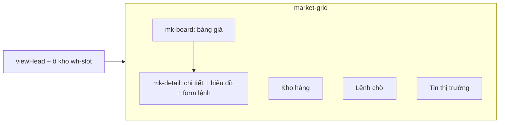

# Màn Sàn

> [!summary]
> Màn giao dịch nguyên liệu (`#market`, tòa 📈 Sàn Nguyên Liệu): bảng giá có sparkline, khung chi tiết với biểu đồ 24 giờ (đường) hoặc 7 ngày (nến giờ), form đặt lệnh thị trường/giới hạn có ước tính phí, kho hàng, lệnh chờ và tin thị trường. Đây là màn duy nhất tự hỏi lại máy chủ mỗi phút. Luật ở [[Sàn Nguyên Liệu]], [[Mặt hàng nguyên liệu]], [[Kho Sàn]], [[Tin tức thị trường]].

## Bố cục



Phụ đề cố định: "Giá đổi mỗi 10 phút theo cung cầu và tin tức. 1 lô = 10 phần." (khớp `MARKET.tickMs = 10 phút` ở `petdex/server/rules/market.js:21`). Nguồn bố cục: `public/ta-tua/game/js/views/market.js:10-12`, `market.js:151-176`.

## Các khối

| Khối | Nội dung | Nguồn |
|---|---|---|
| Ô kho (góc đầu màn) | "🏚️ Kho a/b lô" (đã dùng + đang giữ cho lệnh), thanh `bar energy`, nút "Mở rộng n lô · giá 🪙" nếu còn bậc, nút "📜 Hợp đồng cung ứng" → [[Màn Hợp đồng]] | `market.js:152-160` |
| Bảng giá | cột Mặt hàng (icon, tên, huy hiệu "chế biến"), Giá/lô, 24 giờ (%), sparkline cao 26 px, Kho (lô) ; bấm hàng để chọn mặt hàng | `market.js:39-49`, `market.js:174`, `market.js:189-195` |
| Chi tiết | icon lớn, tên, "Chế biến từ n lô …" hoặc "Hàng thô", "hư sau n ngày" / "không hư", giá, % thay đổi, "mua {ask} · bán {bid}"; nút "24 giờ" / "7 ngày (nến giờ)" | `market.js:51-76` |
| Biểu đồ | `GET /market/:id/history?range=day|week`; `day` vẽ `lineChart` 170 px, `week` vẽ `candleChart` 170 px | `market.js:142-149` |
| Form lệnh (khi đủ cấp) | nút Mua/Bán, "Giá thị trường" / "Đặt giá chờ", ô Khối lượng (lô) 0,1–100 bước 0,1, chip 1/5/10 lô và "Tất cả (n)" khi bán; lệnh chờ có ô "Giá đặt (xu/lô)" trong biên `price × (1 ± band)` với lời "Lệnh chờ tới nửa đêm, xu được ký quỹ / hàng được giữ"; dòng ước tính; "Hôm nay còn n lô mua từ / bán cho NPC · Kho của bạn: n lô"; nút "Mua X" (bạc hà) / "Bán X" (hồng) | `market.js:77-101` |
| Chưa đủ cấp | "🔒 Mở giao dịch khi có một bé đạt cấp {unlocks.market}. Hàng câu được vẫn nằm an toàn trong kho." | `market.js:102` |
| 🏚️ Kho hàng | mỗi mặt hàng: lô, giá trị ≈ theo giá bid, "Lô sớm nhất hư sau …" (đỏ nếu dưới 12 giờ), nút "Bán" (điền sẵn form bán hết rồi cuộn tới khung chi tiết); rỗng: "Kho trống. Mua trên Sàn hoặc câu cá, hứng trân châu ở Khu vui chơi." | `market.js:105-119`, `market.js:211-214` |
| ⏳ Lệnh chờ | "Mua/Bán", "n lô @ giá", "(đã khớp n)", "Ký quỹ n 🪙", nút "Hủy"; rỗng: "Không có lệnh nào đang chờ." | `market.js:121-131` |
| 📰 Tin thị trường | icon, tiêu đề, ▲/▼, "🧠 Tin sớm ·" nếu `early`; nếu không có bé Thông minh: "Bé có Thông minh từ 60 sẽ đọc được tin sớm 30 phút." | `market.js:133-140` |

Ngưỡng 60 và 30 phút khớp máy chủ: `smartReader` kiểm `intellect >= 60` (`petdex/server/market.js:355-357`), `newsLeadMs = 30 phút` (`petdex/server/rules/market.js:31`).

## Công thức ước tính ở client

```
ref   = side == 'buy' ? ask : bid
depth = rules.liquidity × (processed ? rules.processedDepth : 1)
unit  = (limit && giá đặt > 0) ? giá đặt : ref × (1 ± lots / depth / 2)
amount = round(lots × unit);  fee = max(1, round(amount × rules.fee))
Mua: amount + fee      Bán: amount − fee
```

Nguồn `market.js:23-37`. Đây chỉ là ước tính hiển thị; khớp lệnh thật ở máy chủ ([[Module market]]). Khi gửi, khối lượng lô đổi thành phần: `qty = round(lots × 10)` (`market.js:229-236`).

## API

| Hành động | API | Nguồn |
|---|---|---|
| Tải màn, làm mới | `GET /market` | `market.js:178-186` |
| Lịch sử giá | `GET /market/:id/history?range=` | `market.js:145` |
| Đặt lệnh | `POST /market/order {commodity, side, qty, type, limit?}` | `market.js:233-235` |
| Hủy lệnh | `POST /market/orders/:id/cancel` | `market.js:216` |
| Mở rộng kho | `POST /market/warehouse` | `market.js:218` |

## Trạng thái và làm mới

- Lựa chọn của người chơi (mặt hàng, khoảng biểu đồ, phía, loại lệnh, khối lượng, giá đặt) nằm trong biến module `ui` nên giữ nguyên qua các lần vẽ lại và khi quay lại màn (`market.js:7`). Mặc định `milk`, `day`, `buy`, `market`, 1 lô.
- Lần tải đầu (`notifySpoiled: true`) bắn toast lỗi "🦠 n lô X đã hư, bị bỏ khỏi kho." cho từng lô hư (`market.js:182-184`).
- Poll mỗi 60 giây nếu tab đang hiện **và** con trỏ không ở trong màn (để không xóa ô đang gõ) (`market.js:239-242`). Hàm dọn xóa interval.
- Gõ trong form chỉ cập nhật dòng ước tính, không vẽ lại (`market.js:222-227`).

## Liên quan
- [[Sàn Nguyên Liệu]], [[Mặt hàng nguyên liệu]], [[Kho Sàn]], [[Tin tức thị trường]], [[Hợp đồng cung ứng]]
- [[Biểu đồ]], [[Màn Hợp đồng]], [[Màn Báo Trân Châu]], [[Màn Khu vui chơi]], [[Module market]], [[API người chơi]]
