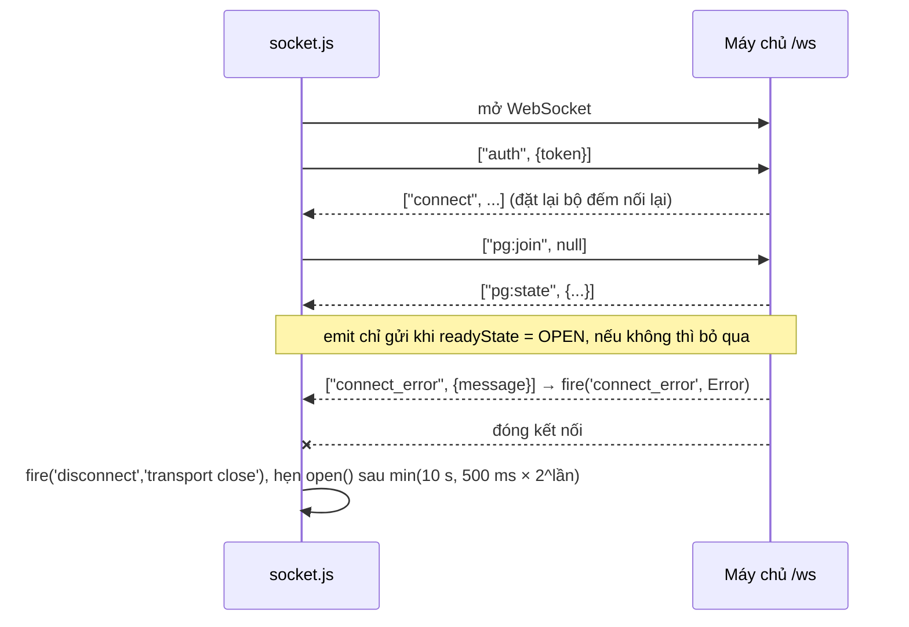

# Socket phía trình duyệt

> [!summary]
> `socket.js` (63 dòng) là một lớp WebSocket thuần mô phỏng phần nhỏ của API socket.io mà `park.js` dùng: `io({auth})` trả về `{on, emit, disconnect, removeAllListeners}` với các sự kiện `connect`, `connect_error`, `disconnect`. Khung tin là mảng JSON `[event, payload]`; khung đầu tiên gửi đi là `['auth', auth]`. Tự nối lại khi rớt mạng với thời gian chờ tăng dần. `app.js` gán nó vào `window.io` để `park.js` gọi như socket.io.

## Địa chỉ

`wsUrl()` trong `api.js`:

| Trường hợp | URL | Nguồn |
|---|---|---|
| Có `#ws=` trong hash (WorkHub chạy local, vì máy chủ dev của Next không chuyển tiếp WebSocket) | giá trị đó, lưu vào `sessionStorage['petdex.ws']` để sống qua lần tải lại khung | `public/ta-tua/game/js/api.js:6-15` |
| Mặc định | `wss://` (hoặc `ws://` trên http) + `location.host` + `BASE` + `/ws`; `BASE` là đường dẫn trước `/game/` (WorkHub: `/ta-tua`) | `api.js:4`, `api.js:16` |

## Giao thức khung

| Hành vi | Chi tiết | Nguồn |
|---|---|---|
| Nhận | `JSON.parse`; bỏ qua khung không phải mảng hoặc lỗi cú pháp | `public/ta-tua/game/js/socket.js:20-32` |
| `connect` | đặt `attempt = 0` | `socket.js:29` |
| `connect_error` | chuyển payload thành `Error(message ?? 'Không kết nối được.')` | `socket.js:30` |
| Đóng do mình (`disconnect()`) | `closedByUser = true`, hủy hẹn giờ, `close(1000, 'bye')`, phát `disconnect` với lý do `io client disconnect` | `socket.js:35`, `socket.js:52-56` |
| Đóng do mạng | phát `disconnect` lý do `transport close`, nối lại sau `min(10 000, 500 × 2^attempt)` ms | `socket.js:36-37` |
| `onerror` | nuốt lỗi (để `onclose` xử lý) | `socket.js:39` |
| `emit(event, payload)` | gửi `[event, payload ?? null]` khi socket đang mở | `socket.js:48-51` |

Danh sách sự kiện công viên và ý nghĩa: [[Giao thức công viên]], cách vẽ: [[Vẽ công viên]]. Phía máy chủ: [[Hub WebSocket]], [[Durable Object PetdexPark]].

> [!info] Không dùng thư viện socket.io
> Tên `io`, `window.io` và chuỗi lý do `io client disconnect` được giữ để `park.js` (viết lúc còn dùng socket.io) chạy nguyên (`public/ta-tua/game/js/app.js:4-5`, `socket.js:1-3`).

## Liên quan
- [[Vẽ công viên]], [[Màn Công viên]], [[Giao thức công viên]], [[Hub WebSocket]], [[App shell]], [[Trang chơi server1]]
