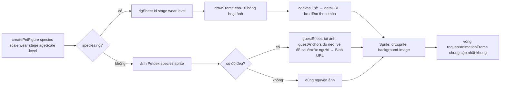

# Sprite và bảng hình

> [!summary]
> Hai mô-đun biến một bé thành hình động trên trang. `petsheet.js` dựng **spritesheet** (một ảnh lưới chứa mọi khung của mọi hoạt ảnh) với đồ đang đeo vẽ sẵn vào từng khung, theo hai đường: bé vẽ bằng [[Bộ khung thú]] (tức thì, từ dữ liệu loài) và bé khách mời Petdex (ảnh vẽ sẵn, phải dò điểm neo rồi vẽ đồ lên, bất đồng bộ). `sprite.js` chạy hoạt ảnh bằng `background-position` của một `
` và cung cấp `createPetFigure`, hàm mọi màn dùng để vẽ bé kèm bóng đổ.

## Đường ống dựng hình

## `petsheet.js`

| Mục | Giá trị | Nguồn |
|---|---|---|
| `ART_PX` | 4,8: cỡ một pixel nghệ thuật trên màn hình ở tỉ lệ 1 (bằng độ thô của Boba và cảnh pixel) | `public/ta-tua/game/js/petsheet.js:8-9` |
| Ô bộ khung | `RIG_FW = 46`, `RIG_FH = 49` (cắt 3 hàng dưới để chân sát đáy như ảnh Petdex) | `petsheet.js:11-13` |
| Hàng bộ khung `RIG_ROWS` | idle, runRight, runLeft (run lật), wave, jump, sad, wait (= think), busy, think, spin | `petsheet.js:16-19` |
| `PETDEX_SHEET` | lưới 8 cột, khung 192×208; idle 7 khung 6 fps, runRight/runLeft 8 khung 12 fps, wave 4/6, jump 5/9, sad 8/4, wait 6/6, busy 6/8, think 6/4, spin 8/10 | `petsheet.js:22-39` |
| `rigSheet(id, stage, wear, level)` | khóa đệm `rig|loài|tuổi|bậc dáng|đồ`; khung hiển thị `46 × 4,8` px; `pixelated: true`; `bodyH` = chiều cao từ đỉnh đầu tới chân để đặt hiệu ứng trên đầu | `petsheet.js:45-73` |
| `guestAnchors(img, spec)` | mỗi khung: đỉnh đầu là hàng trên cùng có từ 2 điểm đặc (alpha > 60), tâm ngang lấy trong 30% trên; neo đầu 3%, mặt 33%, cổ 47%, lưng 45%, bùa 60% chiều cao (bùa đặt ngoài nửa bề ngang đầu + 2) | `petsheet.js:90-144` |
| `guestSheet(sprite, wear)` | vẽ lưng và cổ **sau** người (Boba ôm cốc trước ngực nên đồ cổ chỉ lộ hai bên), rồi ảnh gốc, rồi mặt, đầu, bùa; xuất `toBlob` → `URL.createObjectURL` | `petsheet.js:148-181` |

## `sprite.js`

| Mục | Việc | Nguồn |
|---|---|---|
| Vòng lặp chung | một `requestAnimationFrame` duy nhất cập nhật mọi sprite trong tập `live` | `public/ta-tua/game/js/sprite.js:8-14` |
| `class Sprite(sheet, scale)` | `setSheet` (đổi ảnh khi thay đồ mà giữ hoạt ảnh), `setScale`, `play(name, {once, then})` (chạy một lần rồi quay về `then`), `update`, `draw` (đặt `background-position`), `destroy`; getter `busy` khi đang chạy một lần | `sprite.js:20-92` |
| `createPetFigure(species, scale, wear, {stage, ageScale, level})` | tạo `div.pet-figure` gồm bóng `img.pet-shadow` (hình `shadow` của [[Vẽ pixel]]) và `div.pet-body`; bé bộ khung dùng `scale` nguyên (dáng tuổi và cấp đã vẽ trong khung), bé khách mời nhân `ageScale × levelForm(level).grow` (chỉ lớn thêm cỡ người); trả `{el, body, sprite, scale, height, setWear, destroy}` | `sprite.js:94-146` |

`setWear` của bé khách mời dùng "vé" (`ticket`) để bỏ kết quả cũ nếu người chơi đổi đồ liên tục (`sprite.js:130-137`).

## Nơi gọi `createPetFigure`

| Nơi | Tỉ lệ | Nguồn |
|---|---|---|
| Màn đăng nhập (vẫy tay) | 0,7 | `public/ta-tua/game/js/app.js:158` |
| [[Màn Nhà]] | 1,25 | `app.js:550` |
| [[Màn Nhận nuôi]] | 0,8 (bộ khung) hoặc 0,62, dáng sơ sinh | `app.js:786` |
| [[Màn Bảng vàng]] | 0,3 | `app.js:980`, `app.js:1008` |
| [[Màn Bạn bè]] | 0,38 thẻ bạn, 0,6 khi thăm nhà | `public/ta-tua/game/js/views/community.js:73`, `community.js:94` |
| [[Màn Công viên]] | xem [[Vẽ công viên]] | `public/ta-tua/game/js/park.js` |

## Liên quan
- [[Bộ khung thú]], [[Vẽ pixel]], [[Linh vật Boba]], [[Loài và độ hiếm]], [[Trang phục]]
- [[Xưởng tạo hình Pet Lab]], [[Kiến trúc giao diện game]]
