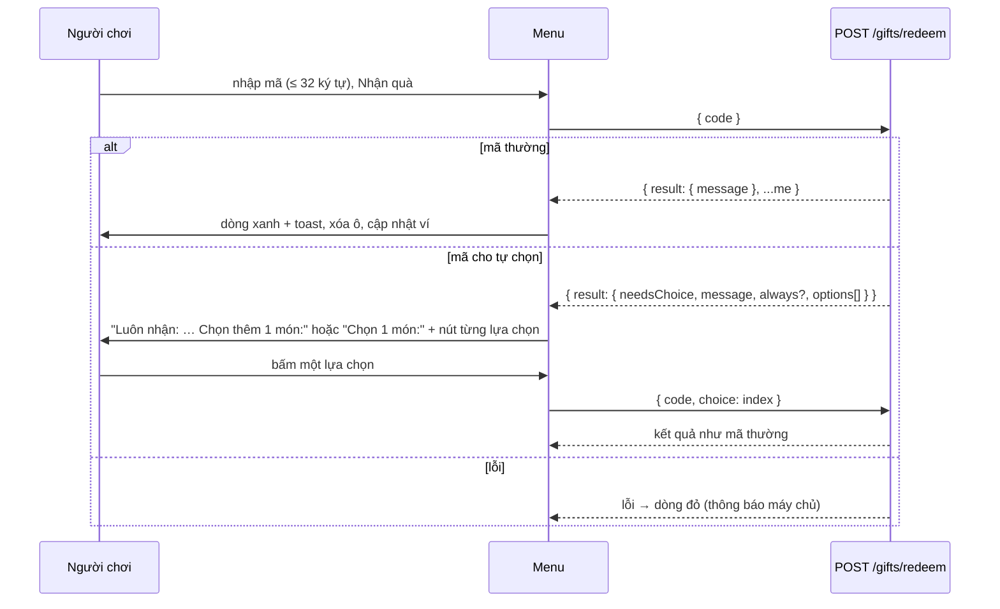

# Thanh điều hướng và menu tài khoản

> [!summary]
> Thanh trên cùng (`header.topbar`, dính đầu trang) gồm logo, 6 tab chính và cụm ví: chip 🎁 Quà ngày (đếm ngược tới lượt sau, hiện chuỗi đăng nhập), chip 🪙 số xu (mở [[Màn Ví]]) và chip 👤 tên người chơi. Ở bản nhúng WorkHub, chip tên mở **menu tài khoản** với 3 khối: nhập [[Mã quà]] (kể cả mã cho tự chọn quà), đặt/đổi mật khẩu, đăng xuất.

## Thành phần

| Phần | HTML | Hành vi | Nguồn |
|---|---|---|---|
| Logo | "🧋 Petdex **Park**" | không bấm được | `public/ta-tua/game/index.html:41` |
| Tab | `button[data-view]`: 🗺️ Phố, 🏠 Nhà, 🎒 Túi đồ, 👛 Ví, 👥 Bạn bè, 🌳 Công viên | `go(view)`; tab của màn hiện tại có lớp `active` | `index.html:42-49`, `public/ta-tua/game/js/app.js:222`, `app.js:1042-1045` |
| Quà ngày | `#daily-btn.chip.daily` | xem dưới | `index.html:51`, `app.js:266-278`, `app.js:1047-1053` |
| Số xu | `#coin-count.chip.coins` "🪙 n" (định dạng vi-VN) | `go('wallet')` | `index.html:52`, `app.js:268`, `app.js:1055` |
| Tên | `#logout-btn` "👤 {tên}" | độc lập: `confirm('Đăng xuất khỏi Petdex Park?')` rồi đăng xuất; nhúng: mở menu tài khoản (tooltip "Tài khoản: nhập mã quà, đổi mật khẩu, đăng xuất") | `index.html:53`, `app.js:1057-1064` |

Ở màn hình ≤ 720 px, tab xếp icon trên chữ, tên người chơi và nhãn Quà ngày bị ẩn chỉ còn icon (`public/ta-tua/game/css/style.css:381-392`).

## Chip Quà ngày

| Trạng thái | Hiển thị | Nguồn |
|---|---|---|
| Chưa tới giờ (`dailyReadyAt > now`) | `disabled`, "⏳ Quà sau 3g05" (`formatWait`: "XgYY" hoặc "Np") | `app.js:270-275`, `public/ta-tua/game/js/ui.js:118-122` |
| Sẵn sàng | lớp `ready` (hồng, lắc `wiggle`), "🎁 Nhận quà ngày · 🔥{streak}" | `app.js:273-276`, `style.css:133` |
| Tooltip | "Chuỗi đăng nhập n ngày. Nhận liên tiếp mỗi ngày để quà tăng dần tới 120 xu." | `app.js:277` |
| Bấm | `act('/daily')`; toast thông báo của máy chủ (ví dụ "🎁 Quà ngày (chuỗi n ngày): +x 🪙 · trợ cấp tân thủ +y 🪙"); ở [[Màn Nhà]] có mưa xu | `app.js:1047-1053`, `petdex/server/routes.js:158-164` |

Con số 120 khớp công thức `60 + 10 × (min(streak, 7) − 1)` (`petdex/server/rules/town.js:80-81`). Chip được vẽ lại mỗi lần `render()`, `refreshMe()` (30 giây) và `applyResult`, nên đếm ngược chỉ nhảy theo các mốc đó, không theo từng giây. Luật: [[Quà ngày]].

## Menu tài khoản (`openAccountMenu`)

Mở bằng `openModal` tiêu đề "👤 {tên}" (`app.js:1070-1104`).

### 🎁 Nhập mã quà

Mọi nút bị khóa trong lúc chờ; mã lưu ở `choiceBox.dataset.code` để gửi lại kèm lựa chọn (`app.js:1111-1149`). Chi tiết mã và quà: [[Mã quà]], [[Quản trị trang phục và mã quà]].

### 🔑 Đặt / đổi mật khẩu

| Mục | Chi tiết | Nguồn |
|---|---|---|
| Tiêu đề | "Đổi mật khẩu" nếu `user.hasPassword`, không thì "Đặt mật khẩu" | `app.js:1086` |
| Lời giải thích | đổi: "Đăng nhập bằng tên **X**. Đổi xong, các máy khác đang đăng nhập sẽ bị đăng xuất."; đặt: "Đặt mật khẩu để lần sau vào thẳng trang chơi bằng tên **X**." | `app.js:1087-1089` |
| Ô | "Mật khẩu hiện tại" (chỉ khi đổi), "Mật khẩu mới (ít nhất 6 ký tự)" (6–72), "Nhập lại mật khẩu mới" | `app.js:1090-1095` |
| Kiểm ở client | "Mật khẩu cần ít nhất 6 ký tự.", "Hai lần nhập mật khẩu chưa khớp." | `app.js:1153-1154` |
| Gửi | `POST {location.origin}/api/ta-tua/account` với `{action: 'credentials', token, username, password, currentPassword}` (API của WorkHub, cùng tên miền với khung, không phải API game) | `app.js:1158-1162` |
| Kết quả | "Đã lưu. Lần sau đăng nhập bằng tên X và mật khẩu mới." và đặt `hasPassword = true`; lỗi: thông báo của WorkHub hoặc "Không lưu được, thử lại nhé." | `app.js:1163-1172` |

### 🚪 Đăng xuất

Phiên `who=member`: chỉ có câu "Bạn đang chơi bằng tài khoản WorkHub: đăng xuất ở WorkHub." Phiên khác: nút "🚪 Đăng xuất" → `confirm('Đăng xuất khỏi Pet Town?')`; trong khung thì gửi `postMessage({type: 'petdex:logout'})` cho trang ngoài, không thì tự `logout()` (`POST /auth/logout`, xóa token, về [[Màn Đăng nhập]]) (`app.js:1098-1102`, `app.js:1174-1180`, `app.js:174-180`). Xem [[Khung nhúng WorkHub]].

> [!warning] Lệch tài liệu
> Chữ trong game không thống nhất tên: logo và màn đăng nhập ghi "Petdex Park", hộp xác nhận bản độc lập ghi "Đăng xuất khỏi Petdex Park?", còn menu nhúng ghi "Đăng xuất khỏi Pet Town?"; tiêu đề tab trình duyệt là "Petdex Park" (`index.html:6`) trong khi WorkHub gọi là "Pet Town".

## Liên quan
- [[App shell]], [[Khung nhúng WorkHub]], [[Màn Ví]], [[Quà ngày]], [[Mã quà]], [[Tài khoản người chơi]], [[Phong cách và CSS]]
