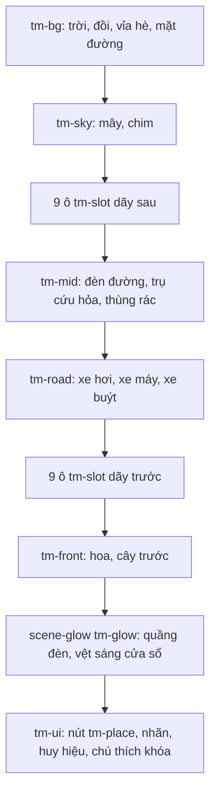

# Vẽ bản đồ phố

> [!summary]
> `townmap.js` (1526 dòng, file lớn nhất của client) vẽ bản đồ "Phố Trân Châu" ở [[Màn Phố]]: hai dãy nhà 9 ô hai bên một con phố, mỗi tòa là một canvas pixel riêng (để nhấc lên khi rê chuột và làm xám khi còn khóa), cộng với xe cộ, mây, khói, bảng điện chạy giá, chim, hoa, đèn đường và cửa sổ sáng ban đêm. Màu theo cùng 4 buổi như [[Cảnh nhà và thời gian trong ngày]]. Mô-đun được nạp lười bằng `import()`; nếu lỗi thì màn dùng danh sách nút.

## Kích thước và lưới

| Hằng | Giá trị | Nguồn |
|---|---|---|
| Độ thô | `PX = PARK_PX = 3` | `public/ta-tua/game/js/townmap.js:4-7` |
| Cảnh | `W = 334`, `H = 200` pixel cảnh; "thế giới" 1000 px rộng, co giãn bằng `transform: scale(width/1000)` | `townmap.js:8-9`, `townmap.js:1494-1505` |
| Ô | `SLOTS = 9` mỗi dãy, `SLOT_W = 37` | `townmap.js:10-11` |
| Chân dãy | `BASE = [92, 188]` (dãy sau, dãy trước); mặt đường `ROAD = [100, 126]`; khoảng trống trên nóc `HEAD = 22` cho khói và cờ | `townmap.js:12-15` |
| Thu gọn | `COMPACT_BELOW = 520` px: thêm lớp `tm-compact`, nhãn chỉ còn biểu tượng | `townmap.js:16`, `townmap.js:1498-1503` |
| Chiều cao tòa `HEIGHT` | home 40, shop 36, jobs 50, bank 44, market 46, news 34, townhall 56, school 50, clinic 40, park 34, arcade 36, kitchen 42, garden 32, bazaar 32, boba 52, factory 46, realestate 44, arena 48, filler 34 | `townmap.js:407-410` |

Hàng 0 (dãy sau) và hàng 1 (dãy trước) khớp với trường `row`, `slot`, `kind` trong `PLACES` của [[Màn Phố]].

## Thứ tự lớp

Nguồn `townmap.js:1214-1232`.

## Dựng một tòa (`renderBuilding`)

- Mỗi `kind` có hàm vẽ riêng trong `BUILD` (home, shop, jobs, bank, market, news, townhall, school, clinic, park, arcade, kitchen, garden, bazaar, boba, factory, realestate, arena; ô trống dùng `filler` vẽ vài cái cây) (`townmap.js:412-957`).
- Bộ dựng `kit` cung cấp tường, kính, cửa sổ, cửa sổ vòm, cửa, mái dốc `gable`, mái thang `hip`, phào `cornice`, mái hiên sọc `awning`, bãi cỏ, khói `smoke`, bảng điện tử `ticker` (chữ số 3×5 `GLYPHS`, xanh khi tăng đỏ khi giảm) (`townmap.js:250-404`). Có chi tiết động như chuông trường (`schoolBell`) và phao câu ở Khu vui chơi (`bobber`).
- Tòa khóa: `greyOut` bỏ màu, nén tương phản như ảnh cũ, kèm ổ khóa pixel `PADLOCK` (`townmap.js:211-224`, `townmap.js:267-275`).
- Ban đêm: `lightWindows` thắp ngẫu nhiên một phần ô kính bằng cách thay đúng các màu kính `GLASS` (`#a9d6ec`→`#ffe7a0`, `#8fc4e0`→`#ffd27a`, `#e3f4fb`→`#fff6d6`), giữ nguyên rèm và kệ hàng (`townmap.js:35-36`, `townmap.js:969-993`).
- Hàm hình dựng sẵn (cây, bụi, mây, ghế, hàng rào) được **chép** từ `scenes.js` chứ không import (`townmap.js:39`).

## Tương tác

| Hành vi | Chi tiết | Nguồn |
|---|---|---|
| Nút trong suốt | mỗi ô một `button.tm-place` đặt đúng vùng tòa (tính từ hàng pixel đặc đầu tiên `firstSolidRow`) | `townmap.js:1234-1260`, `townmap.js:1300-1308` |
| Rê chuột / focus bàn phím | thêm lớp `hot` cho ô (nhấc tòa lên) | `townmap.js:1249-1253` |
| Nhãn | `tm-label` (icon, tên), `tm-badge` (huy hiệu "Lương sẵn sàng!"...), `tm-tip` (lý do khóa) | `townmap.js:1240-1246`, `townmap.js:1310-1327` |
| `aria-label` | "Tên (đang khoá: Mở khi có bé cấp n)" hoặc "Tên – huy hiệu" | `townmap.js:1316-1319` |
| Bấm tòa mở | `onSelect(id)` → `ctx.go(view)` | `townmap.js:1476-1478` |
| Bấm tòa khóa | lắc (`shake`) cả nút và tòa, hiện chú thích 2 giây | `townmap.js:1479-1489` |
| Cỡ chữ nhãn | biến CSS `--tm-k` phóng ngược để chữ không nhỏ hơn khoảng 10 px (12 px khi thu gọn) | `townmap.js:1500-1503` |
| Giao thông | 2 làn `LANES` (y 111 tốc độ 13 sang trái; y 124 tốc độ 17 sang phải), xe hơi, xe máy, xe buýt; đèn pha ban đêm | `townmap.js:1125-1187` |

## API

`mountTownMap(container, { places, onSelect }) → { update(places), destroy() }`. Hoạt ảnh 12 fps; kiểm tra buổi mỗi 60 giây; `ResizeObserver` co giãn; chờ `document.fonts.ready` rồi canh lại nhãn (`townmap.js:1202-1526`).

> [!info] Tiếng Việt trong mã
> Mã này viết "khoá" (dấu kiểu cũ) trong `aria-label` và chú thích, còn các màn khác viết "khóa".

## Liên quan
- [[Màn Phố]], [[Bản đồ Phố Trân Châu]], [[Cảnh nhà và thời gian trong ngày]], [[Vẽ pixel]], [[Vẽ bản đồ đất]], [[Phong cách và CSS]]
