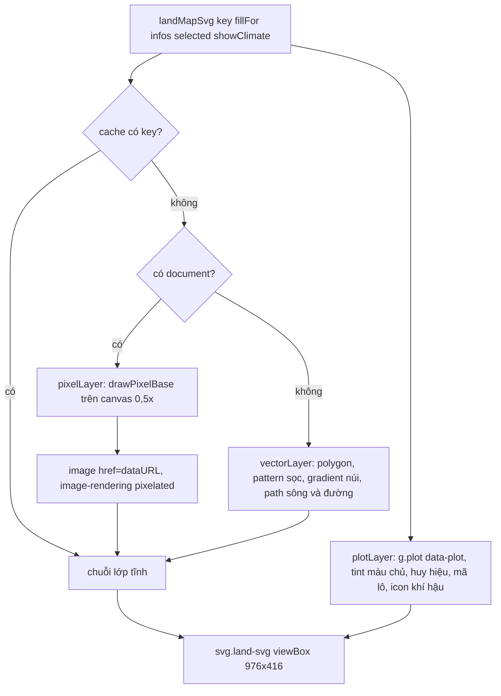

# Vẽ bản đồ đất

> [!summary]
> Bản đồ 200 lô đất của [[Màn Clan]] là một SVG hai lớp: lớp tĩnh (nền địa hình, sông, trục đường) được dựng một lần cho mỗi chế độ tô màu rồi lưu đệm, và lớp lô (vùng bấm, màu gia tộc chủ, huy hiệu, mã lô) dựng lại mỗi lần vẽ. Trong trình duyệt, lớp tĩnh là ảnh pixel art vẽ trên canvas nửa độ phân giải (`landpixel.js`) phóng to sắc nét; khi không có `document` (test trên Node) thì dùng bản vector. Mọi người thấy cùng một bản đồ vì hình học sinh tất định từ `shared/clan.js`.

## Hình học

| Hằng | Giá trị | Nguồn |
|---|---|---|
| Lưới lô | `LAND = { cols: 20, rows: 10, count: 200, minPrice: 100_000, maxPrice: 2_000_000, maxGrowth: 0.18, maxProd: 0.18 }` | `public/ta-tua/game/js/shared/clan.js:106` |
| Ô | `TW = 48`, `TH = 40`, lề `PAD = 8`; `MAP_W = 20×48 + 16 = 976`, `MAP_H = 10×40 + 16 = 416` | `public/ta-tua/game/js/landmap.js:8-12` |
| Phố | nửa bề rộng `GAP = 3.2`, khu phố là tứ giác lô co vào (`inset`) trừ lô biển | `landmap.js:13`, `landmap.js:29-45` |
| Góc cong | `corner(i, j)` lệch theo hàm sin/cos, mép ngoài giữ thẳng, nên khu phố uốn lượn | `landmap.js:18-24` |
| `GEOMETRY` | Map id → `{quad, block, cx, cy, angle}` | `landmap.js:39-45` |
| Sông | theo `riverRow(c)` tới cột 13 rồi chéo xuống, dừng khi gặp biển | `landmap.js:115-124` |
| Trục đường | hàng 5, cột 7, cột 14 và một đường chéo; vòng xoay tại (7,5) và (14,5); bỏ đoạn nằm hẳn trên biển | `landmap.js:127-146` |

7 địa hình (`ZONES`): Trung tâm 🏙️, Ven sông 🏞️, Ven biển 🏖️, Trên biển 🌊, Đồi núi ⛰️, Rừng 🌲, Đồng bằng 🌾; 4 khí hậu: Nhiều nắng ☀️, Mưa ẩm 🌧️, Ôn hòa ⛅, Lộng gió 🌬️ (`shared/clan.js:81-95`).

## Đường ống vẽ

Nguồn: `landmap.js:150-171` (`staticLayer`, `pixelLayer`), `landmap.js:174-201` (`vectorLayer`), `landmap.js:208-227` (`plotLayer`, `landMapSvg`).

## Nền pixel (`landpixel.js`)

1. Canvas `PIXEL_SCALE = 0.5` (`public/ta-tua/game/js/landpixel.js:8`). Duyệt từng điểm ảnh, tìm lô chứa nó trong 9 ô lân cận bằng thử điểm trong đa giác (`inside`), tô màu bằng `ImageData` (`landpixel.js:105-157`).
2. Màu: không thuộc lô là phố kem `#f3e7d1` (viền `#e2d2b4`); có màu nhiệt thì tô màu đó (điểm tối `shadeHex` ×0,88); không thì màu địa hình kèm nhiễu Bayer (`bayer(x, y)` từ [[Vẽ pixel]]). Bảng màu `PIXEL_PALETTE` (`landpixel.js:10-22`).
3. Trang trí khi không tô nhiệt: nhà mái màu (`house`), cây (`tree`), núi (`peak`), sóng, cầu cảng ven biển, công viên đồng bằng; hạt giống `seeded(plot.id × 7919)` để cố định (`landpixel.js:159-197`).
4. Sông: dấu tròn bán kính 5 màu bờ, 4 màu nước, gợn sáng mỗi 9 mẫu, lấy mẫu Catmull-Rom (`sample`) (`landpixel.js:36-60`, `landpixel.js:199-203`).
5. Trục đường: viền `#c27c2c`, mặt cam `#eda447`, vạch `#ffe2a0` đứt quãng, đè lên sông thành cầu; vòng xoay có đảo cỏ (`landpixel.js:205-217`).

## Lớp lô

Mỗi lô là `<g class="plot taken|free [mine] [sel]" data-plot="id">`: đa giác tô màu gia tộc chủ độ mờ 0,38 (nét đứt nếu là lô của mình), đa giác `hit` để bấm, huy hiệu tròn trắng có biểu tượng gia tộc, mã lô ở góc trên trái, và icon khí hậu khi ở chế độ Khí hậu (`landmap.js:208-220`). Màn Clan chọn lô bằng cách đổi lớp `sel` và đưa nhóm lên cuối để vẽ trên cùng, không dựng lại SVG (`public/ta-tua/game/js/views/clans.js:624-631`). Kiểu chữ, nét chọn ở `css/clans.css` ([[Phong cách và CSS]]).

## Liên quan
- [[Màn Clan]], [[Bản đồ đất]], [[Clan]]
- [[Vẽ pixel]], [[Vẽ bản đồ phố]] (cùng phong cách), [[Kiến trúc giao diện game]]
