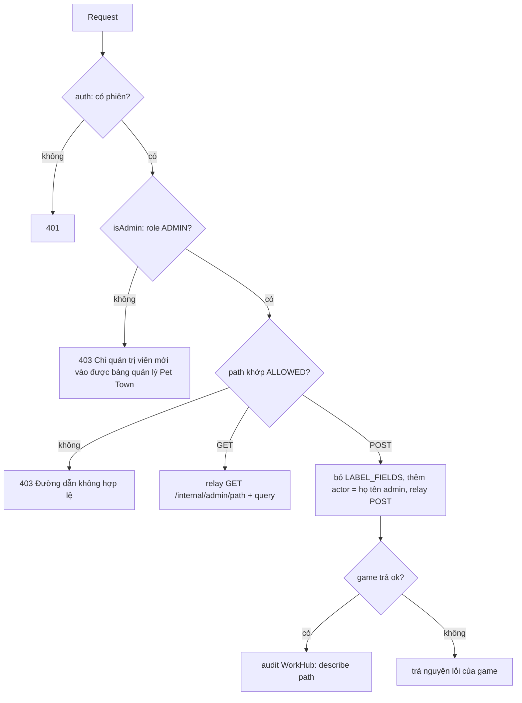

# API cầu nối WorkHub

> [!summary]
> Ba route Next.js dưới `/api/ta-tua/` là cầu nối duy nhất giữa trình duyệt và [[API nội bộ]] của game: `guest` (vào bằng link mời, quay lại bằng token), `account` (tài khoản tên + mật khẩu) và `admin/[...path]` (bảng quản lý). Chúng kiểm tra đầu vào bằng zod, giới hạn tần suất, rồi gọi `gameJson`/`gameFetch` qua binding `PETDEX`. Lỗi luật của game là tiếng Việt và an toàn để hiện thẳng.

## Tổng quan

| Route | Method | Ai gọi | Công khai? | Gọi vào game | Nguồn |
|---|---|---|---|---|---|
| `/api/ta-tua/guest?code=` | GET | trang mời | có | `GET /internal/invites/:code` | `app/api/ta-tua/guest/route.ts:15-25` |
| `/api/ta-tua/guest` | POST `{code, name}` | trang mời | có | `POST /internal/guest` | `app/api/ta-tua/guest/route.ts:37-41` |
| `/api/ta-tua/guest` | POST `{resume}` | trang chơi | có | `POST /internal/guest/resume` | `app/api/ta-tua/guest/route.ts:31-36` |
| `/api/ta-tua/account` | POST `{action,...}` | form tài khoản | có | `POST /internal/account/<action>` | `app/api/ta-tua/account/route.ts:31-51` |
| `/api/ta-tua/admin/<path>` | GET, POST | [[Bảng quản lý Pet Town]] | **không**, chỉ ADMIN | `/internal/admin/<path>` | `app/api/ta-tua/admin/[...path]/route.ts:60-88` |

## `guest`
- Schema vào: `{ code: 6–64, name: trim 2–40 }` hoặc `{ resume: 16–128 }` (`app/api/ta-tua/guest/route.ts:10-11`). Thử `resume` trước, không khớp thì thử vào bằng mã.
- GET với mã sai dạng trả `{valid: false, label: null}` không hỏi game (`app/api/ta-tua/guest/route.ts:18`).
- `GameError` thành 400 với thông báo của game; lỗi khác ném tiếp (500) (`app/api/ta-tua/guest/route.ts:13`).
- Phản hồi vào bằng mã: `{ ok: true, token, username }` (`app/api/ta-tua/guest/route.ts:41`).

## `account`
Schema là union theo `action` (`app/api/ta-tua/account/route.ts:21-29`):

| action | Trường | Việc trong game | Nguồn game |
|---|---|---|---|
| `register` | `username`, `password` | Tạo tài khoản loại `player` (mặc định của cột `users.kind`, `petdex/server/db.js:481`), 150 xu, trả token | `petdex/server/internal.js:158-169` |
| `login` | `username`, `password` (được rỗng) | Đăng nhập; tài khoản cũ chưa có mật khẩu trả 409 `reason: no_password` | `petdex/server/internal.js:171-180` |
| `credentials` | `token`, `currentPassword?`, `username`, `password` | Đặt/đổi tên đăng nhập + mật khẩu từ phiên đang chơi; đổi thì cần mật khẩu cũ và đăng xuất nơi khác | `petdex/server/internal.js:186-202` |
| `claim` | `tokens[≤5]`, `username`, `password` | Tạo mật khẩu cho tài khoản cũ khi trình duyệt còn giữ token của chính nó; không thì 409 `reason: no_proof` | `petdex/server/internal.js:208-220` |
| `setup` | `code` 32 hex, `username`, `password` | [[Link đặt mật khẩu]] | `petdex/server/internal.js:241-256` |

- Body sai: 400 "Điền tên đăng nhập và mật khẩu." (`app/api/ta-tua/account/route.ts:37`).
- `GameError` thành 400, giữ `reason` nếu có (để form hiện nút *Tạo mật khẩu*) (`app/api/ta-tua/account/route.ts:46-48`).
- Giới hạn tần suất hai tầng, xem [[Giới hạn tần suất]].

## `admin/[...path]`

- **Danh sách đường được phép** (`ALLOWED`, `app/api/ta-tua/admin/[...path]/route.ts:12`): `overview`, `log`, `gear-config`, `gear/<id>`, `gear/<id>/delete`, `gift-codes`, `gift-codes/<id>`, `gift-codes/<id>/revoke`, `clans`, `clans/config`, `clans/macro`, `clans/plots/<id>`, `clans/evasion/<id>/collect|dismiss`, `invites`, `invites/<id>/revoke`, `players`, `players/<id>`, `players/<id>/coins|status|name|password-link|gear|pets`, `players/<id>/pets/<petId>`.
- **Trường chỉ để ghi nhật ký** (`LABEL_FIELDS`): `playerName`, `petName`, `speciesName`, `itemName`, `tierName`, `clanName`, `plotCode`. Board gửi kèm để câu nhật ký dễ đọc; game không bao giờ thấy (`app/api/ta-tua/admin/[...path]/route.ts:15`, `app/api/ta-tua/admin/[...path]/route.ts:78-81`).
- `actor` = `me.name` của WorkHub, game cắt còn 80 ký tự (`app/api/ta-tua/admin/[...path]/route.ts:81`, `petdex/server/internal.js:54`).
- Phản hồi của game được chuyển nguyên văn với `content-type: application/json; charset=utf-8` (`app/api/ta-tua/admin/[...path]/route.ts:19-23`).
- Chỉ POST thành công mới ghi audit; xem [[Nhật ký quản trị]].

## Lỗi chung
| Mã | Thông báo | Nguồn |
|---|---|---|
| 503 | "Pet Town chưa được bật trên máy chủ này." | `lib/petdex.ts:36` |
| 400 | thông báo `GameError` của game | `petdex/server/internal.js:611` |
| 500 | "Máy chủ game gặp sự cố." | `petdex/server/internal.js:612-613` |
| 404 | "Không tìm thấy." (đường nội bộ không có) | `petdex/server/internal.js:608` |

## Liên quan
- [[API nội bộ]]
- [[Worker và wrangler]]
- [[Middleware định tuyến]]
- [[Lỗi và thông báo lỗi]]
- [[MOC Vận hành]]
