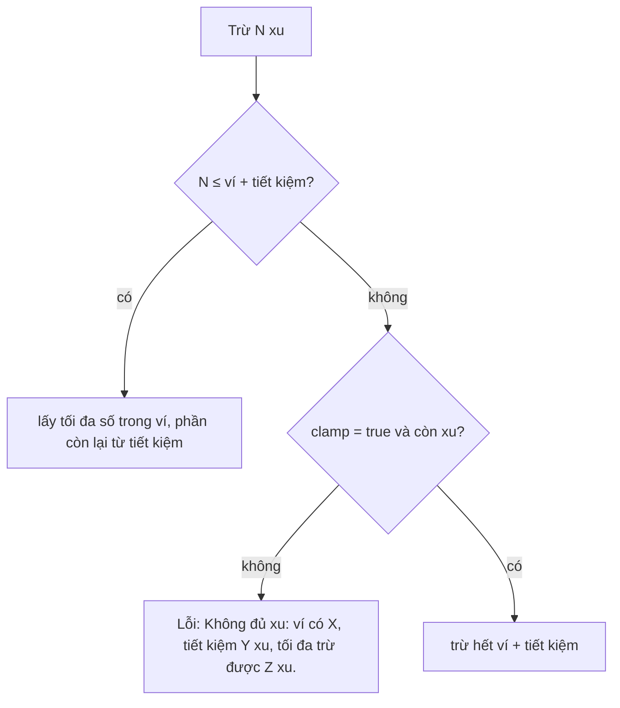

# Bảng quản lý Pet Town

> [!summary]
> `/ta-tua/quan-ly` trong WorkHub là nơi quản trị viên (role `ADMIN`) điều hành game: xem tổng quan kinh tế, tra cứu và chỉnh người chơi (xu, bé, trang phục, tên, khóa, link đặt mật khẩu), chỉnh tỷ lệ trang phục, tạo mã quà, điều hành gia tộc, đất, thuế và vĩ mô, tạo link mời và đọc nhật ký. Mọi thao tác đi qua `/api/ta-tua/admin/*` và được ghi **hai lần**: vào `admin_log` của game và vào Nhật ký thao tác của WorkHub.

## Quyền vào
| Lớp | Kiểm tra | Nguồn |
|---|---|---|
| Trang | không phải admin thì `redirect("/ta-tua")` | `app/(app)/ta-tua/quan-ly/page.tsx:9-13` |
| API | 401 nếu chưa đăng nhập; 403 "Chỉ quản trị viên mới vào được bảng quản lý Pet Town" | `app/api/ta-tua/admin/[...path]/route.ts:60-66` |
| Tên miền | không mở được trên `play.petfarm.online` (ngoài `PLAY_HOST_PATHS`) | `lib/petdex-public.ts:89` |
| Đường dẫn | phải khớp `ALLOWED`, xem [[API cầu nối WorkHub]] | `app/api/ta-tua/admin/[...path]/route.ts:12` |

## Bảy tab
Khai báo ở `TABS` (`app/(app)/ta-tua/quan-ly/board.tsx:26-34`); nút *Vào chơi* về `/ta-tua` (`app/(app)/ta-tua/quan-ly/board.tsx:135-139`).

| Tab | Component | Gọi API | Nguồn |
|---|---|---|---|
| Tổng quan | `OverviewTab` | `GET overview` | `app/(app)/ta-tua/quan-ly/board.tsx:176` |
| Người chơi | `PlayersTab`, `PlayerDrawer` | `GET players?q=&kind=`, `GET players/<id>` | `app/(app)/ta-tua/quan-ly/board.tsx:241`, `app/(app)/ta-tua/quan-ly/board.tsx:320` |
| Trang phục & rớt đồ | `GearConfigTab` | `gear-config` | `app/(app)/ta-tua/quan-ly/gear.tsx:85` |
| Mã quà | `GiftCodesTab` | `gift-codes` | `app/(app)/ta-tua/quan-ly/gear.tsx:531` |
| Gia tộc & Đất | `ClansTab` | `clans`, `clans/*` | `app/(app)/ta-tua/quan-ly/clans.tsx:154` |
| Link mời khách | `InvitesTab` | `invites` | `app/(app)/ta-tua/quan-ly/board.tsx:659` |
| Nhật ký | `LogTab` | `GET log?limit=100` | `app/(app)/ta-tua/quan-ly/board.tsx:776` |

Hai tab trang phục/mã quà xem [[Quản trị trang phục và mã quà]]; tab gia tộc xem [[Quản trị Clan]]; tab nhật ký xem [[Nhật ký quản trị]]; tab link mời xem [[Link mời]].

## Tab Tổng quan
Sáu ô số và hai bảng (`app/(app)/ta-tua/quan-ly/board.tsx:184-235`), dữ liệu từ `/internal/admin/overview` (`petdex/server/internal.js:363-375`):

| Ô | Nội dung | Nguồn dữ liệu |
|---|---|---|
| Nhân viên đã tham gia | số `member`; gợi ý số khách mời và số tự đăng ký | `usersOverview().byKind` (`petdex/server/db.js:838-845`) |
| Hoạt động | hoạt động 24 giờ qua, 7 ngày, số người đang ở công viên | `activeSince`, `parkUsers.size` |
| Xu trong ví | tổng ví; gợi ý tổng tiết kiệm | |
| Ngân sách thị trấn | số dư ngân sách; chỉ số giá và lãi cơ bản %/ngày | `treasuryBalance()`, `economy()` |
| Thú cưng | tổng số bé | |
| Tài khoản bị khoá | số người bị khóa | |
| Bảng "Dòng xu 7 ngày theo hạng mục" | lượt, vào, ra theo loại giao dịch sổ cái | `ledger7d` |
| Bảng "Giàu nhất phố" | 10 người tài sản ròng cao nhất | `richList(10)` |

Liên quan: [[Dòng xu trong game]], [[Ngân sách thị trấn]], [[Ví và tài sản ròng]].

## Tab Người chơi
- Tìm theo tên (tối đa 40 ký tự) và lọc loại: Tất cả, Nhân viên (`member`), Khách mời (`guest`), Tự đăng ký (`player`) (`app/(app)/ta-tua/quan-ly/board.tsx:249-265`, `petdex/server/internal.js:377-381`).
- Cột: Người chơi, Loại, Ví, Tiết kiệm (gồm cả tiền gửi kỳ hạn), Tài sản, Bé/cấp cao nhất, Tín dụng, Hoạt động ("Đang ở công viên" hoặc thời điểm), Trạng thái (`app/(app)/ta-tua/quan-ly/board.tsx:279-304`, `petdex/server/internal.js:65-88`).

### Ngăn chi tiết một người chơi
Dữ liệu `GET players/<id>`: người chơi, bé, túi đồ, tài sản ròng, 30 giao dịch sổ cái gần nhất, link mời đã dùng, kỹ năng, ô nuôi, số trừ được, mọi loài, trang phục (thấy cả hộp kín), danh sách đồ đeo (`petdex/server/internal.js:383-403`).

| Thao tác | API | Luật phía game | Ghi nhật ký WorkHub | Nguồn |
|---|---|---|---|---|
| Đổi tên hiển thị | `players/<id>/name` | 2–40 ký tự | `tatua.rename` | `petdex/server/internal.js:517-526` |
| Cộng / trừ xu kèm lý do | `players/<id>/coins` `{delta, memo, clamp}` | số nguyên khác 0, \|delta\| ≤ 1 tỷ; lý do ≤ 120 ký tự; sổ cái loại `admin` "Quản trị viên điều chỉnh", ghi chú kèm tên admin | `tatua.coins` | `petdex/server/internal.js:429-462`, `petdex/server/ledger.js:66` |
| Khóa / mở khóa | `players/<id>/status` `{banned}` | khóa xóa mọi phiên ngay | `tatua.ban` / `tatua.unban` | `petdex/server/internal.js:507-515` |
| Tạo link đặt mật khẩu | `players/<id>/password-link` | xem [[Link đặt mật khẩu]] | `tatua.password_link` | `petdex/server/internal.js:528-539` |
| Tặng thú cưng | `players/<id>/pets` `{species, name}` | mọi loài kể cả Huyền thoại; tên ≤ 16; cần ô trống (tối đa 4, tính cả trứng đang ấp và ô tưởng niệm) | `tatua.pet_grant` | `petdex/server/internal.js:405-421` |
| Sửa chỉ số bé | `players/<id>/pets/<petId>` | 5 chỉ số kẹp 0–100; cấp 1–100; XP ≥ 0; kỹ năng 0–100 làm tròn 0,1; `sick: null` chữa bệnh | `tatua.pet` | `petdex/server/internal.js:466-505` |
| Trang phục | `players/<id>/gear`, `gear/<id>`, `gear/<id>/delete` | xem [[Quản trị trang phục và mã quà]] | `tatua.gear_*` | `petdex/server/internal.js:275-317` |

#### Trừ xu: ví trước, tiết kiệm sau

- Tiền gửi kỳ hạn, hàng hóa, đồ đạc trong tài sản ròng **không** bị trừ (`petdex/server/internal.js:425-428`, `app/(app)/ta-tua/quan-ly/board.tsx:437`).
- Board kiểm trước: trừ quá số có thì mở hộp "Không đủ xu để trừ" đề nghị *Trừ hết N xu* (gửi `clamp: true`); không còn đồng nào thì báo "Người chơi không còn xu trong ví hay tiết kiệm để trừ" (`app/(app)/ta-tua/quan-ly/board.tsx:358-377`, `app/(app)/ta-tua/quan-ly/board.tsx:487`).
- Thông báo xong: "Đã trừ N xu (M từ tiết kiệm), ví còn K" (`app/(app)/ta-tua/quan-ly/board.tsx:372`).

> [!warning] Lệch tài liệu
> README mô tả cộng/trừ xu "không trừ quá số dư" và commit đầu `89e7f07` ghi "never below zero". Code hiện tại (từ `444bef7`) trừ được cả **tiết kiệm** khi ví thiếu, và có chế độ *Trừ hết* (`clamp`). README cũng chỉ liệt kê bộ lọc "nhân viên / khách" trong khi board có thêm "Tự đăng ký", và chưa nhắc tab *Gia tộc & Đất* (README.md:176).

#### Sửa chỉ số bé
Form 5 chỉ số (No bụng, Vui vẻ, Năng lượng, Sạch sẽ, Sức khỏe), Cấp, XP (gợi ý XP cần), và mỗi kỹ năng; chỉ gửi trường đã đổi, có nút *Hoàn tác* (`app/(app)/ta-tua/quan-ly/board.tsx:608-657`). Sửa xong game phát sự kiện `pet:changed` để người chơi thấy ngay (`petdex/server/internal.js:503`). Xem [[Chỉ số của bé]], [[Kỹ năng]], [[Cấp độ và XP]].

> [!info] Cấp tối đa khi sửa
> Server so `RULES.maxLevel ?? 100`; `RULES` không khai `maxLevel` nên trần là 100 (`petdex/server/internal.js:480`, `petdex/server/game.js:12-20`).

#### Tặng thú cưng
Chọn loài theo nhóm độ hiếm (Huyền thoại, Quý, Hiếm, Thường, Khác), tên trống thì lấy tên loài; bé tạo bằng `createPet` của game (tính cách, kỹ năng theo loài, thành bé chính nếu là bé đầu) (`app/(app)/ta-tua/quan-ly/board.tsx:559-606`, `petdex/server/internal.js:405-421`). Hết ô: "Người chơi đã hết ô nuôi (tối đa 4, tính cả trứng đang ấp và ô tưởng niệm)." Xem [[Loài và độ hiếm]].

## Tiện ích dùng chung
`shared.tsx`: `ADMIN = "/api/ta-tua/admin"`, `when()` định dạng giờ vi-VN ("Chưa" khi rỗng), `useLoad()` tải và tải lại, `Failure` hiện "Không đọc được dữ liệu game" kèm nút *Thử lại* (`app/(app)/ta-tua/quan-ly/shared.tsx:12-40`).

## Liên quan
- [[Quản trị trang phục và mã quà]]
- [[Quản trị Clan]]
- [[Nhật ký quản trị]]
- [[Link mời]]
- [[Link đặt mật khẩu]]
- [[API cầu nối WorkHub]]
- [[MOC Vận hành]]
