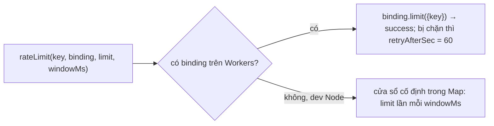

# Giới hạn tần suất

> [!summary]
> Có hai tầng chống spam và dò mật khẩu. Tầng WorkHub (`lib/rate-limit.ts`) dùng binding **Workers Rate Limiting** của Cloudflare cho đăng nhập, đăng ký và các API khách/tài khoản của game. Tầng game tự giới hạn trong bộ nhớ của Durable Object: nhập mã quà, chat, vuốt ve và tặng quà ở công viên. Vì cả game nằm trong **một** object, bộ đếm trong bộ nhớ của game là bộ đếm thật cho toàn server.

## Tầng WorkHub: `lib/rate-limit.ts`

| Điểm | Chi tiết | Nguồn |
|---|---|---|
| Vì sao cần binding | Isolate của Workers không chung bộ nhớ, đếm trong RAM không phải giới hạn thật | `lib/rate-limit.ts:1-6`, `wrangler.jsonc:59-60` |
| Trên Workers | gọi `binding.limit({ key })`; **limit/period lấy từ wrangler**, tham số `limit`, `windowMs` bị bỏ qua | `lib/rate-limit.ts:51-56` |
| Ở máy | cửa sổ cố định trong `Map`, trả số giây phải chờ | `lib/rate-limit.ts:24-34` |
| IP | `cf-connecting-ip`, rồi `x-real-ip`, `x-forwarded-for`, cuối cùng `"unknown"` | `lib/rate-limit.ts:69-76` |

### Hai binding
| Binding | Giới hạn trên Cloudflare | Nguồn |
|---|---|---|
| `LOGIN_LIMITER` | 5 lần / 60 giây cho mỗi khóa | `wrangler.jsonc:62` |
| `LOGIN_IP_LIMITER` | 30 lần / 60 giây cho mỗi khóa | `wrangler.jsonc:63` |

### Các khóa đang dùng
| API | Khóa | Binding | Fallback dev | Thông báo khi chặn | Nguồn |
|---|---|---|---|---|---|
| `POST /api/ta-tua/guest` (vào bằng link, resume) | `tatua-guest:<ip>` | `LOGIN_IP_LIMITER` | 20/phút | "Thử lại sau ít phút." | `app/api/ta-tua/guest/route.ts:28-29` |
| `POST /api/ta-tua/account` mọi action | `tatua-account:<ip>` | `LOGIN_IP_LIMITER` | 20/phút | "Thử lại sau ít phút." | `app/api/ta-tua/account/route.ts:34-35` |
| … action `login` | `tatua-login:<ip>:<tên NFC chữ thường>` | `LOGIN_LIMITER` | 5/phút | "Thử lại sau ít phút." | `app/api/ta-tua/account/route.ts:41-43` |
| … `register`, `credentials`, `claim`, `setup` | `tatua-<action>:<ip>` | `LOGIN_LIMITER` | 5/phút | "Thử lại sau ít phút." | `app/api/ta-tua/account/route.ts:42-43` |
| `POST /api/auth/login` (WorkHub) | `login:<ip>:<email>` và `login-ip:<ip>` | cả hai | 5 và 30 / 15 phút | 429 "Bạn đã thử đăng nhập quá nhiều lần. Vui lòng thử lại sau N phút." | `app/api/auth/login/route.ts:37-48` |
| `POST /api/auth/change-password` | `chpw:<userId>` | `LOGIN_LIMITER` | 5 / 15 phút | | `app/api/auth/change-password/route.ts:14` |

> [!info] Vì sao khóa login gồm cả tên
> Khóa đăng nhập game là địa chỉ IP **cộng** tên đăng nhập như game so sánh (NFC, chữ thường), "để không ai khóa được người chơi từ nơi khác" (`app/api/ta-tua/account/route.ts:39-42`). Người dò từ một IP chỉ tự khóa mình.

> [!warning] Lệch giữa dev và production
> Ở máy, giới hạn khách/tài khoản theo IP là 20/phút; trên Cloudflare cùng khóa đó dùng `LOGIN_IP_LIMITER` nên là **30/phút**. Tương tự, WorkHub login ở máy là 5 lần/15 phút, trên Cloudflare là 5 lần/60 giây. Số trong code chỉ là fallback.

## Tầng game (bộ nhớ Durable Object)
| Hành động | Giới hạn | Thông báo | Nguồn |
|---|---|---|---|
| Nhập mã quà | 10 lần / 60 giây / người chơi | "Bạn nhập mã nhiều quá, thử lại sau một phút nhé." | `petdex/server/gifts.js:216-223` |
| Chat công viên | cách nhau ít nhất 1 giây, tối đa 120 ký tự | "Từ từ thôi, nói chậm lại nào!" | `petdex/server/playground.js:10`, `petdex/server/playground.js:180-187` |
| Tặng quà ở công viên | cách nhau ít nhất 2 giây | "Tặng quà chậm thôi nào!" | `petdex/server/playground.js:11`, `petdex/server/playground.js:232` |
| Vuốt ve cùng một cặp bé | 30 giây | | `petdex/server/playground.js:9`, `petdex/server/playground.js:200` |

Các bộ đếm này mất khi object khởi động lại; chấp nhận được vì chúng chỉ chống spam ngắn hạn.

## Chỗ không có giới hạn tần suất
- [[Bảng quản lý Pet Town]]: đã chỉ cho quản trị viên.
- API game có token (`/ta-tua/api/*`): giới hạn bằng luật chơi (năng lượng, giới hạn ngày), xem [[API người chơi]].

## Liên quan
- [[Phiên chơi và token]]
- [[Tài khoản người chơi]]
- [[Mã quà]]
- [[Công viên]]
- [[MOC Vận hành]]
