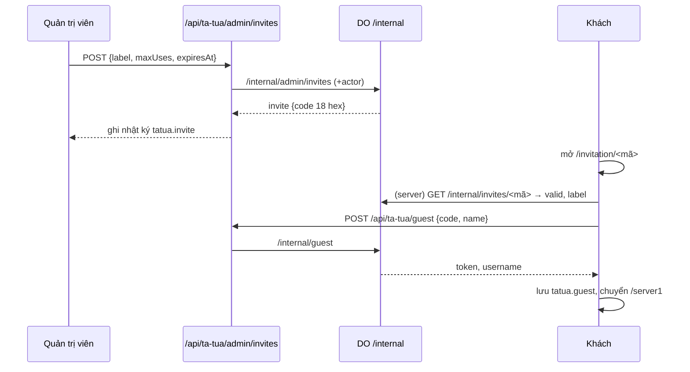

# Link mời

> [!summary]
> Link mời cho người ngoài WorkHub vào chơi chỉ bằng một cái tên. Quản trị viên tạo link ở tab *Link mời khách* của [[Bảng quản lý Pet Town]] (nhãn, số lượt, hạn dùng); người nhận mở `play.petfarm.online/invitation/<mã>`, gõ tên là được tài khoản loại `guest` với 150 xu chào mừng. Trình duyệt nhớ phiên nên lần sau mở thẳng `/server1`.

## Vòng đời một link

## Con số và quy tắc
| Thông số | Giá trị | Nguồn |
|---|---|---|
| Mã | 18 ký tự hex (9 byte ngẫu nhiên) | `petdex/server/db.js:847-848` |
| Mã hợp lệ ở trang | regex `^[a-f0-9]{6,64}$` (không phân biệt hoa thường) | `app/invitation/[code]/page.tsx:14`, `app/api/ta-tua/guest/route.ts:18` |
| Nhãn | tối đa 60 ký tự, trống thì "Khách mời" | `petdex/server/internal.js:544` |
| Số lượt | 1–10.000, trống = không giới hạn | `petdex/server/internal.js:545-546` |
| Hạn dùng | phải ở tương lai; board gửi 23:59:59 của ngày chọn | `petdex/server/internal.js:547-548`, `app/(app)/ta-tua/quan-ly/board.tsx:672` |
| Còn dùng được | chưa thu hồi, chưa hết hạn, chưa hết lượt | `petdex/server/internal.js:61-63` |
| Tên khách | 2–40 ký tự sau khi gộp khoảng trắng | `petdex/server/internal.js:46-52`, `app/api/ta-tua/guest/route.ts:10` |
| Xu chào mừng | `RULES.startCoins` = 150, ghi sổ cái loại `opening` "Quà chào mừng" | `petdex/server/game.js:13`, `petdex/server/internal.js:124` |
| Tên đăng nhập sinh ra | từ tên hiển thị: NFC, khoảng trắng thành `_`, chỉ chữ/số/`_`, tối đa 20; ngắn hơn 3 thì thêm `_bé`; trùng thì thêm `_2`, `_3`… | `petdex/server/internal.js:28-44` |
| Giới hạn tần suất POST | 20 lần/phút/IP (binding `LOGIN_IP_LIMITER`) | `app/api/ta-tua/guest/route.ts:28-29` |

## Các trang
| Trang | Việc | Nguồn |
|---|---|---|
| `/invitation/<mã>` | Server hỏi game mã còn hiệu lực không, hiện `GuestEntry` (ô "Tên của bạn", 2–40 ký tự). Khách đã có phiên lưu thì chuyển thẳng `/server1` | `app/invitation/[code]/page.tsx:9-22`, `components/tatua/guest-entry.tsx:14-60` |
| `/invitation` (không mã) | `PlayScreen` không thành viên: phiên đã lưu, hoặc ô dán link | `app/invitation/page.tsx:7-9` |
| `/ta-tua/khach/<mã>` | Link cũ trước khi có tên miền riêng: redirect sang `inviteUrl(mã)` | `app/ta-tua/khach/[code]/page.tsx:5-9` |

## Thông báo người chơi thấy
| Thông báo | Khi nào | Nguồn |
|---|---|---|
| "Link mời này không còn hiệu lực." | mã sai, hết hạn, hết lượt hoặc đã thu hồi | `petdex/server/internal.js:120` |
| "Tên dài 2–40 ký tự." | tên sai độ dài | `app/api/ta-tua/guest/route.ts:38`, `petdex/server/internal.js:51` |
| "Thử lại sau ít phút." | vượt giới hạn tần suất | `app/api/ta-tua/guest/route.ts:29` |

## Thu hồi
- Tab *Link mời khách* có nút *Thu hồi*; hộp xác nhận ghi: "Link … sẽ không nhận khách mới. Khách đã vào vẫn chơi tiếp." (`app/(app)/ta-tua/quan-ly/board.tsx:766`).
- Thu hồi lần hai báo "Link này đã thu hồi hoặc không tồn tại." (`petdex/server/internal.js:565`).
- Bảng hiển thị cột Nhãn, Link (nút chép), Đã dùng, Hạn, Tạo bởi, Trạng thái ("Đã thu hồi" / "Hết lượt hoặc hết hạn") (`app/(app)/ta-tua/quan-ly/board.tsx:727-756`).

## Trường hợp đặc biệt
- Một link tạo **tài khoản mới mỗi lần** nhập tên; khách "Đổi tên khác" là tạo thêm người chơi mới (dùng thêm một lượt).
- Khách mời có thể bổ sung tên đăng nhập + mật khẩu sau đó ([[Tài khoản người chơi]]); khi đã có mật khẩu, nút trên thanh đổi thành "Đăng xuất".
- Phiên khách lưu ở `localStorage["tatua.guest"]` (`GUEST_SESSION_KEY`), xem [[Phiên chơi và token]].

## Liên quan
- [[Bảng quản lý Pet Town]]
- [[Trang chơi server1]]
- [[Nhật ký quản trị]]
- [[Tài khoản người chơi]]
- [[MOC Vận hành]]
