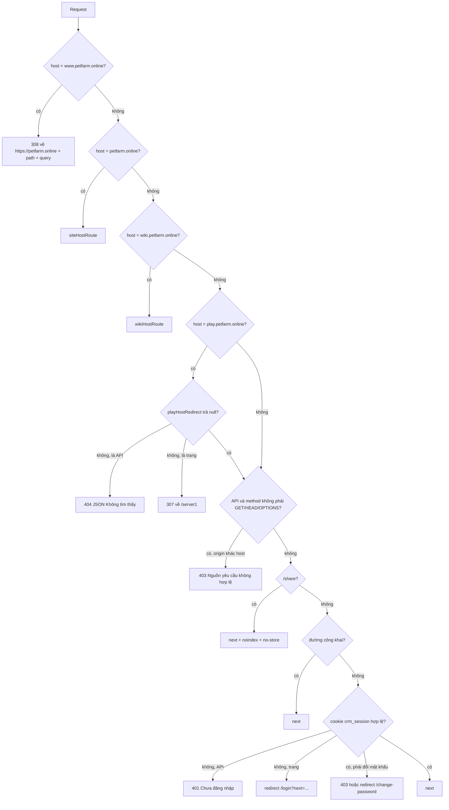

# Middleware định tuyến

> [!summary]
> `middleware.ts` chạy trước mọi trang và API của Next.js (trừ file tĩnh). Theo thứ tự, nó: chuyển `www` về tên miền chính, giới hạn tên miền giới thiệu và wiki vào đúng phần của chúng, khóa tên miền game lại chỉ còn game, chặn POST khác nguồn (CSRF), cho qua các đường công khai, rồi bắt đăng nhập WorkHub cho phần còn lại. Bảng định tuyến nằm ở `lib/petdex-public.ts` để middleware, trang và client dùng chung.

> [!info] Vì sao vẫn là middleware.ts
> Next.js 16 đổi tên file này thành `proxy.ts`, nhưng proxy luôn chạy runtime Node.js, mà OpenNext trên Cloudflare Workers chưa hỗ trợ, nên giữ `middleware.ts` (`middleware.ts:5-7`). Xem [[Quyết định thiết kế]].

## Thứ tự xử lý

## Bảng định tuyến theo tên miền

### petfarm.online: `siteHostRoute` (`lib/petdex-public.ts:64-69`)
| Đường | Kết quả |
|---|---|
| `/` | rewrite sang `/petfarm` (trang giới thiệu) |
| `/api/...` | 404 JSON "Không tìm thấy" |
| `/server1`, `/invitation...`, `/password...` | redirect sang `https://play.petfarm.online` cùng đường |
| mọi đường khác | redirect về `/` |

### wiki.petfarm.online: `wikiHostRoute` (`lib/petdex-public.ts:81-86`)
| Đường | Kết quả |
|---|---|
| `/api/...` | 404 JSON |
| `/server1`, `/invitation...`, `/password...` | redirect sang tên miền game |
| `/wiki` hoặc `/wiki/<bài>` | redirect về địa chỉ ngắn (`/` hoặc `/<bài>`) |
| `/` | rewrite sang `/wiki`, giữ query |
| `/<bài>` | rewrite sang `/wiki/<bài>`, giữ query |

### play.petfarm.online: `playHostRedirect` (`lib/petdex-public.ts:89-98`)
Chỉ những đường trong `PLAY_HOST_PATHS` được phục vụ; mọi trang khác (kể cả `/`) redirect về `/server1`, mọi API khác trả 404.

| Được phục vụ trên tên miền game | Vì sao |
|---|---|
| `/server1`, `/invitation`, `/password` | trang chơi, link mời, link đặt mật khẩu |
| `/ta-tua/game`, `/ta-tua/api`, `/ta-tua/ws` | file game, API game, công viên |
| `/ta-tua/khach` | link mời cũ, tự chuyển sang `/invitation/<mã>` |
| `/api/ta-tua/guest`, `/api/ta-tua/account` | [[API cầu nối WorkHub]] cho khách và tài khoản |
| `/login`, `/api/auth`, `/change-password` | nhân viên WorkHub đăng nhập trên tên miền game |

> [!tip] Hệ quả
> Bảng quản lý (`/ta-tua/quan-ly`, `/api/ta-tua/admin/*`) không mở được trên tên miền game, chỉ trên tên miền WorkHub. Khách mời không chạm được phần nào khác của WorkHub.

## Đường công khai (không cần phiên WorkHub)
`PUBLIC_PATHS` (`middleware.ts:12`): `/login`, `/api/auth/login`, `/share`, `/ta-tua/game`, `/ta-tua/api`, `/ta-tua/khach`, `/api/ta-tua/guest`, `/api/ta-tua/account`, `/invitation`, `/server1`, `/password`, `/petfarm`, `/wiki`. So khớp là đúng đường hoặc bắt đầu bằng `đường/` (`middleware.ts:17-18`).

> [!info] Trang `/server1` công khai nhưng vẫn biết nhân viên
> Middleware cho `/server1` đi qua không cần phiên; chính trang đọc cookie (`getCurrentUser`) để quyết định chơi bằng tài khoản WorkHub hay phiên khách ([[Trang chơi server1]]).

## Chống CSRF
Mọi request `/api/*` có method khác GET/HEAD/OPTIONS mà header `origin` có host khác `host` thì bị 403 "Nguồn yêu cầu không hợp lệ" (`middleware.ts:49-54`). Áp dụng cho cả `/api/ta-tua/account` và `/api/ta-tua/admin/*`.

## Phiên phải đổi mật khẩu
Phiên WorkHub có cờ `mcp` (phải đổi mật khẩu) chỉ được vào `/change-password`, `/api/auth/change-password`, `/api/auth/logout`, `/api/auth/me` (`middleware.ts:15`, `middleware.ts:75-78`). Trang `/server1` cũng không cấp phiên game cho người đang `mustChangePassword` (`app/server1/page.tsx:13`).

## Matcher
Middleware chạy cho mọi đường trừ `_next/static`, `_next/image`, `favicon.ico` và file ảnh/phông (`png jpg jpeg svg gif webp ico woff woff2`) (`middleware.ts:83-86`). Vì vậy ảnh `/petfarm/*.webp` tải được trên mọi tên miền (smoke test kiểm `/petfarm/map.webp`, `scripts/smoke-worker.mjs:173`).

## Mã trạng thái chuyển hướng
| Trường hợp | Mã | Nguồn |
|---|---|---|
| `www` → tên miền chính | 308 | `middleware.ts:26` |
| redirect khác của `NextResponse.redirect` | 307 (mặc định) | smoke test `scripts/smoke-worker.mjs:175` |

> [!warning] Lệch tài liệu nhỏ
> Trên `petfarm.online`, rewrite `/` sang `/petfarm` **không** giữ query (`middleware.ts:29`), còn wiki có giữ (`middleware.ts:37`). Không ảnh hưởng gì hiện nay vì trang giới thiệu không đọc query.

## Liên quan
- [[Tên miền Petfarm]]
- [[Trang chơi server1]]
- [[Đăng nhập một lần WorkHub]]
- [[CI và smoke test]]
- [[MOC Vận hành]]
