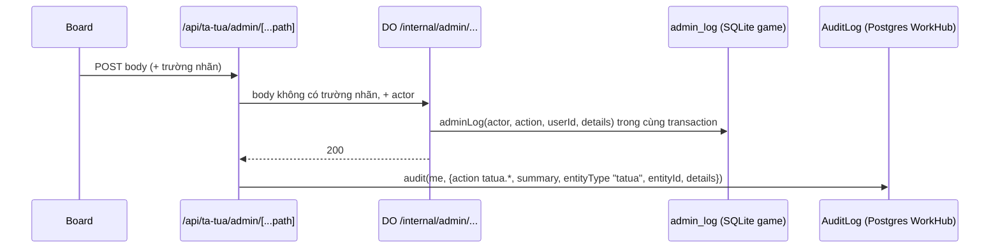

# Nhật ký quản trị

> [!summary]
> Mỗi thao tác quản trị Pet Town được ghi ở **hai nơi**: bảng `admin_log` trong SQLite của game (hiện ở tab *Nhật ký* của [[Bảng quản lý Pet Town]]) và bảng `AuditLog` trong Postgres của WorkHub (trang *Cài đặt → Nhật ký thao tác*, nhóm "Pet Town"). Hai bản bổ sung nhau: bản game có chi tiết kỹ thuật (trước/sau, số dư), bản WorkHub có câu mô tả, IP và giữ theo chính sách 365 ngày của WorkHub. Không bản nào chứa mã link đặt mật khẩu.

## Luồng ghi

- Game ghi trong **cùng transaction** với thay đổi, nên có thay đổi là có dòng nhật ký (`petdex/server/internal.js:264-272` và các route khác).
- WorkHub chỉ ghi khi game trả `ok` (`app/api/ta-tua/admin/[...path]/route.ts:82-85`); lỗi ghi audit chỉ in log, không làm hỏng thao tác (`lib/audit.ts:55-61`).
- `details` của WorkHub là body đã bỏ trường nhãn (`app/api/ta-tua/admin/[...path]/route.ts:80-84`).

## Bảng `admin_log` (game)
| Cột | Ý nghĩa | Nguồn |
|---|---|---|
| `id` | tự tăng, có chỉ mục giảm dần | `petdex/server/db.js:506-514` |
| `actor` | họ tên admin WorkHub, "Sở thuế", hoặc tên người chơi (khi tự đặt mật khẩu qua link) | |
| `action` | mã thao tác (bảng dưới) | |
| `user_id` | người chơi liên quan (có thể rỗng) | |
| `details` | JSON | |
| `created_at` | ms | |

Tab *Nhật ký* đọc 100 dòng mới nhất (`GET log?limit=100`; server cho 1–200, mặc định 50) với cột Thời gian, Quản trị viên, Thao tác, Người chơi, Chi tiết (`app/(app)/ta-tua/quan-ly/board.tsx:776-830`, `petdex/server/internal.js:569-572`).

## Bảng đối chiếu thao tác

| Game `action` | Nhãn trên tab Nhật ký | WorkHub `tatua.*` | Câu WorkHub (tóm tắt) | Ai ghi |
|---|---|---|---|---|
| `coins` | Cộng/trừ xu | `tatua.coins` | "Cộng/Trừ N xu cho/của “tên”: lý do" | admin |
| `pet` | Sửa chỉ số bé | `tatua.pet` | "Sửa chỉ số thú cưng “bé” của …" | admin |
| `pet_grant` | Tặng thú cưng | `tatua.pet_grant` | "Tặng thú cưng “loài” cho …" | admin |
| `ban` / `unban` | Khoá / Mở khoá | `tatua.ban` / `tatua.unban` | "Khoá / Mở khoá …" | admin |
| `rename` | Đổi tên | `tatua.rename` | "Đổi tên … thành “…”" | admin |
| `invite` | Tạo link mời | `tatua.invite` | "Tạo link mời khách “nhãn”" | admin |
| `invite_revoke` | Thu hồi link | `tatua.invite_revoke` | "Thu hồi link mời #id" | admin |
| `password_link` | Tạo link đặt mật khẩu | `tatua.password_link` | "Tạo link đặt mật khẩu cho … (dùng một lần, 24 giờ)" | admin |
| `password_set` | Đặt mật khẩu qua link | (không có) | | người chơi |
| `gear_config` | Chỉnh tỷ lệ trang phục | `tatua.gear_config` | "Chỉnh tỷ lệ cấp, biên độ chỉ số trang phục và tỷ lệ rớt đồ mini-game" | admin |
| `gear_grant` | Tặng trang phục | `tatua.gear_grant` | "Tặng trang phục X (cấp) cho …" | admin |
| `gear_edit` | Sửa trang phục | `tatua.gear_edit` | "Sửa cấp và chỉ số trang phục #id …" | admin |
| `gear_delete` | Xoá trang phục | `tatua.gear_delete` | "Xoá trang phục #id …" | admin |
| `gift_code` | Tạo mã quà | `tatua.gift_code` | "Tạo N mã quà “nhãn”" | admin |
| `gift_code_revoke` | Thu hồi mã quà | `tatua.gift_code_revoke` | "Thu hồi mã quà #id" | admin |
| `clan_config` | Chỉnh luật gia tộc & giá đất | `tatua.clan_config` | "Chỉnh luật gia tộc, thuế doanh nghiệp và giá đất" | admin |
| `land_price` | Đặt giá lô đất | `tatua.land_price` | "Đặt giá lô X: N xu" / "Trả lô X về giá tự tính" | admin |
| `macro` | Chỉnh kinh tế vĩ mô | `tatua.macro` | "Chỉnh kinh tế vĩ mô: pha …, thời tiết … (áp dụng ngay)" | admin |
| `tax_evasion` | Sở thuế: phát hiện khai thiếu | (không có) | | quyết toán đêm, actor "Sở thuế" |
| `tax_collect` | Truy thu thuế | `tatua.tax_collect` | "Truy thu thuế trốn của gia tộc “…” (hồ sơ #id)" | admin |
| `tax_dismiss` | Bỏ qua hồ sơ thuế | `tatua.tax_dismiss` | "Bỏ qua hồ sơ thuế #id của “…”" | admin |

Nguồn: nhãn tab `LOG_LABEL` (`app/(app)/ta-tua/quan-ly/board.tsx:771`); câu WorkHub `describe()` (`app/api/ta-tua/admin/[...path]/route.ts:25-58`); danh mục và nhóm "Pet Town" (`lib/audit-actions.ts:16`, `lib/audit-actions.ts:76-95`); `tax_evasion` (`petdex/server/clans.js:659`); `password_set` (`petdex/server/internal.js:252`).

## Thời gian lưu
| Nơi | Giữ | Nguồn |
|---|---|---|
| `AuditLog` WorkHub | 365 ngày, job bảo trì 02:00 xóa dòng cũ hơn | `lib/audit-actions.ts:110`, `lib/maintenance.ts:131-132` |
| `admin_log` game | không tự xóa | `petdex/server/db.js:874` |

> [!warning] Chỗ dễ nhầm
> - Ghi chú của sổ cái game khi cộng/trừ xu có dạng `lý do (tên admin)` (`petdex/server/internal.js:437`), nên người chơi thấy tên quản trị viên trong sao kê của mình.
> - Câu mô tả trên tab *Nhật ký* được dựng lại ở client từ `details` (`app/(app)/ta-tua/quan-ly/board.tsx:779-805`); action lạ hiện mã thô.

## Liên quan
- [[Bảng quản lý Pet Town]]
- [[API cầu nối WorkHub]]
- [[Sổ cái]]
- [[Sao lưu dữ liệu]]
- [[MOC Vận hành]]
