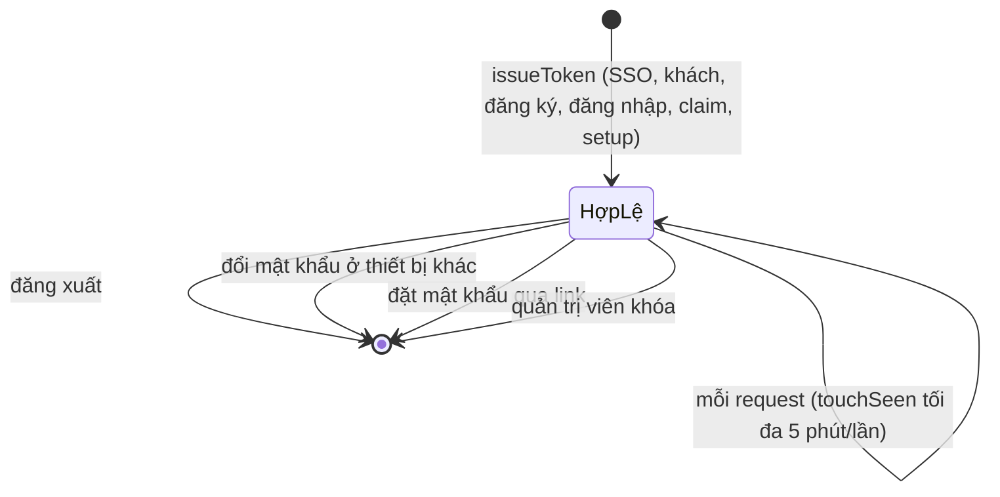

# Phiên chơi và token

> [!summary]
> Mọi người chơi (nhân viên, khách mời, tài khoản tự đăng ký) vào game bằng một **token phiên** 48 ký tự hex do Durable Object cấp và lưu trong bảng `sessions`. Token đi trong header `Authorization: Bearer` cho API và trong khung `['auth', {token}]` đầu tiên cho WebSocket công viên. Phía trình duyệt có hai bản lưu: `tatua.guest` (trang chơi của WorkHub, `GUEST_SESSION_KEY`) và `petdex.token` (bên trong trang game). Token **không có hạn dùng cố định**: nó sống tới khi bị đăng xuất, bị thu hồi hoặc người chơi bị khóa.

## Bảng `sessions`
| Cột | Kiểu | Nguồn |
|---|---|---|
| `token` | TEXT khóa chính | `petdex/server/db.js:30-34` |
| `user_id` | INTEGER, xóa theo người dùng (`ON DELETE CASCADE`) | `petdex/server/db.js:32` |
| `created_at` | INTEGER (ms) | `petdex/server/db.js:33` |

## Cấp, dùng và thu hồi
| Thao tác | Hàm | Chi tiết | Nguồn |
|---|---|---|---|
| Cấp | `issueToken(userId)` | 24 byte ngẫu nhiên từ `crypto.getRandomValues`, dạng hex | `petdex/server/db.js:808-815` |
| Dùng lại (SSO) | `recentToken(userId, 7 ngày)` | phiên mới nhất tạo trong 7 ngày | `petdex/server/db.js:820` |
| Kiểm tra | `userForToken(token)` | join `sessions` với `users` | `petdex/server/db.js:669`, `petdex/server/db.js:721` |
| Middleware API | `auth` | thiếu/sai: 401 "Phiên đăng nhập đã hết, hãy đăng nhập lại."; bị khóa: 403 "Tài khoản này đã bị quản trị viên khóa." | `petdex/server/http.js:6-15` |
| Mốc hoạt động | `touchSeen` | ghi `last_seen_at` nhiều nhất 5 phút một lần | `petdex/server/db.js:836` |
| Đăng xuất | `POST /api/auth/logout` | xóa đúng token đang dùng | `petdex/server/routes.js:144-145` |
| Đổi mật khẩu | `revokeOtherSessions` | giữ phiên hiện tại, xóa các phiên khác | `petdex/server/db.js:829`, `petdex/server/internal.js:198` |
| Đặt mật khẩu qua link | `revokeSessions` | xóa mọi phiên | `petdex/server/db.js:834`, `petdex/server/internal.js:251` |
| Khóa tài khoản | `setBanned(id, true)` | xóa mọi phiên ngay, người chơi văng ra | `petdex/server/db.js:830-833` |

## Phía trình duyệt
| Nơi lưu | Khóa | Nội dung | Ai ghi | Nguồn |
|---|---|---|---|---|
| `localStorage` (origin trang chơi) | `tatua.guest` (`GUEST_SESSION_KEY`) | `{ token, name, code, kind?, hasPassword? }`; `code` là mã mời đã dùng, `""` với tài khoản mật khẩu | `/invitation`, `/server1` | `lib/petdex-public.ts:40-51`, `components/tatua/play-screen.tsx:25-40` |
| `localStorage` | `petdex.token` | token mà trang game tự giữ khi chạy độc lập | game | `public/ta-tua/game/js/api.js:1`, `public/ta-tua/game/js/api.js:18-24` |
| `sessionStorage` | `petdex.who` | `member` hoặc `player` | game | `public/ta-tua/game/js/app.js:13-15` |
| `sessionStorage` | `petdex.ws` | địa chỉ WebSocket dev | game | `public/ta-tua/game/js/api.js:7-14` |
| cookie phiên | `tatua_cred_asked`, `tatua_cred_later` | cờ của lời nhắc đặt mật khẩu | trang chơi | `components/tatua/account.tsx:14-21` |

- `kind` và `hasPassword` là thứ game **báo lại** mỗi lần resume, không phải dữ liệu tin cậy (`lib/petdex-public.ts:47-50`).
- `localStorage` bị chặn (chế độ riêng tư) thì khách chỉ phải gõ tên lại lần sau (`components/tatua/play-screen.tsx:34-40`).
- Khi tạo mật khẩu "claim", trình duyệt gửi tối đa 5 token đang giữ (cả `tatua.guest` lẫn `petdex.token`) để chứng minh sở hữu (`components/tatua/account.tsx:40-48`, `petdex/server/internal.js:210-211`).

## Resume (quay lại)
`POST /api/ta-tua/guest {resume: token}` (token 16–128 ký tự) gọi `/internal/guest/resume`: token còn và người chơi không bị khóa thì trả `{ok: true, userId, username, displayName, kind, hasPassword}`, ngược lại `{ok: false}` và trang xóa bản lưu (`app/api/ta-tua/guest/route.ts:11`, `petdex/server/internal.js:132-136`, `components/tatua/play-screen.tsx:100-111`).

## WebSocket công viên
Kết nối `/ta-tua/ws` phải gửi khung đầu `['auth', { token }]`; hub trả `['connect', {id}]` hoặc `['connect_error', {message}]` rồi đóng (`petdex/server/hub.js:3-4`, `petdex/server/playground.js:99`). Smoke test kiểm cả hai nhánh (`scripts/smoke-worker.mjs:119-137`). Xem [[Hub WebSocket]] và [[Giao thức công viên]].

## Liên quan
- [[Đăng nhập một lần WorkHub]]
- [[Tài khoản người chơi]]
- [[Trang chơi server1]]
- [[Giới hạn tần suất]]
- [[API người chơi]]
- [[MOC Vận hành]]
