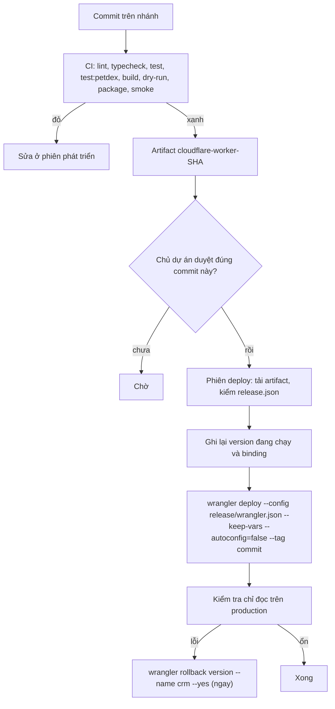

# Quy trình deploy

> [!summary]
> Pet Town lên production cùng Worker `crm` của WorkHub, nên mỗi lần deploy là deploy cả WorkHub lẫn game. Quy tắc cứng: **chỉ một phiên deploy chuyên trách** được deploy production, **sau khi chủ dự án duyệt một commit có tên cụ thể** và **CI trên đúng SHA đó đã xanh**. Phiên phát triển không bao giờ deploy. Mọi kiểm tra trên production là **chỉ đọc**. Bản deploy là đúng gói Linux mà CI đã build và chạy thử, không build lại.

## Quy tắc vận hành

> [!warning] Không bao giờ deploy từ phiên phát triển
> - Production chỉ do **phiên deploy riêng** thực hiện.
> - Điều kiện: chủ dự án đã duyệt **một commit đích danh** và CI trên **chính SHA đó** xanh (có artifact `cloudflare-worker-<sha>`).
> - Phiên phát triển (sửa code, viết tài liệu, vault này) không deploy, không chạy `npm run deploy`, `wrangler deploy` hay `scripts/deploy-cloudflare.sh`.
> - Kiểm tra production chỉ là **đọc**: mở trang, gọi API GET, `wrangler deployments list`, `wrangler versions view`. Không ghi dữ liệu game, không tạo người chơi thử, không đổi secret.

## Các bước chi tiết (theo `docs/production-release.md`)
1. **Build trên Linux.** Bản vá Prisma của OpenNext phụ thuộc nền tảng; build trên Windows qua được dry-run nhưng chết trên workerd. `npm run deploy` có `predeploy` chạy `scripts/require-linux.mjs` để chặn máy không phải Linux (`docs/production-release.md:3`, `package.json:18-19`).
2. **CI build và chạy thử gói.** CI đóng gói `.release/worker-release.tar.gz` rồi chạy chính gói đó trong workerd với Postgres test; chỉ lần chạy thành công mới upload artifact (`docs/production-release.md:5`, xem [[CI và smoke test]]).
3. **Tải artifact của lần chạy xanh**, giải nén ZIP và tarball vào thư mục mới, đối chiếu `release.json`: `sourceHead`, `tree` (cây Git) và `workerSha256`. Cây được deploy phải trùng cây CI đã kiểm. **Không build lại OpenNext trên máy deploy** (`docs/production-release.md:7`, `scripts/package-worker.mjs:24-31`).
4. **Ghi lại trạng thái hiện tại:** `wrangler deployments list --name crm` và `wrangler versions view <version> --name crm` để biết version đang chạy và binding. Giữ secret và biến (`--keep-vars`). Không tạo storage mới, không đổi thông tin đăng nhập DB trong một lần phát hành ứng dụng (`docs/production-release.md:9`).
5. **Bỏ hai mục R2** khỏi cấu hình đã giải nén khi deploy vào tài khoản production hiện tại (tài khoản đó chưa có R2) (`docs/production-release.md:9`). Hệ quả xem [[Sao lưu dữ liệu]].
6. **Deploy:** `wrangler deploy --config <release>/wrangler.json --keep-vars --autoconfig=false --tag <commit>`. Cấu hình `no_bundle` giữ nguyên JavaScript/WASM Linux đã kiểm, kể cả module WASM và static assets (`docs/production-release.md:11`, `scripts/package-worker.mjs:17-21`).
7. **Kiểm tra chỉ đọc** trên trình duyệt đã đăng nhập; với Pet Town: mở `/ta-tua`, `play.petfarm.online/server1`, `petfarm.online`, `wiki.petfarm.online`, xem game vào được, không bấm thao tác ghi.
8. **Lỗi thì rollback ngay:** `wrangler rollback <version> --name crm --yes` về version đã ghi ở bước 4, rồi mới điều tra (`docs/production-release.md:11`).

## Gói phát hành
`scripts/package-worker.mjs` chép `.wrangler-dry-run` và `.open-next/assets` vào `.release/worker`, viết `wrangler.json` từ `wrangler.jsonc` với `main: worker/worker.js`, `no_bundle: true`, `find_additional_modules: true`, rule `CompiledWasm` cho `**/*.wasm`, kèm `release.json` (`scripts/package-worker.mjs:8-34`).

## Durable Object và migration
- Lớp `PetdexPark` khai báo trong `migrations` với tag `petdex-v1` (`wrangler.jsonc:58`). Đổi tên lớp hay xóa lớp cần migration mới của Cloudflare, nếu không object và dữ liệu SQLite sẽ không còn gắn với code.
- Schema bên trong SQLite do game tự nâng cấp lúc object khởi động (`ensureSchema()`, `migrate()`), không cần bước thủ công khi deploy (`petdex/server/durable.js:26-28`). Xem [[Migration]].
- Deploy làm object khởi động lại: các bộ đếm trong RAM (giới hạn nhập mã quà, chat) về 0, người chơi ở công viên phải nối lại WebSocket.

## `scripts/deploy-cloudflare.sh`
Script dựng hạ tầng lần đầu, idempotent: xác định tài khoản, đăng ký subdomain workers.dev, tạo Hyperdrive (tắt cache), ghi id vào `wrangler.jsonc`, sinh `JWT_SECRET` một lần (không in ra), tạo bucket R2 (bỏ qua khi R2 tắt), build và deploy (`scripts/deploy-cloudflare.sh:1-18`). Đây là công cụ **dựng môi trường**, không phải đường phát hành thường ngày; quy trình phát hành dùng artifact của CI như trên.

> [!warning] Lệch tài liệu
> `docs/production-release.md` chỉ nhắc kiểm tra lịch dự án và bộ lọc hạn công việc sau deploy, chưa nhắc Pet Town (`docs/production-release.md:11`). Danh sách kiểm tra Pet Town ở bước 7 là bổ sung của vault.

## Liên quan
- [[CI và smoke test]]
- [[Worker và wrangler]]
- [[Sao lưu dữ liệu]]
- [[Migration]]
- [[MOC Vận hành]]
