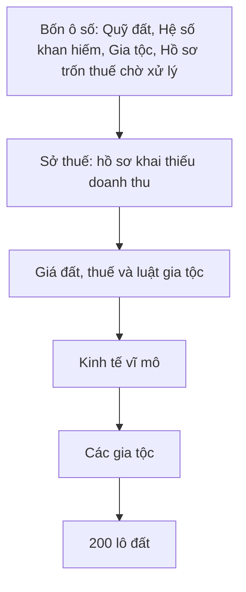

# Quản trị Clan

> [!summary]
> Tab **Gia tộc & Đất** của [[Bảng quản lý Pet Town]] (từ commit `05840b3`, 2026-10-30) là bàn điều khiển của Sở Nhà Đất, Sở thuế và kinh tế vĩ mô: xem quỹ đất và hệ số khan hiếm, xử lý hồ sơ khai thiếu doanh thu (truy thu kèm tiền phạt hoặc bỏ qua), chỉnh giá đất, thuế doanh nghiệp và luật gia tộc, ép pha kinh tế hoặc thời tiết, xem bảng gia tộc và đặt giá riêng cho từng lô trong 200 lô. Luật chơi chi tiết nằm ở [[Clan]], [[Bản đồ đất]], [[Thuế doanh nghiệp]], [[Kinh tế vĩ mô]].

## Dữ liệu
`GET clans` trả `adminClanView()`: `stats` (`sold`, `free`, `scarcity`, `landIndex`, `industryClans`), `macro` (`day`, `phase`, `weather`, `landIndex`, `gdp`, `demand`), `config`, `clans`, `plots`, `evasions`, `treasury` (`app/(app)/ta-tua/quan-ly/clans.tsx:92-93`, `petdex/server/internal.js:576`). Mọi POST của tab đều trả lại `adminClanView()` mới (`petdex/server/internal.js:578-606`).

## Các thẻ trong tab

### Bốn ô số (`app/(app)/ta-tua/quan-ly/clans.tsx:176-182`)
| Ô | Nội dung |
|---|---|
| Quỹ đất | `trống/tổng`, gợi ý số lô đã bán |
| Hệ số khan hiếm | `×scarcity`, gợi ý chỉ số giá đất (3 chữ số) |
| Gia tộc | số gia tộc, gợi ý ngân sách thị trấn |
| Hồ sơ trốn thuế chờ xử lý | số hồ sơ `open`, gợi ý tổng thuế trốn |

### Sở thuế (`TaxOffice`, `app/(app)/ta-tua/quan-ly/clans.tsx:196-267`)
- Mỗi đêm, gia tộc nào khai thấp hơn doanh thu thật thì phần thuế thiếu được ghi một hồ sơ, người ghi là "Sở thuế", action `tax_evasion`; **gia tộc không được báo** (`petdex/server/clans.js:659`, `app/(app)/ta-tua/quan-ly/clans.tsx:214`).
- Cột: Gia tộc, Ngày, Doanh thu, Khai báo, Thuế trốn, Trạng thái.
- Ô **Tiền phạt (%)**: mặc định 50, nhập 0–500 (`app/(app)/ta-tua/quan-ly/clans.tsx:197`, `app/(app)/ta-tua/quan-ly/clans.tsx:215`).

| Nút | API | Công thức | Nguồn |
|---|---|---|---|
| Truy thu | `POST clans/evasion/<id>/collect {penalty}` | phải thu = `round(thuế trốn × (1 + phạt))`, phạt kẹp 0–5 (0–500%); thu thực = `min(phải thu, quỹ gia tộc)`; tiền chuyển quỹ gia tộc → ngân sách thị trấn, loại sổ cái `corp_tax_collect` | `petdex/server/clans.js:750-763` |
| Bỏ qua | `POST clans/evasion/<id>/dismiss` | đóng hồ sơ, không thu | `petdex/server/clans.js:750-770` |

Lỗi: "Không có hồ sơ này.", "Hồ sơ đã xử lý rồi." (`petdex/server/clans.js:753-754`). Hộp xác nhận: "Thu N xu (thuế trốn + P% phạt) từ quỹ X, ngày D." hoặc "Đóng hồ sơ ngày D của X mà không thu." (`app/(app)/ta-tua/quan-ly/clans.tsx:255-259`).

### Giá đất, thuế và luật gia tộc (`ConfigCard`, `app/(app)/ta-tua/quan-ly/clans.tsx:269-335`)
Công thức trên thẻ: **tự động**: giá lô trống = giá gốc × hệ số chung × hệ số khan hiếm × chỉ số giá đất vĩ mô; **tay**: giá gốc × hệ số chung, không tự chạy; giá đặt riêng từng lô luôn được ưu tiên (`app/(app)/ta-tua/quan-ly/clans.tsx:298`).

| Nhóm | Trường (`FIELDS`) | Mặc định | Nguồn mặc định |
|---|---|---|---|
| Đất | Cách tính giá đất (`land.mode`) | `auto` | `petdex/server/clans.js:35` |
| Đất | Giá đất thấp nhất / cao nhất | 100.000 / 2.000.000 xu | `public/ta-tua/game/js/shared/clan.js:106` |
| Đất | Hệ số giá chung | 1 | `petdex/server/clans.js:39` |
| Đất | Độ dốc khan hiếm `k` (hết quỹ đất thì giá gấp 1 + k) | 2 | `petdex/server/clans.js:38` |
| Đất | Sản lượng/ngày theo giá gốc | 0,6% | `petdex/server/clans.js:41` |
| Đất | Giá Sở Nhà Đất mua lại | 85% | `petdex/server/clans.js:42` |
| Đất | Trần tăng giá lô đã mua | 3 lần giá mua | `petdex/server/clans.js:43` |
| Đất | Phần tiền đất vào ngân sách (còn lại bị hủy) | 20% | `petdex/server/clans.js:45` |
| Thuế | Thuế doanh nghiệp (gia tộc một ngành) | 35% | `petdex/server/clans.js:25` |
| Thuế | Cộng thêm mỗi ngành mở rộng | 5 điểm | `petdex/server/clans.js:26` |
| Thuế | Hoàn thuế cuối tháng | 15% tổng thuế tháng | `petdex/server/clans.js:27` |
| Thuế | Hệ số phí ngành thứ 2, 3 | ×10 mức bồi thường gốc | `petdex/server/clans.js:24` |
| Thuế | Bồi thường thị trường từng ngành (11 ngành) | 20.000–50.000 | `petdex/server/clans.js:31-32` |
| Gia tộc | Phí lập gia tộc | 3.000 xu | `petdex/server/clans.js:19` |
| Gia tộc | Cấp bé cần để vào gia tộc | 4 | `petdex/server/clans.js:20` |
| Gia tộc | Cấp gia tộc cho ngành 1, 2, 3 | 1, 3, 5 | `petdex/server/clans.js:22` |
| Gia tộc | Định mức góp quỹ/tuần mỗi cấp | 300 | `petdex/server/clans.js:28` |
| Gia tộc | Phí duy trì/đêm mỗi cấp | 80 | `petdex/server/clans.js:29` |
| Gia tộc | Phí duy trì/đêm mỗi lô | 200 | `petdex/server/clans.js:30` |

Danh sách trường và chú thích ở `app/(app)/ta-tua/quan-ly/clans.tsx:104-125`. Server kẹp từng trường trong khoảng an toàn (ví dụ `createCost` 0–10.000.000, `unlockLevel` 1–30, `baseTax` 0–0,9, `refundRate` 0–1) (`petdex/server/clans.js:55-70`). Lưu ghi `clan_config` (game) và `tatua.clan_config` "Chỉnh luật gia tộc, thuế doanh nghiệp và giá đất" (WorkHub).

### Kinh tế vĩ mô (`MacroCard`, `app/(app)/ta-tua/quan-ly/clans.tsx:337-402`)
- Hiện trạng hôm nay: pha, thời tiết, chỉ số giá đất, GDP, cầu từng ngành.
- **Pha** (để trống: tự chạy): Phục hồi, Tăng trưởng nóng, Đỉnh chu kỳ, Suy thoái (`public/ta-tua/game/js/shared/clan.js:538`).
- **Thời tiết** (để trống: ngẫu nhiên mỗi ngày): Trời yên biển lặng, Thời tiết thuận lợi, Nắng nóng kéo dài, Mưa lớn nhiều ngày, Bão biển, Rét đậm (`public/ta-tua/game/js/shared/clan.js:556`).
- **Chỉ số giá đất hôm nay**: 0,6–1,8, chỉ dùng khi áp dụng ngay; server kẹp lại trong khoảng này (`petdex/server/macro.js:110`).
- Hai nút: *Lưu, áp dụng từ ngày mai* (`today: false`, chỉ ghi vào `config.macro`) và *Áp dụng ngay hôm nay* (`today: true`, còn ghi đè trạng thái vĩ mô của hôm nay qua `overrideMacro`) (`petdex/server/internal.js:591-598`).

### Các gia tộc (`ClanTable`)
Cột: Gia tộc, Tộc trưởng, Cấp, Người, Ngành, Lô, Giá trị đất, Quỹ, Doanh thu 30 ngày, Thuế 30 ngày, Khai báo (tỷ lệ doanh thu gia tộc tự khai) (`app/(app)/ta-tua/quan-ly/clans.tsx:404-436`). Chỉ xem, không có thao tác.

### 200 lô đất (`PlotTable`)
- Lọc theo địa hình (7 vùng), trạng thái (Còn trống / Đã bán), tìm mã lô (`app/(app)/ta-tua/quan-ly/clans.tsx:438-478`).
- Cột: Lô, Địa hình · khí hậu, Tăng giá/tháng, Sản xuất, Giá gốc, Giá bán (giá Sở Nhà Đất đang chào cho lô trống), Chủ, Giá riêng.
- Đặt giá riêng: `POST clans/plots/<id> {price}`; số nguyên 1.000–1.000.000.000, để trống rồi lưu là về giá tự tính (`petdex/server/clans.js:742-744`). Nhật ký WorkHub "Đặt giá lô X: N xu" hoặc "Trả lô X về giá tự tính" (`app/api/ta-tua/admin/[...path]/route.ts:48-51`).

## Liên quan
- [[Clan]]
- [[Bản đồ đất]]
- [[Thuế doanh nghiệp]]
- [[Kinh tế vĩ mô]]
- [[Ngân sách thị trấn]]
- [[Module clans]]
- [[Module macro]]
- [[Nhật ký quản trị]]
- [[MOC Vận hành]]
