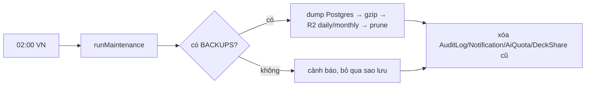

# Sao lưu dữ liệu

> [!summary]
> Worker có một cron mỗi ngày lúc 02:00 giờ Việt Nam chạy `runMaintenance`: chụp **toàn bộ Postgres của WorkHub** thành JSON nén gzip vào bucket R2 `BACKUPS`, rồi dọn nhật ký và thông báo cũ. Điều quan trọng với Pet Town: **dữ liệu game nằm trong SQLite của Durable Object, không nằm trong Postgres**, nên bản sao lưu này **không chứa** người chơi, bé, xu hay sổ cái của game. Phần game chỉ được "sao lưu" gián tiếp qua bảng `AuditLog` (nhật ký quản trị).

## Lịch và quy trình
| Bước | Chi tiết | Nguồn |
|---|---|---|
| Lịch | cron `0 19 * * *` (19:00 UTC = 02:00 Asia/Ho_Chi_Minh) | `wrangler.jsonc:49-52` |
| Gọi | `scheduled` → `ctx.waitUntil(runMaintenance(env))` | `worker.ts:43-45` |
| Kết nối | `pg` trực tiếp (không Prisma) qua `HYPERDRIVE.connectionString` hoặc `DATABASE_URL` | `lib/maintenance.ts:11`, `lib/maintenance.ts:104-112` |
| Chụp | mọi bảng `public` trong một giao dịch `REPEATABLE READ READ ONLY`, mỗi bảng `json_agg`; bảng đọc lỗi thì bỏ qua và ghi `skipped` | `lib/maintenance.ts:59-89` |
| Bỏ bảng | `ContractFileBlob` (byte PDF cũ, file thật đã ở R2) | `lib/maintenance.ts:37` |
| Ghi | `daily/YYYY-MM-DD.json.gz`; ngày 01 ghi thêm `monthly/YYYY-MM.json.gz`; metadata `rows`, `tables`, `createdAt` | `lib/maintenance.ts:114-124` |
| Giữ | 30 bản ngày, 12 bản tháng | `lib/maintenance.ts:34-35`, `lib/maintenance.ts:125` |
| Không có bucket | in cảnh báo "no BACKUPS bucket bound: backup skipped", vẫn dọn dữ liệu | `lib/maintenance.ts:127-129` |
| Dọn | `AuditLog` cũ hơn 365 ngày, `Notification` 90 ngày, `AiQuota` cũ hơn 7 ngày, link chia sẻ hết hạn lâu | `lib/maintenance.ts:131-141` |

## Đọc và tải bản sao lưu
`lib/backups.ts` liệt kê bucket (khóa đúng mẫu `^(daily|monthly)/\d{4}-\d{2}(-\d{2})?\.json\.gz$`), mới nhất trước, kèm số dòng (`lib/backups.ts:25-54`). Trang *Cài đặt* của WorkHub có thẻ sao lưu (`app/(app)/settings/backups-card.tsx`, `app/api/backups/route.ts`, `app/api/backups/download/route.ts`). Khôi phục bằng `scripts/restore-backup.mjs` (`lib/maintenance.ts:7`).

> [!warning] Dữ liệu game không có trong bản sao lưu
> - Máy chủ game dùng `ctx.storage` SQLite của Durable Object (`petdex/server/durable.js:26`); `runMaintenance` chỉ đọc schema `public` của Postgres. Repo không có cơ chế xuất hay sao lưu SQLite của object `park`.
> - Cloudflare có khả năng khôi phục theo thời điểm cho Durable Object SQLite ở tầng nền tảng, nhưng repo không dùng hay nhắc tới nó. **Chưa kiểm chứng** được qua code.
> - `docs/production-release.md` ghi: tài khoản production hiện có Hyperdrive và rate limit nhưng **không có binding R2**, khi deploy phải bỏ hai mục R2 khỏi cấu hình. Nghĩa là trên production hiện tại, ngay cả bản sao lưu Postgres cũng bị bỏ qua (`lib/maintenance.ts:127-129`). Điều này đúng với lời ghi chú trong `wrangler.jsonc:42-44` ("while R2 is not enabled on the account it deploys without them").

## Gợi ý vận hành (chưa có trong code)
- Nếu cần sao lưu game: thêm một route nội bộ xuất SQLite (hoặc từng bảng) từ object `park` và gọi nó trong `runMaintenance`. Đây là đề xuất, chưa làm.

## Liên quan
- [[Worker và wrangler]]
- [[Nhật ký quản trị]]
- [[Lớp SQL]]
- [[Durable Object PetdexPark]]
- [[Quy trình deploy]]
- [[MOC Vận hành]]
