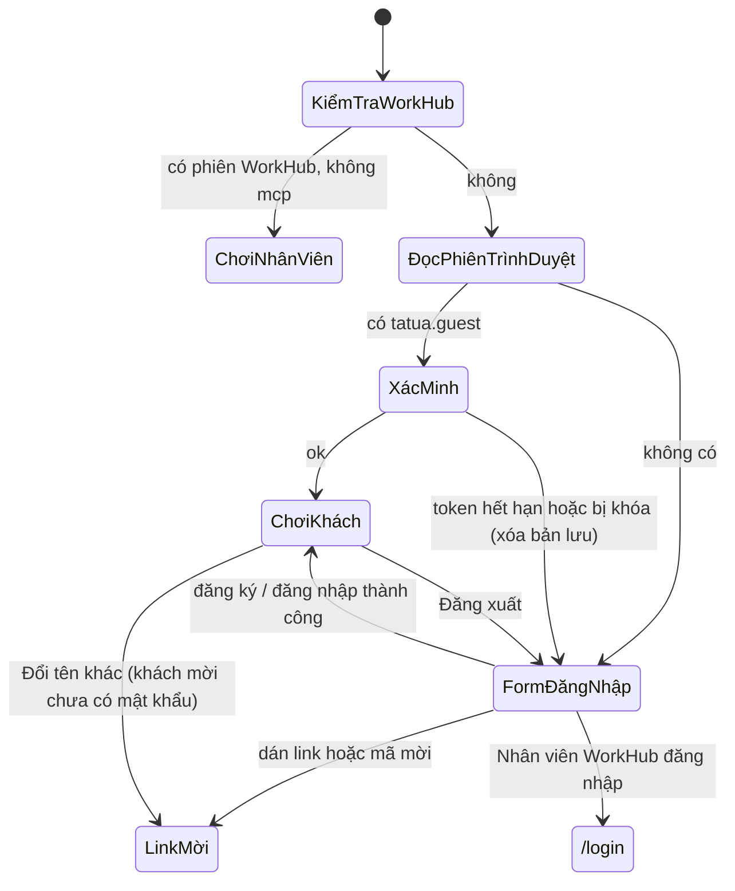

# Trang chơi server1

> [!summary]
> `play.petfarm.online/server1` là trang chơi toàn màn hình. Nó mở game trong iframe bằng một trong ba loại phiên: nhân viên WorkHub đã đăng nhập trên tên miền này, phiên mà trình duyệt đã giữ (khách mời hoặc tài khoản tên + mật khẩu), hoặc chưa có gì thì hiện form đăng nhập/đăng ký trên nền đồng cỏ động. Trong WorkHub, mục **Pet Town** (`/ta-tua`) là phiên bản nhúng trong khung của cùng game.

## Ba lối vào game

| Lối | Trang | Cách lấy token | Nguồn |
|---|---|---|---|
| Nhân viên trong WorkHub | `/ta-tua` (trong app shell, có nút *Tải lại*, *Mở tab riêng*, *Quản lý* cho admin) | server gọi `memberSession(me)` | `app/(app)/ta-tua/page.tsx:10-23`, `app/(app)/ta-tua/game-frame.tsx:10-49` |
| Nhân viên trên tên miền game | `/server1` khi có cookie WorkHub và không phải đổi mật khẩu | server gọi `memberSession(me)` | `app/server1/page.tsx:10-21` |
| Khách / tài khoản tự đăng ký | `/server1` không có phiên WorkHub | đọc `localStorage["tatua.guest"]`, xác minh bằng `POST /api/ta-tua/guest {resume}` | `components/tatua/play-screen.tsx:94-112` |

## Trang khi chưa có phiên
- Tiêu đề "Pet Town", câu "Chưa có tài khoản thì tạo một cái, lần sau chỉ cần nhớ tên và mật khẩu." và `AccountForm` (đăng nhập, đăng ký, tạo mật khẩu cho tài khoản cũ) (`components/tatua/play-screen.tsx:163-172`).
- Ô "Link hoặc mã mời": lấy chuỗi hex 6–64 ký tự ở cuối rồi chuyển tới `/invitation/<mã>` (`components/tatua/play-screen.tsx:148-152`).
- Nút "Nhân viên WorkHub đăng nhập" mở `/login?next=/server1` (`components/tatua/play-screen.tsx:180-183`).
- Nền đồng cỏ `MeadowShell` (chuồng, cối xay gió, mây, bướm, chính các bé của game) ở `components/tatua/meadow.tsx`. Phần vẽ thuộc [[MOC Giao diện]].

## Khung game
- Thanh trên cùng cao 48px: biểu tượng, chữ "Pet Town", ai đang chơi (`… · tài khoản WorkHub`, `Khách mời · <tên>` hoặc tên), và nút hành động (`components/tatua/play-screen.tsx:64-91`).
- `CredentialsNotice` ở trên iframe nhắc người chưa có mật khẩu bổ sung tên đăng nhập + mật khẩu: hộp thoại tự mở **một lần mỗi phiên trình duyệt**, thanh nhắc ở lại đến khi đặt xong hoặc bấm "Để sau". Hai cờ là cookie phiên `tatua_cred_asked`, `tatua_cred_later` (không có hạn, dùng chung mọi tab) (`components/tatua/account.tsx:14-21`, `components/tatua/account.tsx:225-260`).
- Iframe trỏ tới `GAME_PAGE` + `#token=...` (+ `&who=member` cho nhân viên, + `&ws=` khi dev) (`components/tatua/play-screen.tsx:18-23`). `GAME_PAGE` là `/ta-tua/game/` ở production và `/ta-tua/game/index.html` khi dev, vì Cloudflare phục vụ `index.html` ở đường thư mục còn `next dev` thì không (`lib/petdex-public.ts:34-38`).

## Đăng xuất
- Nhân viên: không có nút đăng xuất trong game (`who=member` làm game ẩn nút); đăng xuất ở WorkHub (`public/ta-tua/game/js/app.js:12-24`).
- Khách / tài khoản: nút "Đăng xuất" hoặc "Đổi tên khác". `signOut` gọi `POST /ta-tua/api/auth/logout` với `keepalive`, xóa `petdex.token` và `tatua.guest` để máy dùng chung không còn phiên (`components/tatua/play-screen.tsx:42-62`).
- Menu tài khoản trong game bấm "Đăng xuất" thì gửi `postMessage({type: "petdex:logout"})` lên trang cha cùng origin; trang cha làm việc đăng xuất thật (`public/ta-tua/game/js/app.js:1178`, `components/tatua/play-screen.tsx:65-73`).
- Khách mời chưa có mật khẩu chỉ quay lại được bằng link mời, nên nút ghi "Đổi tên khác" và đưa về `/invitation/<mã>` (`components/tatua/play-screen.tsx:127-132`).

## Lỗi người chơi có thể thấy
| Thông báo | Khi nào | Nguồn |
|---|---|---|
| "Chưa vào chơi được" + lỗi của game | `/ta-tua` không lấy được phiên | `app/(app)/ta-tua/game-frame.tsx:45` |
| "Máy chủ game gặp sự cố, thử lại sau." | lỗi không phải `GameError` | `app/(app)/ta-tua/page.tsx:20` |
| "Tài khoản chơi của bạn đã bị quản trị viên khóa." | nhân viên bị khóa | `petdex/server/internal.js:106` |
| "Đang mở phiên chơi…" | đang xác minh phiên đã lưu | `components/tatua/play-screen.tsx:162` |

> [!info] /server1 với nhân viên bị khóa
> Nếu `memberSession` ném `GameError` (ví dụ bị khóa), `/server1` không báo lỗi mà rơi về màn khách/đăng nhập (`app/server1/page.tsx:16-18`). Trong WorkHub thì `/ta-tua` hiện thông báo lỗi.

## Liên quan
- [[Phiên chơi và token]]
- [[Link mời]]
- [[Đăng nhập một lần WorkHub]]
- [[Tài khoản người chơi]]
- [[App shell]]
- [[MOC Vận hành]]
